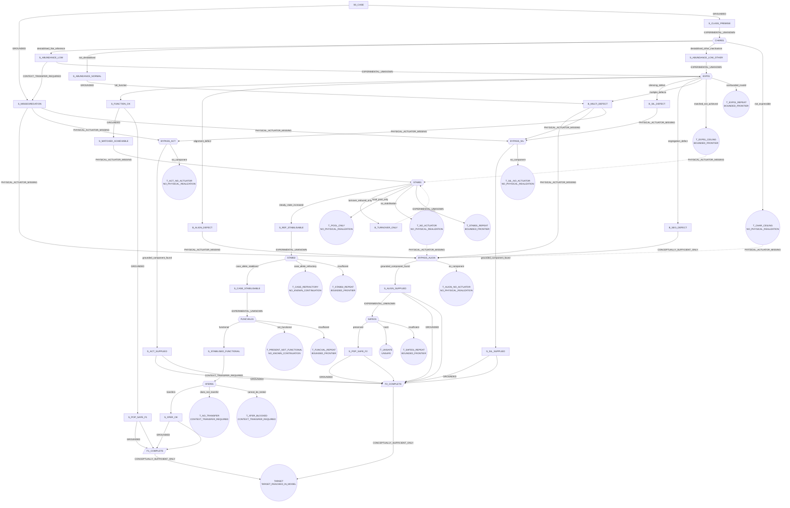

# MVA_001 — contingent route map

Generated by `tools/control/compile_route_map.py` from `MVA_CONTINGENT_ROUTE_MAP.yaml`. Case data
and a renderer, not a new compiler layer: the existing machinery represents causal chains and
per-experiment decision rules, neither of which branches on admissible experimental outcome.

The question this answers is not what EXP01 will return. It is what we would do next under every
admissible result, how much of each resulting route is already known, and which ignorance is worth
removing first. No probabilities appear anywhere, because none is grounded.

## The target

A biological state, never "normal BUB1B". All seven must hold at once:

- `T_ALIGN` — correct chromosome alignment
- `T_ACT` — correct checkpoint activation
- `T_SIL` — correct checkpoint silencing
- `T_MIS` — low chromosome missegregation
- `T_VIA` — preserved viability
- `T_DIV` — preserved division
- `T_DEATH` — no increase in cell death

## Where the route map says to look first

From today, the smallest set of unresolved branch nodes that would establish the target is
**4**: `BYPASS_ACT`, `BYPASS_ALIGN`, `BYPASS_SIL`, `SAFE01`.

**That count alone would mislead, so it is split by kind.** A branch entered only through a
missing physical actuator is a *component discovery* — find something nobody has described —
while a branch entered as an experimental unknown is a *runnable measurement*. They are not
interchangeable units of work, and the shortest route by count is not the shortest by effort.

| branch | kind |
|---|---|
| `BYPASS_ACT` | component discovery |
| `BYPASS_ALIGN` | component discovery |
| `BYPASS_SIL` | component discovery |
| `SAFE01` | runnable measurement |

Runnable measurements on that route: **1 of 4**.

Unavoidable experiments — every route from the case state to the target passes through these:

- none: no single branch gates every route

Distance to target from each branch's best admissible outcome, counting unresolved branch nodes
still required. Fewer is closer; the set is shown because routes share experiments and summing
them would invent work that does not exist.

| branch | kind | best outcome | what remains after it | runnable |
|---|---|---|---|---|
| `CHAR01` | runnable measurement | `destabilised_like_reference` | 4: `BYPASS_ACT`, `BYPASS_ALIGN`, `BYPASS_SIL`, `SAFE01` | 1 |
| `EXP01` | runnable measurement | `full_function` | 4: `BYPASS_ACT`, `BYPASS_ALIGN`, `BYPASS_SIL`, `SAFE01` | 1 |
| `STAB01` | runnable measurement | `steady_state_increased` | 4: `BYPASS_ACT`, `BYPASS_ALIGN`, `BYPASS_SIL`, `SAFE01` | 1 |
| `STAB02` | runnable measurement | `case_allele_stabilised` | 4: `BYPASS_ACT`, `BYPASS_ALIGN`, `BYPASS_SIL`, `SAFE01` | 1 |
| `FUNCVAL01` | runnable measurement | `functional` | 3: `CHAR01`, `EXP01`, `XFER01` | 3 |
| `XFER01` | runnable measurement | `transfers` | 2: `CHAR01`, `EXP01` | 2 |
| `SAFE01` | runnable measurement | `preserved` | 3: `BYPASS_ACT`, `BYPASS_ALIGN`, `BYPASS_SIL` | 0 |
| `BYPASS_ALIGN` | component discovery | `grounded_component_found` | 3: `BYPASS_ACT`, `BYPASS_SIL`, `SAFE01` | 1 |
| `BYPASS_SIL` | component discovery | `grounded_component_found` | 3: `BYPASS_ACT`, `BYPASS_ALIGN`, `SAFE01` | 1 |
| `BYPASS_ACT` | component discovery | `grounded_component_found` | 3: `BYPASS_ALIGN`, `BYPASS_SIL`, `SAFE01` | 1 |

### Highest-leverage opportunities

No branch has an outcome that leaves one or fewer experiments. Every route to the target still
requires at least two unresolved results.

## Branch nodes: every admissible outcome, continued

### `CHAR01`

Does this exact allele destabilise the protein at all? Cycloheximide chase, HSP90 inhibition and MG132 on an exact-allele construct beside wild-type and the reference substrates. No patient material required.

*Why unresolved:* MC_0006 ('this child's missense allele reduces BUBR1 abundance or function') is UNRESOLVED on zero establishing records. Q921H is a kinase-domain substitution that is normal in both level and function, so domain location does not establish instability.

| outcome | leads to | route state from there |
|---|---|---|
| `destabilised_like_reference` | `S_ABUNDANCE_LOW` (state) | 4 still unresolved: `BYPASS_ACT`, `BYPASS_ALIGN`, `BYPASS_SIL`, `SAFE01` |
| `not_destabilised` | `S_ABUNDANCE_NORMAL` (state) | 4 still unresolved: `BYPASS_ACT`, `BYPASS_ALIGN`, `BYPASS_SIL`, `SAFE01` |
| `destabilised_other_mechanism` | `S_ABUNDANCE_LOW_OTHER` (state) | 4 still unresolved: `BYPASS_ACT`, `BYPASS_ALIGN`, `BYPASS_SIL`, `SAFE01` |
| `not_expressible` | `T_CHAR_CEILING` (`NO_PHYSICAL_REALIZATION`) | 4 still unresolved: `BYPASS_ACT`, `BYPASS_ALIGN`, `BYPASS_SIL`, `SAFE01` |

### `EXP01`

At matched abundance, are alignment, silencing and segregation normal for the exact altered protein?

*Why unresolved:* No experiment has expressed this exact substitution at wild-type-comparable abundance. Checkpoint activation is class-supported and is a replication control, not a discriminator.

| outcome | leads to | route state from there |
|---|---|---|
| `full_function` | `S_FUNCTION_OK` (state) | 4 still unresolved: `BYPASS_ACT`, `BYPASS_ALIGN`, `BYPASS_SIL`, `SAFE01` |
| `alignment_defect` | `B_ALIGN_DEFECT` (state) | 4 still unresolved: `BYPASS_ACT`, `BYPASS_ALIGN`, `BYPASS_SIL`, `SAFE01` |
| `silencing_defect` | `B_SIL_DEFECT` (state) | 4 still unresolved: `BYPASS_ACT`, `BYPASS_ALIGN`, `BYPASS_SIL`, `SAFE01` |
| `segregation_defect` | `B_SEG_DEFECT` (state) | 4 still unresolved: `BYPASS_ACT`, `BYPASS_ALIGN`, `BYPASS_SIL`, `SAFE01` |
| `multiple_defects` | `B_MULTI_DEFECT` (state) | 4 still unresolved: `BYPASS_ACT`, `BYPASS_ALIGN`, `BYPASS_SIL`, `SAFE01` |
| `matched_not_achieved` | `T_EXP01_CEILING` (`BOUNDED_FRONTIER`) | 4 still unresolved: `BYPASS_ACT`, `BYPASS_ALIGN`, `BYPASS_SIL`, `SAFE01` |
| `confounded_invalid` | `T_EXP01_REPEAT` (`BOUNDED_FRONTIER`) | 4 still unresolved: `BYPASS_ACT`, `BYPASS_ALIGN`, `BYPASS_SIL`, `SAFE01` |

### `STAB01`

Can the steady-state abundance of a misfolding kinase-domain BubR1 missense protein be raised in a human cell by perturbing folding or degradation machinery?

*Why unresolved:* Search closed at 50 queries over four rounds: no record raises abundance or slows turnover of a destabilised BubR1 missense protein. P1/P2 are grounded only in the destabilising direction.

| outcome | leads to | route state from there |
|---|---|---|
| `steady_state_increased` | `S_REF_STABILISABLE` (state) | 4 still unresolved: `BYPASS_ACT`, `BYPASS_ALIGN`, `BYPASS_SIL`, `SAFE01` |
| `turnover_reduced_only` | `B_TURNOVER_ONLY` (state) | 4 still unresolved: `BYPASS_ACT`, `BYPASS_ALIGN`, `BYPASS_SIL`, `SAFE01` |
| `local_pool_only` | `T_POOL_ONLY` (`NO_PHYSICAL_REALIZATION`) | 4 still unresolved: `BYPASS_ACT`, `BYPASS_ALIGN`, `BYPASS_SIL`, `SAFE01` |
| `no_stabilisation` | `T_NO_ACTUATOR` (`NO_PHYSICAL_REALIZATION`) | 4 still unresolved: `BYPASS_ACT`, `BYPASS_ALIGN`, `BYPASS_SIL`, `SAFE01` |
| `insufficient` | `T_STAB01_REPEAT` (`BOUNDED_FRONTIER`) | 4 still unresolved: `BYPASS_ACT`, `BYPASS_ALIGN`, `BYPASS_SIL`, `SAFE01` |

### `STAB02`

Does the working perturbation raise the exact case allele's abundance toward wild-type?

*Why unresolved:* Reached only under the STAB01 stop rule; the exact allele has never been placed in such a system.

| outcome | leads to | route state from there |
|---|---|---|
| `case_allele_stabilised` | `S_CASE_STABILISABLE` (state) | 4 still unresolved: `BYPASS_ACT`, `BYPASS_ALIGN`, `BYPASS_SIL`, `SAFE01` |
| `case_allele_refractory` | `T_CASE_REFRACTORY` (`NO_KNOWN_CONTINUATION`) | 4 still unresolved: `BYPASS_ACT`, `BYPASS_ALIGN`, `BYPASS_SIL`, `SAFE01` |
| `insufficient` | `T_STAB02_REPEAT` (`BOUNDED_FRONTIER`) | 4 still unresolved: `BYPASS_ACT`, `BYPASS_ALIGN`, `BYPASS_SIL`, `SAFE01` |

### `FUNCVAL01`

Is the protein stabilised by that perturbation functional, or merely present?

*Why unresolved:* A chaperone-retained protein can be abundant and non-native. EXP01 answers function at ectopically matched abundance, which is a different condition from function under a stabilising perturbation.

| outcome | leads to | route state from there |
|---|---|---|
| `functional` | `S_STABILISED_FUNCTIONAL` (state) | 3 still unresolved: `CHAR01`, `EXP01`, `XFER01` |
| `not_functional` | `T_PRESENT_NOT_FUNCTIONAL` (`NO_KNOWN_CONTINUATION`) | 4 still unresolved: `BYPASS_ACT`, `BYPASS_ALIGN`, `BYPASS_SIL`, `SAFE01` |
| `insufficient` | `T_FUNCVAL_REPEAT` (`BOUNDED_FRONTIER`) | 4 still unresolved: `BYPASS_ACT`, `BYPASS_ALIGN`, `BYPASS_SIL`, `SAFE01` |

### `XFER01`

Does the effect hold in a cell type relevant to this child?

*Why unresolved:* Every result in this map comes from cancer lines. No patient-derived material is available and none may be acquired.

| outcome | leads to | route state from there |
|---|---|---|
| `transfers` | `S_XFER_OK` (state) | 2 still unresolved: `CHAR01`, `EXP01` |
| `does_not_transfer` | `T_NO_TRANSFER` (`CONTEXT_TRANSFER_REQUIRED`) | 4 still unresolved: `BYPASS_ACT`, `BYPASS_ALIGN`, `BYPASS_SIL`, `SAFE01` |
| `cannot_be_tested` | `T_XFER_BLOCKED` (`CONTEXT_TRANSFER_REQUIRED`) | 4 still unresolved: `BYPASS_ACT`, `BYPASS_ALIGN`, `BYPASS_SIL`, `SAFE01` |

### `SAFE01`

Does the bypass component preserve viability, division rate and cell death?

*Why unresolved:* A component that supplies a mitotic function has no safety record until it is named; nothing can be inherited from the abundance route, whose safety readouts are observations about a different manipulation.

| outcome | leads to | route state from there |
|---|---|---|
| `preserved` | `S_POP_SAFE_F2` (state) | 3 still unresolved: `BYPASS_ACT`, `BYPASS_ALIGN`, `BYPASS_SIL` |
| `harm` | `T_UNSAFE` (`UNSAFE`) | 4 still unresolved: `BYPASS_ACT`, `BYPASS_ALIGN`, `BYPASS_SIL`, `SAFE01` |
| `insufficient` | `T_SAFE01_REPEAT` (`BOUNDED_FRONTIER`) | 4 still unresolved: `BYPASS_ACT`, `BYPASS_ALIGN`, `BYPASS_SIL`, `SAFE01` |

### `BYPASS_ALIGN`

Is there a physically realisable way to supply chromosome alignment without the child's BubR1?

*Why unresolved:* Alignment depends on the central region 484-715, which is grounded; what is missing is a component that supplies that function. The synthesis layer found routes under every evidence-compatible model and the realization layer returned NO_GROUNDED_REALIZATION for them.

| outcome | leads to | route state from there |
|---|---|---|
| `grounded_component_found` | `S_ALIGN_SUPPLIED` (state) | 3 still unresolved: `BYPASS_ACT`, `BYPASS_SIL`, `SAFE01` |
| `no_component` | `T_ALIGN_NO_ACTUATOR` (`NO_PHYSICAL_REALIZATION`) | 4 still unresolved: `BYPASS_ACT`, `BYPASS_ALIGN`, `BYPASS_SIL`, `SAFE01` |

### `BYPASS_SIL`

Is there a physically realisable way to supply timely checkpoint silencing independently?

*Why unresolved:* Silencing was never measured at restored abundance for any MVA allele, and no component is known to supply it.

| outcome | leads to | route state from there |
|---|---|---|
| `grounded_component_found` | `S_SIL_SUPPLIED` (state) | 3 still unresolved: `BYPASS_ACT`, `BYPASS_ALIGN`, `SAFE01` |
| `no_component` | `T_SIL_NO_ACTUATOR` (`NO_PHYSICAL_REALIZATION`) | 4 still unresolved: `BYPASS_ACT`, `BYPASS_ALIGN`, `BYPASS_SIL`, `SAFE01` |

### `BYPASS_ACT`

Is there a physically realisable way to supply checkpoint activation independently?

*Why unresolved:* The TPR-KNL1 route is grounded as a requirement, not as a suppliable component.

| outcome | leads to | route state from there |
|---|---|---|
| `grounded_component_found` | `S_ACT_SUPPLIED` (state) | 3 still unresolved: `BYPASS_ALIGN`, `BYPASS_SIL`, `SAFE01` |
| `no_component` | `T_ACT_NO_ACTUATOR` (`NO_PHYSICAL_REALIZATION`) | 4 still unresolved: `BYPASS_ACT`, `BYPASS_ALIGN`, `BYPASS_SIL`, `SAFE01` |

## Transitions by grounding label

| label | count | meaning for the route |
|---|---|---|
| `GROUNDED` | 11 | traversed directly; no branch created |
| `CONTEXT_TRANSFER_REQUIRED` | 2 | the relation holds somewhere else and the transfer is unestablished |
| `EXPERIMENTAL_UNKNOWN` | 7 | a branch node; outcomes enumerated above |
| `PHYSICAL_ACTUATOR_MISSING` | 12 | the requirement is grounded and no component is known to supply it |
| `CONCEPTUALLY_SUFFICIENT_ONLY` | 3 | sufficient in model; not a physical claim |
| `UNSAFE` | 0 | closed on safety grounds |

**`PHYSICAL_ACTUATOR_MISSING` transitions:**

- `S_MISSEGREGATION` → `BYPASS_ALIGN` — Available from the current state; independent of EXP01's result
- `S_MISSEGREGATION` → `BYPASS_ACT` — Available from the current state; independent of EXP01's result
- `S_MISSEGREGATION` → `BYPASS_SIL` — Available from the current state; independent of EXP01's result
- `S_MATCHED_ACHIEVABLE` → `STAB01` — Ectopic matching is a laboratory condition, not a control the case can hold. A physical actuator is required and none is grounded
- `B_ALIGN_DEFECT` → `BYPASS_ALIGN` — Alignment must be supplied independently. The requirement is grounded (central region 484-715); the component is not
- `B_SIL_DEFECT` → `BYPASS_SIL`
- `B_MULTI_DEFECT` → `BYPASS_ALIGN` — Composite replacement: each lost function must be supplied, and the functions are separable, so they must be supplied separately
- `B_MULTI_DEFECT` → `BYPASS_SIL`
- `B_MULTI_DEFECT` → `BYPASS_ACT`
- `T_CHAR_CEILING` → `BYPASS_ALIGN` — An unreachable abundance ceiling forces the bypass family. The terminal closes the abundance family and opens this one
- `T_NO_ACTUATOR` → `BYPASS_ALIGN` — Merge point: a dead abundance actuator and a failed EXP01 arrive at the same bypass family
- `T_EXP01_CEILING` → `STAB01` — Matched abundance unreachable ectopically closes the function question and opens the stabilisation question: can it be held up at all?

**`CONTEXT_TRANSFER_REQUIRED` transitions:**

- `S_ABUNDANCE_LOW` → `S_MISSEGREGATION` — Direction grounded by doxycycline titration (~6% of wild-type missegregates in most cells, ~13% is near-normal); the magnitude was measured with normal protein in HeLa and does not transfer
- `S_STABILISED_FUNCTIONAL` → `XFER01`

## Grounded facts traversed without branching

Per the PRD: a sufficiently grounded transition is traversed directly, with its applicability
boundary recorded, rather than being split into alternative worlds because it has caveats.

- **`G_KINASE_DISPENSABLE`** — Neither kinase activity nor the 265-residue kinase domain is required for checkpoint or stable attachments (731X restores both) [PMID:20516114]
  - *consequence:* Any route premised on restoring BubR1 kinase activity is eliminated and does not appear in this map
- **`G_SEPARABLE`** — Alignment and checkpoint are separable functions (Y155C restores alignment and not checkpoint; 483X the converse) [PMID:20516114]
  - *consequence:* Composite bypass must supply each function separately; one component is not assumed to cover both
- **`G_ALIGN_REGION`** — Stable kinetochore-microtubule attachment relies on the central region 484-715 [PMID:20516114]
- **`G_ACT_REGION`** — The N-terminal TPR domain is required for checkpoint signalling via KNL1/Blinkin [PMID:20516114]
- **`G_MECHANISM`** — For the reference substrates, low abundance arises from HSP90-dependent misfolding and proteasomal clearance at normal transcript level [PMID:20516114]
  - *consequence:* Grounds P1/P2 in the destabilising direction only
- **`G_SIRT2`** — SIRT2 activity and BubR1 abundance are coupled through K668 acetylation: raising SIRT2 raises abundance in mouse tissue, inhibiting Sirt2 destabilises BubR1 in human cells [PMID:24825348, PMID:25672491]
  - *consequence:* A grounded relation, untested on a misfolding substrate; it is the best-grounded candidate mechanism for STAB01 and grounds no rescue direction
- **`G_KEN_SELF_DEFEATING`** — The BubR1 KEN degron is also required for checkpoint function [PMID:17406666, PMID:20516114]
  - *consequence:* Degron disruption is excluded as a stabilisation route on function grounds, not evidence grounds

## Deliberate loops and family transitions

The map is acyclic except where a negative result re-enters a branch on a different arm, and
terminals may close one family while opening another — the PRD's "a negative experiment closes one
edge and opens another branch".

- *re-entry:* `B_TURNOVER_ONLY` → `STAB01` — Re-enters STAB01 on the folding-capacity arm (P1-R) rather than the degradative arm. A deliberate loop: the same branch node asked of a different arm
- *family transition:* `T_CHAR_CEILING` → `BYPASS_ALIGN` — An unreachable abundance ceiling forces the bypass family. The terminal closes the abundance family and opens this one
- *family transition:* `T_NO_ACTUATOR` → `BYPASS_ALIGN` — Merge point: a dead abundance actuator and a failed EXP01 arrive at the same bypass family
- *family transition:* `T_EXP01_CEILING` → `STAB01` — Matched abundance unreachable ectopically closes the function question and opens the stabilisation question: can it be held up at all?

## The graph

Diamonds are unresolved branches, circles terminals, trapezoids AND nodes. Dotted edges are
deliberate loops or family transitions.

## If EXP01 returned each result tomorrow

Every outcome continues; none terminates in a bare unknown. The headline count is the same under
all seven, because the shortest route by count does not pass through EXP01 — so the decision-useful
view is per family. `F1` is the abundance family (restore the child's own protein); `F2` is the
composite bypass (supply each lost function independently).

| EXP01 result | F1 abundance family | F2 bypass family | what it decides |
|---|---|---|---|
| `full_function` | 4 left (4 runnable) | 4 left (1 runnable) | the abundance premise survives for this allele; the whole question becomes physical |
| `alignment_defect` | **closed** | 4 left (1 runnable) | F1 cannot be a complete solution; alignment must be supplied independently |
| `silencing_defect` | **closed** | 4 left (1 runnable) | F1 cannot be a complete solution; silencing must be supplied independently |
| `segregation_defect` | **closed** | 4 left (1 runnable) | the failing upstream function must be identified before a route is chosen |
| `multiple_defects` | **closed** | 4 left (1 runnable) | F1 is closed as a complete solution; composite replacement is the only route |
| `matched_not_achieved` | unresolved — the result decides nothing | 4 left (1 runnable) | the function question is unanswerable until the protein can be held up at all |
| `confounded_invalid` | unresolved — the result decides nothing | 4 left (1 runnable) | nothing; the named validity gate is repeated |

Then, recursively, at each branch the same question. The per-branch distance table above is that
answer in aggregate: it is the remaining-unknown set after every branch's best admissible outcome.

### What the map says about priority

Two readings, and they disagree, which is the useful part.

**By branch count**, the bypass family is shorter. But three of its four remaining branches are
component discoveries — find a component nobody has described — and one is a measurement. A route
made of discoveries is not short.

**By runnable measurement**, the abundance family is the one that can be worked today: every one of
its branches is a measurement, and `CHAR01` sits upstream of all of them. `CHAR01` is also the
cheapest: one construct, a cycloheximide chase with HSP90 inhibition and MG132, no patient material,
and a strict subset of what STAB01 already specifies.

So the chronological next experiment is not the most valuable one. `EXP01` asks whether the altered
protein works at matched abundance. `CHAR01` asks whether the premise underneath that question holds
for this allele at all — and the premise is currently class-level inference: `MC_0006` is
`UNRESOLVED` on zero establishing records, `MC_0005` rests on 0 establishing and 11 indirect, and
Q921H is a kinase-domain substitution that is normal in both level and function. If this allele is
not destabilised, EXP01's matched-abundance framing is miscast before it is run.

## What this map does not claim

No probability is attached to any branch, because none is grounded. A route that "conditionally
reaches the target" reaches it *in model*, under the labelled transitions, and every
`CONCEPTUALLY_SUFFICIENT_ONLY` edge into the target means the population endpoints still have to be
observed rather than assumed. Nothing here is a treatment recommendation, and the terminal
`T_XFER_BLOCKED` is a governance boundary rather than a biological one: no patient-derived material
is available and none may be acquired.
