# MVA_001 — contingent route map

Generated by `tools/control/compile_route_map.py` from `MVA_CONTINGENT_ROUTE_MAP.yaml`. Case data
and a renderer, not a new compiler layer: the existing machinery represents causal chains and
per-experiment decision rules, neither of which branches on admissible experimental outcome.

The question this answers is not what EXP01 will return. It is what we would do next under every
admissible result, how much of each resulting route is already known, and which ignorance is worth
removing first. No probabilities appear anywhere, because none is grounded.

## The target

A biological state, never "normal BUB1B". All seven must hold at once:

- `T_ALIGN` — correct chromosome alignment
- `T_ACT` — correct checkpoint activation
- `T_SIL` — correct checkpoint silencing
- `T_MIS` — low chromosome missegregation
- `T_VIA` — preserved viability
- `T_DIV` — preserved division
- `T_DEATH` — no increase in cell death
- `T_ACT_RISK` — checkpoint-competence risk resolved — see the audit

## Target semantics audit

The cell-level endpoints were audited individually, because a target built from the canonical
BubR1 trajectory would reject any synthetic route that reaches the same terminal state another
way. Nothing was removed: every endpoint keeps its node, and the canonical state is still
computed beside the functional one.

| endpoint | verdict | retained as |
|---|---|---|
| `T_MIS` | `TERMINAL_FUNCTIONAL_REQUIREMENT` | target conjunct |
| `T_VIA` | `TERMINAL_FUNCTIONAL_REQUIREMENT` | target conjunct |
| `T_DIV` | `TERMINAL_FUNCTIONAL_REQUIREMENT` | target conjunct |
| `T_DEATH` | `TERMINAL_FUNCTIONAL_REQUIREMENT` | target conjunct |
| `T_ALIGN` | `CANONICAL_MECHANISTIC_INTERMEDIATE` | route-specific requirement for any route that works through attachment, and a mechanistic diagnostic everywhere else |
| `T_ACT` | `CANONICAL_MECHANISTIC_INTERMEDIATE_CONDITIONALLY_NECESSARY` | mechanistic diagnostic, and a safety question in its own right — see T_ACT_RISK |
| `T_SIL` | `CANONICAL_MECHANISTIC_INTERMEDIATE_DOUBLY_CONDITIONAL` | route-specific requirement for any route that restores checkpoint signalling |
| `T_ACT_RISK` | `TERMINAL_SAFETY_REQUIREMENT` | target conjunct |

| destination | distance | unavoidable branches | `BYPASS_ACT` an unavoidable gate? |
|---|---|---|---|
| `CANONICAL_CELLULAR_STATE` | 5: `BYPASS_ACT`, `COMPOSITE_VALID`, `DEP_FLUX`, `DEP_TRIP13`, `SAFE01` | none | no |
| `FUNCTIONAL_CELLULAR_TARGET` | 3: `ACT_SAFETY01`, `DEP_FLUX`, `SAFE01` | `ACT_SAFETY01` | no |
| `ORGANISM_TARGET` | 7: `ACT_SAFETY01`, `DEP_FLUX`, `IRREV01`, `SAFE01`, `SAFE_ORG`, `XSCALE01`, `XSCALE02` | `ACT_SAFETY01`, `IRREV01`, `SAFE_ORG`, `XSCALE01`, `XSCALE02` | no |

**`BYPASS_ACT` is not an unavoidable gate to either cell-level destination.** Checkpoint
activation is therefore a route-specific requirement and a mechanistic diagnostic, not a
universal target conjunct — several iterations were spent hunting a component a synthetic
architecture may not need. It stays in the map and in the canonical state; it no longer gates
the functional target.

What replaced it is narrower and honest: `ACT_SAFETY01`. Checkpoint deficiency predisposes to
tumours by a route the missegregation endpoint cannot see, and this disorder already carries
embryonal tumour risk. So the question is not "must the checkpoint signal" but "does this case
need checkpoint competence for reasons other than fidelity" — and that is now the one
unavoidable branch on the functional target.

## Where the route map says to look first

From today, the smallest set of unresolved branch nodes that would establish the target is
**3**: `ACT_SAFETY01`, `DEP_FLUX`, `SAFE01`.

**That count alone would mislead, so it is split by kind.** A branch entered only through a
missing physical actuator is a *component discovery* — find something nobody has described —
while a branch entered as an experimental unknown is a *runnable measurement*. They are not
interchangeable units of work, and the shortest route by count is not the shortest by effort.

| branch | kind |
|---|---|
| `ACT_SAFETY01` | runnable measurement |
| `DEP_FLUX` | runnable measurement |
| `SAFE01` | runnable measurement |

Runnable measurements on that route: **3 of 3**.

Unavoidable experiments — every route from the case state to the target passes through these:

- **`ACT_SAFETY01`** — Is checkpoint competence required for this case on tumour-predisposition grounds, independently of per-division missegregation?

Distance to target from each branch's best admissible outcome, counting unresolved branch nodes
still required. Fewer is closer; the set is shown because routes share experiments and summing
them would invent work that does not exist.

Distances are to `FUNCTIONAL_CELLULAR_TARGET` unless stated otherwise.

| branch | kind | needs | best outcome | what remains after it | runnable |
|---|---|---|---|---|---|
| `CHAR01` | runnable measurement | CELL_MODEL | `destabilised_like_reference` | 3: `ACT_SAFETY01`, `DEP_FLUX`, `SAFE01` | 3 |
| `EXP01` | runnable measurement | CELL_MODEL | `full_function` | 3: `ACT_SAFETY01`, `DEP_FLUX`, `SAFE01` | 3 |
| `STAB01` | runnable measurement | CELL_MODEL | `steady_state_increased` | 3: `ACT_SAFETY01`, `DEP_FLUX`, `SAFE01` | 3 |
| `STAB02` | runnable measurement | CELL_MODEL | `case_allele_stabilised` | 3: `ACT_SAFETY01`, `DEP_FLUX`, `SAFE01` | 3 |
| `FUNCVAL01` | runnable measurement | CELL_MODEL | `functional` | 3: `ACT_SAFETY01`, `DEP_FLUX`, `SAFE01` | 3 |
| `XFER01` | runnable measurement | GOVERNANCE_ABSENT | `transfers` | 3: `ACT_SAFETY01`, `DEP_FLUX`, `SAFE01` | 3 |
| `SAFE01` | runnable measurement | CELL_MODEL | `preserved` | 2: `ACT_SAFETY01`, `DEP_FLUX` | 2 |
| `SAFE02` | runnable measurement | CELL_MODEL | `preserved` | 2: `ACT_SAFETY01`, `DEP_FLUX` | 2 |
| `EXPRVAL01` | runnable measurement | CELL_MODEL | `construct_limited` | 3: `ACT_SAFETY01`, `DEP_FLUX`, `SAFE01` | 3 |
| `COMPOSITE_VALID` | runnable measurement | CELL_MODEL | `system_validated` | 3: `ACT_SAFETY01`, `DEP_FLUX`, `SAFE01` | 3 |
| `DEP_KIF18A` | runnable measurement | CELL_MODEL | `independent_of_bubr1` | 3: `ACT_SAFETY01`, `DEP_FLUX`, `SAFE01` | 3 |
| `DEP_FLUX` | runnable measurement | CELL_MODEL | `independent_of_bubr1` | 2: `ACT_SAFETY01`, `SAFE01` | 2 |
| `DEP_TRIP13` | runnable measurement | CELL_MODEL | `independent_and_specific` | 3: `ACT_SAFETY01`, `DEP_FLUX`, `SAFE01` | 3 |
| `BYPASS_ACT` | component discovery | CELL_MODEL | `grounded_component_found` | 3: `ACT_SAFETY01`, `DEP_FLUX`, `SAFE01` | 3 |
| `ACT_SAFETY01` | runnable measurement | CELL_MODEL | `not_required_for_this_state` | 2: `DEP_FLUX`, `SAFE01` | 2 |
| `XSCALE01` | runnable measurement | TISSUE_MODEL | `fraction_falls` | 3: `ACT_SAFETY01`, `DEP_FLUX`, `SAFE01` | 3 |
| `IRREV01` | runnable measurement | ORGANISM_MODEL | `prospective_component_exists` | 3: `ACT_SAFETY01`, `DEP_FLUX`, `SAFE01` | 3 |
| `XSCALE02` | runnable measurement | ORGANISM_MODEL | `course_modified` | 3: `ACT_SAFETY01`, `DEP_FLUX`, `SAFE01` | 3 |
| `SAFE_ORG` | runnable measurement | ORGANISM_MODEL | `no_harm` | 3: `ACT_SAFETY01`, `DEP_FLUX`, `SAFE01` | 3 |

### Highest-leverage opportunities

No branch has an outcome that leaves one or fewer experiments. Every route to the target still
requires at least two unresolved results.

## Branch nodes: every admissible outcome, continued

### `CHAR01`

Does this exact allele destabilise the protein at all? Cycloheximide chase, HSP90 inhibition and MG132 on an exact-allele construct beside wild-type and the reference substrates. No patient material required.

*Why unresolved:* MC_0006 ('this child's missense allele reduces BUBR1 abundance or function') is UNRESOLVED on zero establishing records. Q921H is a kinase-domain substitution that is normal in both level and function, so domain location does not establish instability.

| outcome | leads to | route state from there |
|---|---|---|
| `destabilised_like_reference` | `S_ABUNDANCE_LOW` (state) | 3 still unresolved: `ACT_SAFETY01`, `DEP_FLUX`, `SAFE01` |
| `not_destabilised` | `S_ABUNDANCE_NORMAL` (state) | 3 still unresolved: `ACT_SAFETY01`, `DEP_FLUX`, `SAFE01` |
| `destabilised_other_mechanism` | `S_ABUNDANCE_LOW_OTHER` (state) | 3 still unresolved: `ACT_SAFETY01`, `DEP_FLUX`, `SAFE01` |
| `not_expressible` | `S_NOT_EXPRESSIBLE` (state) | 3 still unresolved: `ACT_SAFETY01`, `DEP_FLUX`, `SAFE01` |

### `EXP01`

At matched abundance, are alignment, silencing and segregation normal for the exact altered protein?

*Why unresolved:* No experiment has expressed this exact substitution at wild-type-comparable abundance. Checkpoint activation is class-supported and is a replication control, not a discriminator.

| outcome | leads to | route state from there |
|---|---|---|
| `full_function` | `S_FUNCTION_OK` (state) | 3 still unresolved: `ACT_SAFETY01`, `DEP_FLUX`, `SAFE01` |
| `alignment_defect` | `B_ALIGN_DEFECT` (state) | 3 still unresolved: `ACT_SAFETY01`, `DEP_FLUX`, `SAFE01` |
| `silencing_defect` | `B_SIL_DEFECT` (state) | 3 still unresolved: `ACT_SAFETY01`, `DEP_FLUX`, `SAFE01` |
| `segregation_defect` | `B_SEG_DEFECT` (state) | 3 still unresolved: `ACT_SAFETY01`, `DEP_FLUX`, `SAFE01` |
| `multiple_defects` | `B_MULTI_DEFECT` (state) | 3 still unresolved: `ACT_SAFETY01`, `DEP_FLUX`, `SAFE01` |
| `matched_not_achieved` | `T_EXP01_CEILING` (`BOUNDED_FRONTIER`) | 3 still unresolved: `ACT_SAFETY01`, `DEP_FLUX`, `SAFE01` |
| `confounded_invalid` | `T_EXP01_REPEAT` (`BOUNDED_FRONTIER`) | 3 still unresolved: `ACT_SAFETY01`, `DEP_FLUX`, `SAFE01` |

### `STAB01`

Can the steady-state abundance of a misfolding kinase-domain BubR1 missense protein be raised in a human cell by perturbing folding or degradation machinery?

*Why unresolved:* Search closed at 50 queries over four rounds: no record raises abundance or slows turnover of a destabilised BubR1 missense protein. P1/P2 are grounded only in the destabilising direction.

| outcome | leads to | route state from there |
|---|---|---|
| `steady_state_increased` | `S_REF_STABILISABLE` (state) | 3 still unresolved: `ACT_SAFETY01`, `DEP_FLUX`, `SAFE01` |
| `turnover_reduced_only` | `B_TURNOVER_ONLY` (state) | 3 still unresolved: `ACT_SAFETY01`, `DEP_FLUX`, `SAFE01` |
| `local_pool_only` | `T_POOL_ONLY` (`NO_KNOWN_CONTINUATION`) | 3 still unresolved: `ACT_SAFETY01`, `DEP_FLUX`, `SAFE01` |
| `no_stabilisation` | `T_NO_ACTUATOR` (`NOT_FOUND_IN_SEARCHED_EXTERNAL_UNIVERSE`) | 3 still unresolved: `ACT_SAFETY01`, `DEP_FLUX`, `SAFE01` |
| `insufficient` | `T_STAB01_REPEAT` (`BOUNDED_FRONTIER`) | 3 still unresolved: `ACT_SAFETY01`, `DEP_FLUX`, `SAFE01` |

### `STAB02`

Does the working perturbation raise the exact case allele's abundance toward wild-type?

*Why unresolved:* Reached only under the STAB01 stop rule; the exact allele has never been placed in such a system.

| outcome | leads to | route state from there |
|---|---|---|
| `case_allele_stabilised` | `S_CASE_STABILISABLE` (state) | 3 still unresolved: `ACT_SAFETY01`, `DEP_FLUX`, `SAFE01` |
| `case_allele_refractory` | `T_CASE_REFRACTORY` (`NO_KNOWN_CONTINUATION`) | 3 still unresolved: `ACT_SAFETY01`, `DEP_FLUX`, `SAFE01` |
| `insufficient` | `T_STAB02_REPEAT` (`BOUNDED_FRONTIER`) | 3 still unresolved: `ACT_SAFETY01`, `DEP_FLUX`, `SAFE01` |

### `FUNCVAL01`

Is the protein stabilised by that perturbation functional, or merely present?

*Why unresolved:* A chaperone-retained protein can be abundant and non-native. EXP01 answers function at ectopically matched abundance, which is a different condition from function under a stabilising perturbation.

| outcome | leads to | route state from there |
|---|---|---|
| `functional` | `S_STABILISED_FUNCTIONAL` (state) | 3 still unresolved: `ACT_SAFETY01`, `DEP_FLUX`, `SAFE01` |
| `not_functional` | `T_PRESENT_NOT_FUNCTIONAL` (`NO_KNOWN_CONTINUATION`) | 3 still unresolved: `ACT_SAFETY01`, `DEP_FLUX`, `SAFE01` |
| `insufficient` | `T_FUNCVAL_REPEAT` (`BOUNDED_FRONTIER`) | 3 still unresolved: `ACT_SAFETY01`, `DEP_FLUX`, `SAFE01` |

### `XFER01`

Does the effect hold in a cell type relevant to this child?

*Why unresolved:* Every result in this map comes from cancer lines. No patient-derived material is available and none may be acquired.

| outcome | leads to | route state from there |
|---|---|---|
| `transfers` | `S_XFER_OK` (state) | 3 still unresolved: `ACT_SAFETY01`, `DEP_FLUX`, `SAFE01` |
| `does_not_transfer` | `T_NO_TRANSFER` (`CONTEXT_TRANSFER_REQUIRED`) | 3 still unresolved: `ACT_SAFETY01`, `DEP_FLUX`, `SAFE01` |
| `cannot_be_tested` | `T_XFER_BLOCKED` (`CONTEXT_TRANSFER_REQUIRED`) | 3 still unresolved: `ACT_SAFETY01`, `DEP_FLUX`, `SAFE01` |

### `SAFE01`

Does the bypass component preserve viability, division rate and cell death?

*Why unresolved:* A component that supplies a mitotic function has no safety record until it is named; nothing can be inherited from the abundance route, whose safety readouts are observations about a different manipulation.

| outcome | leads to | route state from there |
|---|---|---|
| `preserved` | `S_POP_SAFE_F2` (state) | 2 still unresolved: `ACT_SAFETY01`, `DEP_FLUX` |
| `harm` | `T_UNSAFE` (`UNSAFE`) | 3 still unresolved: `ACT_SAFETY01`, `DEP_FLUX`, `SAFE01` |
| `insufficient` | `T_SAFE01_REPEAT` (`BOUNDED_FRONTIER`) | 3 still unresolved: `ACT_SAFETY01`, `DEP_FLUX`, `SAFE01` |

### `SAFE02`

Does the physical stabilisation manipulation itself preserve viability, division rate and cell death?

*Why unresolved:* Chaperone and degradation perturbations are broadly cytotoxic at the doses that engage their targets, and EXP01's readouts describe a different manipulation entirely.

| outcome | leads to | route state from there |
|---|---|---|
| `preserved` | `S_POP_SAFE_F1B` (state) | 2 still unresolved: `ACT_SAFETY01`, `DEP_FLUX` |
| `harm` | `T_UNSAFE_F1` (`UNSAFE`) | 3 still unresolved: `ACT_SAFETY01`, `DEP_FLUX`, `SAFE01` |
| `insufficient` | `T_SAFE02_REPEAT` (`BOUNDED_FRONTIER`) | 3 still unresolved: `ACT_SAFETY01`, `DEP_FLUX`, `SAFE01` |

### `EXPRVAL01`

Is the failure to reach wild-type-comparable abundance a property of the construct and condition rather than the protein?

*Why unresolved:* Codon usage, promoter strength, tag placement and degradation during expression are all testable, and mitotic checkpoint gene expression is known to be tuned by codon usage.

| outcome | leads to | route state from there |
|---|---|---|
| `construct_limited` | `S_ABUNDANCE_LOW` (state) | 3 still unresolved: `ACT_SAFETY01`, `DEP_FLUX`, `SAFE01` |
| `protein_limited` | `S_PROTEIN_CEILING` (state) | 3 still unresolved: `ACT_SAFETY01`, `DEP_FLUX`, `SAFE01` |
| `insufficient` | `T_EXPR_INVALID` (`BOUNDED_FRONTIER`) | 3 still unresolved: `ACT_SAFETY01`, `DEP_FLUX`, `SAFE01` |

### `COMPOSITE_VALID`

Does the assembled composite system actually lower chromosome missegregation while holding the functional state and population safety?

*Why unresolved:* No composite has been assembled, and the component functions interact: a protein recruited to supply one function may perturb another.

| outcome | leads to | route state from there |
|---|---|---|
| `system_validated` | `S_COMPOSITE_VALIDATED` (state) | 3 still unresolved: `ACT_SAFETY01`, `DEP_FLUX`, `SAFE01` |
| `functions_conflict` | `T_COMPOSITE_CONFLICT` (`NO_KNOWN_CONTINUATION`) | 3 still unresolved: `ACT_SAFETY01`, `DEP_FLUX`, `SAFE01` |
| `no_improvement` | `T_COMPOSITE_NULL` (`NO_KNOWN_CONTINUATION`) | 3 still unresolved: `ACT_SAFETY01`, `DEP_FLUX`, `SAFE01` |
| `insufficient` | `T_COMPOSITE_REPEAT` (`BOUNDED_FRONTIER`) | 3 still unresolved: `ACT_SAFETY01`, `DEP_FLUX`, `SAFE01` |

### `DEP_KIF18A`

Does KIF18A support chromosome alignment when BubR1 is limiting, or does its congression role run through CENP-E and therefore through BubR1?

*Why unresolved:* Full-text adjudication: KIF18A's own paper mentions BubR1 only as a localisation marker, so no experiment places it in a BubR1-limited background. PMID:41120314 additionally shows congression after CENP-E reactivation succeeds without KIF18A activity, so KIF18A is not an alternative driver of the congression-initiation step BubR1 is required for; its remaining relevance is alignment at the metaphase plate. Absence of a direct BubR1 link is not independence.

| outcome | leads to | route state from there |
|---|---|---|
| `independent_of_bubr1` | `S_ALIGN_SUPPLIED` (state) | 3 still unresolved: `ACT_SAFETY01`, `DEP_FLUX`, `SAFE01` |
| `requires_bubr1` | `T_KIF18A_DEPENDENT` (`NO_KNOWN_CONTINUATION`) | 3 still unresolved: `ACT_SAFETY01`, `DEP_FLUX`, `SAFE01` |
| `unestablished` | `T_KIF18A_FRONTIER` (`BOUNDED_FRONTIER`) | 3 still unresolved: `ACT_SAFETY01`, `DEP_FLUX`, `SAFE01` |

### `DEP_FLUX`

Does modifying poleward flux lower missegregation in a BubR1-limited background, and is the effect independent of residual BubR1?

*Why unresolved:* Full-text adjudication: BubR1 appears zero times in 454 sentences, so dependency is wholly unaddressed and silence is not independence. What the full text does add is a positive mechanistic argument — by targeting poleward flux, chromosome alignment is affected independently of kinetochore attachment status, which is the axis BubR1 acts on — plus three mechanistically independent perturbations (low-dose taxol, HAUS8 or NuMA codepletion) that rescued misalignment, lagging chromosomes and micronuclei in human RPE-1 and in OVKATE cells, and a stated predictor of when it works (antiparallel overlap length). The misalignment rescued was flux-driven, not attachment-driven, which is the transfer this case needs.

| outcome | leads to | route state from there |
|---|---|---|
| `independent_of_bubr1` | `S_FLUX_LOWERS_MIS` (state) | 2 still unresolved: `ACT_SAFETY01`, `SAFE01` |
| `requires_bubr1` | `T_FLUX_DEPENDENT` (`NO_KNOWN_CONTINUATION`) | 3 still unresolved: `ACT_SAFETY01`, `DEP_FLUX`, `SAFE01` |
| `unestablished` | `T_FLUX_FRONTIER` (`BOUNDED_FRONTIER`) | 3 still unresolved: `ACT_SAFETY01`, `DEP_FLUX`, `SAFE01` |

### `DEP_TRIP13`

Does augmenting TRIP13/APC15-driven MCC turnover restore timely exit without requiring BubR1, and without degrading checkpoint activation?

*Why unresolved:* Full-text adjudication confirms the trade-off in one system and sharpens it. The two disassembly pathways do not target BubR1 directly (Mad2 for TRIP13/p31comet, Cdc20 for APC15), so dependency is indirect — but the substrate complex contains BubR1, the arrest TRIP13 depletion causes was itself dependent on Mad2 and BubR1 (Fig. 3b), and every experiment ran at BubR1-present. The dual role is demonstrated, not inferred: losing TRIP13 in interphase causes checkpoint activation failure through loss of soluble O-Mad2 (half-time 1.4 h), while losing it just before mitosis causes a dramatic delay in exit. The authors frame TRIP13 as a counter-balance in a delicate equilibrium and note that both loss and overexpression matter, so augmenting it for silencing cannot be assumed to leave activation intact.

| outcome | leads to | route state from there |
|---|---|---|
| `independent_and_specific` | `S_SIL_SUPPLIED` (state) | 3 still unresolved: `ACT_SAFETY01`, `DEP_FLUX`, `SAFE01` |
| `requires_bubr1` | `T_TRIP13_DEPENDENT` (`NO_KNOWN_CONTINUATION`) | 3 still unresolved: `ACT_SAFETY01`, `DEP_FLUX`, `SAFE01` |
| `degrades_activation` | `T_TRIP13_CONFLICT` (`NO_KNOWN_CONTINUATION`) | 3 still unresolved: `ACT_SAFETY01`, `DEP_FLUX`, `SAFE01` |
| `unestablished` | `T_TRIP13_FRONTIER` (`BOUNDED_FRONTIER`) | 3 still unresolved: `ACT_SAFETY01`, `DEP_FLUX`, `SAFE01` |

### `BYPASS_ACT`

Is there a physically realisable way to supply checkpoint activation independently?

*Why unresolved:* The TPR-KNL1 route is grounded as a requirement, not as a suppliable component.

| outcome | leads to | route state from there |
|---|---|---|
| `grounded_component_found` | `S_ACT_SUPPLIED` (state) | 3 still unresolved: `ACT_SAFETY01`, `DEP_FLUX`, `SAFE01` |
| `no_component` | `T_ACT_NO_ACTUATOR` (`NOT_FOUND_IN_SEARCHED_EXTERNAL_UNIVERSE`) | 3 still unresolved: `ACT_SAFETY01`, `DEP_FLUX`, `SAFE01` |

### `ACT_SAFETY01`

Is checkpoint competence required for this case on tumour-predisposition grounds, independently of per-division missegregation?

*Why unresolved:* Checkpoint deficiency predisposes to tumours by a route the missegregation endpoint does not measure, and this disorder already carries embryonal tumour risk. Nothing establishes whether a euploid-but-checkpoint-deficient state carries that liability, so it is asked rather than assumed either way.

| outcome | leads to | route state from there |
|---|---|---|
| `not_required_for_this_state` | `S_CHECKPOINT_RISK_RESOLVED` (state) | 2 still unresolved: `DEP_FLUX`, `SAFE01` |
| `checkpoint_competence_required` | `T_ACT_IS_REQUIRED` (`NO_KNOWN_CONTINUATION`) | 3 still unresolved: `ACT_SAFETY01`, `DEP_FLUX`, `SAFE01` |
| `unestablished` | `T_ACT_RISK_FRONTIER` (`BOUNDED_FRONTIER`) | 3 still unresolved: `ACT_SAFETY01`, `DEP_FLUX`, `SAFE01` |

### `XSCALE01`

Does improving per-division fidelity lower the aneuploid cell fraction in a relevant tissue?

*Why unresolved:* Every readout in this map is per-division in cultured cells. A tissue's aneuploid fraction is a population property set by division fidelity, selection and clearance together, and nothing here measures the aggregate.

| outcome | leads to | route state from there |
|---|---|---|
| `fraction_falls` | `S_TISSUE_FRACTION_FALLS` (state) | 3 still unresolved: `ACT_SAFETY01`, `DEP_FLUX`, `SAFE01` |
| `no_aggregate` | `T_NO_TISSUE_EFFECT` (`NO_KNOWN_CONTINUATION`) | 3 still unresolved: `ACT_SAFETY01`, `DEP_FLUX`, `SAFE01` |
| `untestable` | `T_TISSUE_UNTESTABLE` (`CONTEXT_TRANSFER_REQUIRED`) | 3 still unresolved: `ACT_SAFETY01`, `DEP_FLUX`, `SAFE01` |

### `IRREV01`

Is the already-established component of the phenotype reversible by improving mitotic fidelity from now on?

*Why unresolved:* Mosaic variegated aneuploidy is constitutional: much of the burden is developmental and already laid down. Improving fidelity prospectively does not undo an aneuploid cell that already exists, and nothing establishes which part of the phenotype is prospective.

| outcome | leads to | route state from there |
|---|---|---|
| `prospective_component_exists` | `S_PROSPECTIVE_EXISTS` (state) | 3 still unresolved: `ACT_SAFETY01`, `DEP_FLUX`, `SAFE01` |
| `established_and_fixed` | `T_IRREVERSIBLE` (`NO_KNOWN_CONTINUATION`) | 3 still unresolved: `ACT_SAFETY01`, `DEP_FLUX`, `SAFE01` |
| `unestablished` | `T_IRREV_FRONTIER` (`BOUNDED_FRONTIER`) | 3 still unresolved: `ACT_SAFETY01`, `DEP_FLUX`, `SAFE01` |

### `XSCALE02`

Does a lower tissue aneuploid fraction modify a measurable feature of the clinical course?

*Why unresolved:* The link from aneuploid burden to clinical feature is not quantified for this disorder, and the phenotype is multi-system.

| outcome | leads to | route state from there |
|---|---|---|
| `course_modified` | `S_CLINICAL_MODIFIED` (state) | 3 still unresolved: `ACT_SAFETY01`, `DEP_FLUX`, `SAFE01` |
| `no_change` | `T_NO_CLINICAL_EFFECT` (`NO_KNOWN_CONTINUATION`) | 3 still unresolved: `ACT_SAFETY01`, `DEP_FLUX`, `SAFE01` |
| `unassessable` | `T_CLINICAL_UNTESTABLE` (`CONTEXT_TRANSFER_REQUIRED`) | 3 still unresolved: `ACT_SAFETY01`, `DEP_FLUX`, `SAFE01` |

### `SAFE_ORG`

Does the manipulation avoid organism-level harm?

*Why unresolved:* No candidate in this map has an organism-level safety record, and several act on machinery (chaperones, the proteasome, mitotic motors) with broad effects outside mitosis.

| outcome | leads to | route state from there |
|---|---|---|
| `no_harm` | `S_ORG_SAFE` (state) | 3 still unresolved: `ACT_SAFETY01`, `DEP_FLUX`, `SAFE01` |
| `harm` | `T_UNSAFE_ORG` (`UNSAFE`) | 3 still unresolved: `ACT_SAFETY01`, `DEP_FLUX`, `SAFE01` |
| `unassessable` | `T_ORG_SAFETY_FRONTIER` (`BOUNDED_FRONTIER`) | 3 still unresolved: `ACT_SAFETY01`, `DEP_FLUX`, `SAFE01` |

## Transitions by grounding label

| label | count | meaning for the route |
|---|---|---|
| `GROUNDED` | 32 | traversed directly; no branch created |
| `CONTEXT_TRANSFER_REQUIRED` | 2 | the relation holds somewhere else and the transfer is unestablished |
| `EXPERIMENTAL_UNKNOWN` | 22 | a branch node; outcomes enumerated above |
| `PHYSICAL_ACTUATOR_MISSING` | 4 | the requirement is grounded and no component is known to supply it |
| `CONCEPTUALLY_SUFFICIENT_ONLY` | 5 | sufficient in model; not a physical claim |
| `UNSAFE` | 0 | closed on safety grounds |

**`PHYSICAL_ACTUATOR_MISSING` transitions:**

- `S_MISSEGREGATION` → `BYPASS_ACT` — No named candidate survived function-first discovery for checkpoint activation; available from the current state and independent of EXP01's result
- `S_MATCHED_ACHIEVABLE` → `STAB01` — Ectopic matching is a laboratory condition, not a control the case can hold. A physical actuator is required and none is grounded
- `B_MULTI_DEFECT` → `BYPASS_ACT`
- `T_EXP01_CEILING` → `STAB01` — Matched abundance unreachable ectopically closes the function question and opens the stabilisation question: can it be held up at all?

**`CONTEXT_TRANSFER_REQUIRED` transitions:**

- `S_ABUNDANCE_LOW` → `S_MISSEGREGATION` — Direction grounded by doxycycline titration (~6% of wild-type missegregates in most cells, ~13% is near-normal); the magnitude was measured with normal protein in HeLa and does not transfer
- `S_STABILISED_FUNCTIONAL` → `XFER01`

## Grounded facts traversed without branching

Per the PRD: a sufficiently grounded transition is traversed directly, with its applicability
boundary recorded, rather than being split into alternative worlds because it has caveats.

- **`G_KINASE_DISPENSABLE`** — Neither kinase activity nor the 265-residue kinase domain is required for checkpoint or stable attachments (731X restores both) [PMID:20516114]
  - *consequence:* Any route premised on restoring BubR1 kinase activity is eliminated and does not appear in this map
- **`G_SEPARABLE`** — Alignment and checkpoint are separable functions (Y155C restores alignment and not checkpoint; 483X the converse) [PMID:20516114]
  - *consequence:* Composite bypass must supply each function separately; one component is not assumed to cover both
- **`G_ALIGN_REGION`** — Stable kinetochore-microtubule attachment relies on the central region 484-715 [PMID:20516114]
- **`G_ACT_REGION`** — The N-terminal TPR domain is required for checkpoint signalling via KNL1/Blinkin [PMID:20516114]
- **`G_MECHANISM`** — For the reference substrates, low abundance arises from HSP90-dependent misfolding and proteasomal clearance at normal transcript level [PMID:20516114]
  - *consequence:* Grounds P1/P2 in the destabilising direction only
- **`G_SIRT2`** — SIRT2 activity and BubR1 abundance are coupled through K668 acetylation: raising SIRT2 raises abundance in mouse tissue, inhibiting Sirt2 destabilises BubR1 in human cells [PMID:24825348, PMID:25672491]
  - *consequence:* A grounded relation, untested on a misfolding substrate; it is the best-grounded candidate mechanism for STAB01 and grounds no rescue direction
- **`G_BUBR1_REQUIRED_FOR_CONGRESSION`** — BubR1 is required for the initiation of chromosome congression independently of its role in recruiting CENP-E, and its absence cannot be compensated by inhibiting Aurora kinases [PMID:41120314]
  - *consequence:* Raises the bar for any alignment bypass: the function to be supplied is one BubR1 is directly required for, not merely one it assists
- **`G_NO_LIMITING_EXPERIMENT`** — Across all five full texts adjudicated, every experiment ran at BubR1-present or BubR1-absent (siRNA or degron depletion). None ran at BubR1-limiting [PMID:41120314, PMID:38354735, PMID:41218610, PMID:39541344, PMID:30341343]
  - *consequence:* This case is BubR1-limiting, not BubR1-null. Every dependency verdict in the literature is therefore about a different regime, and that is why each dependency branch keeps an `unestablished` outcome rather than resolving on the published work
- **`G_LOCALISATION_NOT_FUNCTION`** — A BubR1-independent route can target a component to the kinetochore without being shown to deliver the component's function [PMID:38354735, PMID:41120314]
  - *consequence:* The same distinction Y155C forces inside this case: normal localisation with a dead function. A bypass candidate must be adjudicated on its function, never on its localisation
- **`G_KEN_SELF_DEFEATING`** — The BubR1 KEN degron is also required for checkpoint function [PMID:17406666, PMID:20516114]
  - *consequence:* Degron disruption is excluded as a stabilisation route on function grounds, not evidence grounds

## Deliberate loops and family transitions

The map is acyclic except where a negative result re-enters a branch on a different arm, and
terminals may close one family while opening another — the PRD's "a negative experiment closes one
edge and opens another branch".

- *re-entry:* `B_TURNOVER_ONLY` → `STAB01` — Re-enters STAB01 on the folding-capacity arm (P1-R) rather than the degradative arm. A deliberate loop: the same branch node asked of a different arm
- *family transition:* `S_PROTEIN_CEILING` → `C_KIF18A` — Bypass remains available
- *family transition:* `S_NOT_EXPRESSIBLE` → `C_KIF18A` — Bypass remains available as an alternative continuation
- *family transition:* `T_NO_ACTUATOR` → `C_KIF18A` — Merge point: a dead abundance actuator and a failed EXP01 arrive at the same bypass family
- *family transition:* `T_EXP01_CEILING` → `STAB01` — Matched abundance unreachable ectopically closes the function question and opens the stabilisation question: can it be held up at all?

## The graph

```mermaid
graph TD
  S0_CASE["S0_CASE"]
  S_CLASS_PREMISE["S_CLASS_PREMISE"]
  S_ABUNDANCE_LOW["S_ABUNDANCE_LOW"]
  S_ABUNDANCE_NORMAL["S_ABUNDANCE_NORMAL"]
  S_MISSEGREGATION["S_MISSEGREGATION"]
  S_MATCHED_ACHIEVABLE["S_MATCHED_ACHIEVABLE"]
  S_FUNCTION_OK["S_FUNCTION_OK"]
  S_REF_STABILISABLE["S_REF_STABILISABLE"]
  S_CASE_STABILISABLE["S_CASE_STABILISABLE"]
  S_STABILISED_FUNCTIONAL["S_STABILISED_FUNCTIONAL"]
  F1_COMPLETE[/"F1_COMPLETE"/]
  S_XFER_OK["S_XFER_OK"]
  S_ALIGN_SUPPLIED["S_ALIGN_SUPPLIED"]
  S_SIL_SUPPLIED["S_SIL_SUPPLIED"]
  S_ACT_SUPPLIED["S_ACT_SUPPLIED"]
  F2_COMPLETE[/"F2_COMPLETE"/]
  S_POP_SAFE_F1["S_POP_SAFE_F1"]
  S_POP_SAFE_F1B["S_POP_SAFE_F1B"]
  S_COMPOSITE_VALIDATED["S_COMPOSITE_VALIDATED"]
  S_POP_SAFE_F2["S_POP_SAFE_F2"]
  CHAR01{{"CHAR01"}}
  S_NOT_EXPRESSIBLE["S_NOT_EXPRESSIBLE"]
  S_ABUNDANCE_LOW_OTHER["S_ABUNDANCE_LOW_OTHER"]
  EXP01{{"EXP01"}}
  B_ALIGN_DEFECT["B_ALIGN_DEFECT"]
  B_SIL_DEFECT["B_SIL_DEFECT"]
  B_SEG_DEFECT["B_SEG_DEFECT"]
  B_MULTI_DEFECT["B_MULTI_DEFECT"]
  STAB01{{"STAB01"}}
  B_TURNOVER_ONLY["B_TURNOVER_ONLY"]
  STAB02{{"STAB02"}}
  FUNCVAL01{{"FUNCVAL01"}}
  XFER01{{"XFER01"}}
  SAFE01{{"SAFE01"}}
  SAFE02{{"SAFE02"}}
  EXPRVAL01{{"EXPRVAL01"}}
  COMPOSITE_VALID{{"COMPOSITE_VALID"}}
  C_CENPE["C_CENPE"]
  C_KIF18A["C_KIF18A"]
  C_FLUX["C_FLUX"]
  DEP_KIF18A{{"DEP_KIF18A"}}
  DEP_FLUX{{"DEP_FLUX"}}
  C_TRIP13["C_TRIP13"]
  DEP_TRIP13{{"DEP_TRIP13"}}
  BYPASS_ACT{{"BYPASS_ACT"}}
  CANONICAL_CELLULAR_STATE["CANONICAL_CELLULAR_STATE"]
  S_MIS_LOWERED["S_MIS_LOWERED"]
  S_POP_SAFE_ANY["S_POP_SAFE_ANY"]
  S_CHECKPOINT_RISK_RESOLVED["S_CHECKPOINT_RISK_RESOLVED"]
  FUNCTIONAL_CELLULAR_TARGET[/"FUNCTIONAL_CELLULAR_TARGET"/]
  S_FLUX_LOWERS_MIS["S_FLUX_LOWERS_MIS"]
  ACT_SAFETY01{{"ACT_SAFETY01"}}
  T_ACT_IS_REQUIRED(("T_ACT_IS_REQUIRED<br/>NO_KNOWN_CONTINUATION"))
  T_ACT_RISK_FRONTIER(("T_ACT_RISK_FRONTIER<br/>BOUNDED_FRONTIER"))
  S_TISSUE_FRACTION_FALLS["S_TISSUE_FRACTION_FALLS"]
  S_CLINICAL_MODIFIED["S_CLINICAL_MODIFIED"]
  S_PROSPECTIVE_EXISTS["S_PROSPECTIVE_EXISTS"]
  S_ORG_SAFE["S_ORG_SAFE"]
  ORGANISM_TARGET[/"ORGANISM_TARGET"/]
  T_ORGANISM_REACHED(("T_ORGANISM_REACHED<br/>TARGET_REACHED_IN_MODEL"))
  T_NO_TISSUE_EFFECT(("T_NO_TISSUE_EFFECT<br/>NO_KNOWN_CONTINUATION"))
  T_TISSUE_UNTESTABLE(("T_TISSUE_UNTESTABLE<br/>CONTEXT_TRANSFER_REQUIRED"))
  T_IRREVERSIBLE(("T_IRREVERSIBLE<br/>NO_KNOWN_CONTINUATION"))
  T_NO_CLINICAL_EFFECT(("T_NO_CLINICAL_EFFECT<br/>NO_KNOWN_CONTINUATION"))
  T_CLINICAL_UNTESTABLE(("T_CLINICAL_UNTESTABLE<br/>CONTEXT_TRANSFER_REQUIRED"))
  XSCALE01{{"XSCALE01"}}
  IRREV01{{"IRREV01"}}
  T_IRREV_FRONTIER(("T_IRREV_FRONTIER<br/>BOUNDED_FRONTIER"))
  XSCALE02{{"XSCALE02"}}
  SAFE_ORG{{"SAFE_ORG"}}
  T_UNSAFE_ORG(("T_UNSAFE_ORG<br/>UNSAFE"))
  T_ORG_SAFETY_FRONTIER(("T_ORG_SAFETY_FRONTIER<br/>BOUNDED_FRONTIER"))
  T_EXPR_INVALID(("T_EXPR_INVALID<br/>BOUNDED_FRONTIER"))
  T_EXP01_CEILING(("T_EXP01_CEILING<br/>BOUNDED_FRONTIER"))
  T_EXP01_REPEAT(("T_EXP01_REPEAT<br/>BOUNDED_FRONTIER"))
  T_STAB01_REPEAT(("T_STAB01_REPEAT<br/>BOUNDED_FRONTIER"))
  T_STAB02_REPEAT(("T_STAB02_REPEAT<br/>BOUNDED_FRONTIER"))
  T_FUNCVAL_REPEAT(("T_FUNCVAL_REPEAT<br/>BOUNDED_FRONTIER"))
  T_POOL_ONLY(("T_POOL_ONLY<br/>NO_KNOWN_CONTINUATION"))
  T_NO_ACTUATOR(("T_NO_ACTUATOR<br/>NOT_FOUND_IN_SEARCHED_EXTERNAL_UNIVERSE"))
  T_CASE_REFRACTORY(("T_CASE_REFRACTORY<br/>NO_KNOWN_CONTINUATION"))
  T_PRESENT_NOT_FUNCTIONAL(("T_PRESENT_NOT_FUNCTIONAL<br/>NO_KNOWN_CONTINUATION"))
  T_NO_TRANSFER(("T_NO_TRANSFER<br/>CONTEXT_TRANSFER_REQUIRED"))
  T_XFER_BLOCKED(("T_XFER_BLOCKED<br/>CONTEXT_TRANSFER_REQUIRED"))
  S_PROTEIN_CEILING["S_PROTEIN_CEILING"]
  T_UNSAFE_F1(("T_UNSAFE_F1<br/>UNSAFE"))
  T_SAFE02_REPEAT(("T_SAFE02_REPEAT<br/>BOUNDED_FRONTIER"))
  T_COMPOSITE_CONFLICT(("T_COMPOSITE_CONFLICT<br/>NO_KNOWN_CONTINUATION"))
  T_COMPOSITE_NULL(("T_COMPOSITE_NULL<br/>NO_KNOWN_CONTINUATION"))
  T_COMPOSITE_REPEAT(("T_COMPOSITE_REPEAT<br/>BOUNDED_FRONTIER"))
  T_UNSAFE(("T_UNSAFE<br/>UNSAFE"))
  T_SAFE01_REPEAT(("T_SAFE01_REPEAT<br/>BOUNDED_FRONTIER"))
  T_CENPE_DEPENDENT(("T_CENPE_DEPENDENT<br/>NO_KNOWN_CONTINUATION"))
  T_KIF18A_DEPENDENT(("T_KIF18A_DEPENDENT<br/>NO_KNOWN_CONTINUATION"))
  T_KIF18A_FRONTIER(("T_KIF18A_FRONTIER<br/>BOUNDED_FRONTIER"))
  T_FLUX_DEPENDENT(("T_FLUX_DEPENDENT<br/>NO_KNOWN_CONTINUATION"))
  T_FLUX_FRONTIER(("T_FLUX_FRONTIER<br/>BOUNDED_FRONTIER"))
  T_TRIP13_DEPENDENT(("T_TRIP13_DEPENDENT<br/>NO_KNOWN_CONTINUATION"))
  T_TRIP13_CONFLICT(("T_TRIP13_CONFLICT<br/>NO_KNOWN_CONTINUATION"))
  T_TRIP13_FRONTIER(("T_TRIP13_FRONTIER<br/>BOUNDED_FRONTIER"))
  T_ALIGN_NO_ACTUATOR(("T_ALIGN_NO_ACTUATOR<br/>NOT_FOUND_IN_SEARCHED_EXTERNAL_UNIVERSE"))
  T_SIL_NO_ACTUATOR(("T_SIL_NO_ACTUATOR<br/>NOT_FOUND_IN_SEARCHED_EXTERNAL_UNIVERSE"))
  T_ACT_NO_ACTUATOR(("T_ACT_NO_ACTUATOR<br/>NOT_FOUND_IN_SEARCHED_EXTERNAL_UNIVERSE"))
  CHAR01 -->|destabilised_like_reference| S_ABUNDANCE_LOW
  CHAR01 -->|not_destabilised| S_ABUNDANCE_NORMAL
  CHAR01 -->|destabilised_other_mechanism| S_ABUNDANCE_LOW_OTHER
  CHAR01 -->|not_expressible| S_NOT_EXPRESSIBLE
  EXP01 -->|full_function| S_FUNCTION_OK
  EXP01 -->|alignment_defect| B_ALIGN_DEFECT
  EXP01 -->|silencing_defect| B_SIL_DEFECT
  EXP01 -->|segregation_defect| B_SEG_DEFECT
  EXP01 -->|multiple_defects| B_MULTI_DEFECT
  EXP01 -->|matched_not_achieved| T_EXP01_CEILING
  EXP01 -->|confounded_invalid| T_EXP01_REPEAT
  STAB01 -->|steady_state_increased| S_REF_STABILISABLE
  STAB01 -->|turnover_reduced_only| B_TURNOVER_ONLY
  STAB01 -->|local_pool_only| T_POOL_ONLY
  STAB01 -->|no_stabilisation| T_NO_ACTUATOR
  STAB01 -->|insufficient| T_STAB01_REPEAT
  STAB02 -->|case_allele_stabilised| S_CASE_STABILISABLE
  STAB02 -->|case_allele_refractory| T_CASE_REFRACTORY
  STAB02 -->|insufficient| T_STAB02_REPEAT
  FUNCVAL01 -->|functional| S_STABILISED_FUNCTIONAL
  FUNCVAL01 -->|not_functional| T_PRESENT_NOT_FUNCTIONAL
  FUNCVAL01 -->|insufficient| T_FUNCVAL_REPEAT
  XFER01 -->|transfers| S_XFER_OK
  XFER01 -->|does_not_transfer| T_NO_TRANSFER
  XFER01 -->|cannot_be_tested| T_XFER_BLOCKED
  SAFE01 -->|preserved| S_POP_SAFE_F2
  SAFE01 -->|harm| T_UNSAFE
  SAFE01 -->|insufficient| T_SAFE01_REPEAT
  SAFE02 -->|preserved| S_POP_SAFE_F1B
  SAFE02 -->|harm| T_UNSAFE_F1
  SAFE02 -->|insufficient| T_SAFE02_REPEAT
  EXPRVAL01 -->|construct_limited| S_ABUNDANCE_LOW
  EXPRVAL01 -->|protein_limited| S_PROTEIN_CEILING
  EXPRVAL01 -->|insufficient| T_EXPR_INVALID
  COMPOSITE_VALID -->|system_validated| S_COMPOSITE_VALIDATED
  COMPOSITE_VALID -->|functions_conflict| T_COMPOSITE_CONFLICT
  COMPOSITE_VALID -->|no_improvement| T_COMPOSITE_NULL
  COMPOSITE_VALID -->|insufficient| T_COMPOSITE_REPEAT
  DEP_KIF18A -->|independent_of_bubr1| S_ALIGN_SUPPLIED
  DEP_KIF18A -->|requires_bubr1| T_KIF18A_DEPENDENT
  DEP_KIF18A -->|unestablished| T_KIF18A_FRONTIER
  DEP_FLUX -->|independent_of_bubr1| S_FLUX_LOWERS_MIS
  DEP_FLUX -->|requires_bubr1| T_FLUX_DEPENDENT
  DEP_FLUX -->|unestablished| T_FLUX_FRONTIER
  DEP_TRIP13 -->|independent_and_specific| S_SIL_SUPPLIED
  DEP_TRIP13 -->|requires_bubr1| T_TRIP13_DEPENDENT
  DEP_TRIP13 -->|degrades_activation| T_TRIP13_CONFLICT
  DEP_TRIP13 -->|unestablished| T_TRIP13_FRONTIER
  BYPASS_ACT -->|grounded_component_found| S_ACT_SUPPLIED
  BYPASS_ACT -->|no_component| T_ACT_NO_ACTUATOR
  ACT_SAFETY01 -->|not_required_for_this_state| S_CHECKPOINT_RISK_RESOLVED
  ACT_SAFETY01 -->|checkpoint_competence_required| T_ACT_IS_REQUIRED
  ACT_SAFETY01 -->|unestablished| T_ACT_RISK_FRONTIER
  XSCALE01 -->|fraction_falls| S_TISSUE_FRACTION_FALLS
  XSCALE01 -->|no_aggregate| T_NO_TISSUE_EFFECT
  XSCALE01 -->|untestable| T_TISSUE_UNTESTABLE
  IRREV01 -->|prospective_component_exists| S_PROSPECTIVE_EXISTS
  IRREV01 -->|established_and_fixed| T_IRREVERSIBLE
  IRREV01 -->|unestablished| T_IRREV_FRONTIER
  XSCALE02 -->|course_modified| S_CLINICAL_MODIFIED
  XSCALE02 -->|no_change| T_NO_CLINICAL_EFFECT
  XSCALE02 -->|unassessable| T_CLINICAL_UNTESTABLE
  SAFE_ORG -->|no_harm| S_ORG_SAFE
  SAFE_ORG -->|harm| T_UNSAFE_ORG
  SAFE_ORG -->|unassessable| T_ORG_SAFETY_FRONTIER
  S0_CASE -->|GROUNDED| S_MISSEGREGATION
  S0_CASE -->|GROUNDED| S_CLASS_PREMISE
  S_CLASS_PREMISE -->|EXPERIMENTAL_UNKNOWN| CHAR01
  S_ABUNDANCE_LOW -->|CONTEXT_TRANSFER_REQUIRED| S_MISSEGREGATION
  S_ABUNDANCE_LOW_OTHER -->|EXPERIMENTAL_UNKNOWN| EXP01
  S_MISSEGREGATION -->|GROUNDED| C_CENPE
  S_MISSEGREGATION -->|GROUNDED| C_KIF18A
  S_MISSEGREGATION -->|GROUNDED| C_FLUX
  S_MISSEGREGATION -->|GROUNDED| C_TRIP13
  S_MISSEGREGATION -->|PHYSICAL_ACTUATOR_MISSING| BYPASS_ACT
  C_CENPE -->|GROUNDED| T_CENPE_DEPENDENT
  C_KIF18A -->|EXPERIMENTAL_UNKNOWN| DEP_KIF18A
  C_FLUX -->|EXPERIMENTAL_UNKNOWN| DEP_FLUX
  C_TRIP13 -->|EXPERIMENTAL_UNKNOWN| DEP_TRIP13
  S_ABUNDANCE_NORMAL -->|EXPERIMENTAL_UNKNOWN| EXP01
  S_ABUNDANCE_LOW -->|EXPERIMENTAL_UNKNOWN| EXP01
  S_FUNCTION_OK -->|GROUNDED| S_MATCHED_ACHIEVABLE
  S_MATCHED_ACHIEVABLE -->|PHYSICAL_ACTUATOR_MISSING| STAB01
  S_REF_STABILISABLE -->|EXPERIMENTAL_UNKNOWN| STAB02
  S_CASE_STABILISABLE -->|EXPERIMENTAL_UNKNOWN| FUNCVAL01
  S_STABILISED_FUNCTIONAL -->|CONTEXT_TRANSFER_REQUIRED| XFER01
  S_XFER_OK -->|GROUNDED| F1_COMPLETE
  S_FUNCTION_OK -->|GROUNDED| S_POP_SAFE_F1
  S_ALIGN_SUPPLIED -->|EXPERIMENTAL_UNKNOWN| SAFE01
  F1_COMPLETE -->|CONCEPTUALLY_SUFFICIENT_ONLY| CANONICAL_CELLULAR_STATE
  B_TURNOVER_ONLY -.->|EXPERIMENTAL_UNKNOWN| STAB01
  B_ALIGN_DEFECT -->|GROUNDED| C_KIF18A
  B_SIL_DEFECT -->|GROUNDED| C_TRIP13
  B_SEG_DEFECT -->|CONCEPTUALLY_SUFFICIENT_ONLY| C_KIF18A
  B_MULTI_DEFECT -->|GROUNDED| C_KIF18A
  B_MULTI_DEFECT -->|GROUNDED| C_TRIP13
  B_MULTI_DEFECT -->|PHYSICAL_ACTUATOR_MISSING| BYPASS_ACT
  S_NOT_EXPRESSIBLE -->|EXPERIMENTAL_UNKNOWN| STAB01
  S_PROTEIN_CEILING -->|EXPERIMENTAL_UNKNOWN| STAB01
  S_PROTEIN_CEILING -.->|GROUNDED| C_KIF18A
  S_NOT_EXPRESSIBLE -->|EXPERIMENTAL_UNKNOWN| EXPRVAL01
  S_NOT_EXPRESSIBLE -.->|GROUNDED| C_KIF18A
  S_ALIGN_SUPPLIED -->|GROUNDED| F2_COMPLETE
  S_SIL_SUPPLIED -->|GROUNDED| F2_COMPLETE
  S_ACT_SUPPLIED -->|GROUNDED| F2_COMPLETE
  S_POP_SAFE_F2 -->|GROUNDED| F2_COMPLETE
  S_POP_SAFE_F1 -->|EXPERIMENTAL_UNKNOWN| SAFE02
  S_POP_SAFE_F1B -->|GROUNDED| F1_COMPLETE
  CANONICAL_CELLULAR_STATE -->|GROUNDED| S_MIS_LOWERED
  CANONICAL_CELLULAR_STATE -->|EXPERIMENTAL_UNKNOWN| ACT_SAFETY01
  S_FLUX_LOWERS_MIS -->|CONCEPTUALLY_SUFFICIENT_ONLY| S_MIS_LOWERED
  S_FLUX_LOWERS_MIS -->|GROUNDED| S_ALIGN_SUPPLIED
  S_FLUX_LOWERS_MIS -->|EXPERIMENTAL_UNKNOWN| ACT_SAFETY01
  S_POP_SAFE_F1B -->|GROUNDED| S_POP_SAFE_ANY
  S_POP_SAFE_F2 -->|GROUNDED| S_POP_SAFE_ANY
  S_MIS_LOWERED -->|GROUNDED| FUNCTIONAL_CELLULAR_TARGET
  S_POP_SAFE_ANY -->|GROUNDED| FUNCTIONAL_CELLULAR_TARGET
  S_CHECKPOINT_RISK_RESOLVED -->|GROUNDED| FUNCTIONAL_CELLULAR_TARGET
  FUNCTIONAL_CELLULAR_TARGET -->|EXPERIMENTAL_UNKNOWN| XSCALE01
  FUNCTIONAL_CELLULAR_TARGET -->|EXPERIMENTAL_UNKNOWN| IRREV01
  FUNCTIONAL_CELLULAR_TARGET -->|EXPERIMENTAL_UNKNOWN| SAFE_ORG
  S_TISSUE_FRACTION_FALLS -->|EXPERIMENTAL_UNKNOWN| XSCALE02
  S_CLINICAL_MODIFIED -->|GROUNDED| ORGANISM_TARGET
  S_PROSPECTIVE_EXISTS -->|GROUNDED| ORGANISM_TARGET
  S_ORG_SAFE -->|GROUNDED| ORGANISM_TARGET
  ORGANISM_TARGET -->|CONCEPTUALLY_SUFFICIENT_ONLY| T_ORGANISM_REACHED
  F2_COMPLETE -->|EXPERIMENTAL_UNKNOWN| COMPOSITE_VALID
  S_COMPOSITE_VALIDATED -->|CONCEPTUALLY_SUFFICIENT_ONLY| CANONICAL_CELLULAR_STATE
  T_NO_ACTUATOR -.->|GROUNDED| C_KIF18A
  T_EXP01_CEILING -.->|PHYSICAL_ACTUATOR_MISSING| STAB01
  S_XFER_OK --> F1_COMPLETE
  S_POP_SAFE_F1B --> F1_COMPLETE
  S_ALIGN_SUPPLIED --> F2_COMPLETE
  S_ACT_SUPPLIED --> F2_COMPLETE
  S_SIL_SUPPLIED --> F2_COMPLETE
  S_POP_SAFE_F2 --> F2_COMPLETE
  S_MIS_LOWERED --> FUNCTIONAL_CELLULAR_TARGET
  S_POP_SAFE_ANY --> FUNCTIONAL_CELLULAR_TARGET
  S_CHECKPOINT_RISK_RESOLVED --> FUNCTIONAL_CELLULAR_TARGET
  S_CLINICAL_MODIFIED --> ORGANISM_TARGET
  S_ORG_SAFE --> ORGANISM_TARGET
  S_PROSPECTIVE_EXISTS --> ORGANISM_TARGET
```

Diamonds are unresolved branches, circles terminals, trapezoids AND nodes. Dotted edges are
deliberate loops or family transitions.

## If EXP01 returned each result tomorrow

Every outcome continues; none terminates in a bare unknown. The headline count is the same under
all seven, because the shortest route by count does not pass through EXP01 — so the decision-useful
view is per family. `F1` is the abundance family (restore the child's own protein); `F2` is the
composite bypass (supply each lost function independently).

| EXP01 result | F1 abundance family | F2 bypass family | what it decides |
|---|---|---|---|
| `full_function` | 5 left (5 runnable) | 4 left (3 runnable) | the abundance premise survives for this allele; the whole question becomes physical |
| `alignment_defect` | **closed** | 4 left (3 runnable) | F1 cannot be a complete solution; alignment must be supplied independently |
| `silencing_defect` | **closed** | 4 left (3 runnable) | F1 cannot be a complete solution; silencing must be supplied independently |
| `segregation_defect` | **closed** | 4 left (3 runnable) | the failing upstream function must be identified before a route is chosen |
| `multiple_defects` | **closed** | 4 left (3 runnable) | F1 is closed as a complete solution; composite replacement is the only route |
| `matched_not_achieved` | unresolved — the result decides nothing | 4 left (3 runnable) | the function question is unanswerable until the protein can be held up at all |
| `confounded_invalid` | unresolved — the result decides nothing | 4 left (3 runnable) | nothing; the named validity gate is repeated |

Then, recursively, at each branch the same question. The per-branch distance table above is that
answer in aggregate: it is the remaining-unknown set after every branch's best admissible outcome.

### What the map says about priority

No single branch gates every route, because the two families are genuinely alternative. The
decision-relevant fact is which branch gates a whole family:

| family | unavoidable branches |
|---|---|
| F1 abundance | `CHAR01`, `EXP01`, `FUNCVAL01`, `SAFE02`, `STAB01`, `STAB02`, `XFER01` |
| F2 bypass | `BYPASS_ACT`, `DEP_TRIP13`, `SAFE01` |

The two families are blocked by different kinds of thing. **F1** is a strict chain: all
7 of its branches are unavoidable and 7 are runnable measurements, so it
is long but every step is work someone can do. **F2** is gated by
`BYPASS_ACT`, which is a component discovery — the one hole the external search could not fill.

So the bypass family is not blocked by effort but by the absence of a thing. A route cannot be
assembled from two supplied functions and a missing one.

The shortest route holds **3 runnable measurements of 3**, and no discovery.

Two readings, and where they disagree is the useful part. **By branch count** the bypass family
is shorter. **By kind**, what matters is how many of those branches are measurements someone can
run rather than components nobody has described — which is why the external search mattered more
than another pass over the graph.

`CHAR01` remains the leading runnable experiment on the abundance family: the corrected graph
still makes it unavoidable for F1, it is the cheapest branch on that family, and it needs no
patient material — one construct, a cycloheximide chase with HSP90 inhibition and MG132, a
strict subset of what STAB01 already specifies.

It is not EXP01, and the reason is about the premise rather than the question. `EXP01` asks whether
the altered protein works at matched abundance. `CHAR01` asks whether the premise underneath that
question holds for this allele at all — and the premise is class-level inference: `MC_0006` is
`UNRESOLVED` on zero establishing records, `MC_0005` rests on 0 establishing and 11 indirect, and
Q921H is a kinase-domain substitution normal in both level and function. If this allele is not
destabilised, EXP01's matched-abundance framing is miscast before it is run.

### What the external search changed

The three component-discovery diamonds were the map's biggest holes. Function-first discovery
against external literature, followed by dependency adjudication, replaced two of the three with
named candidates:

- **alignment** — `CENP-E` is **closed by evidence**, which is the most useful single result: it
  has a BubR1-independent route to the outer corona, while the mechanism by which it initiates
  congression is explicitly BubR1-dependent. Localisation is not function, the same distinction
  Y155C forces. `KIF18A` and microtubule `poleward flux` survive as named candidates with their
  dependency unestablished.
- **silencing** — `TRIP13` with `APC15` survives as a named candidate. It carries a specific extra
  risk the map records as its own outcome: the same protein maintains open-state Mad2 for
  checkpoint activation, so augmenting it for silencing may trade one broken function for another.
- **activation** — nothing survived function-first discovery. This stays a bounded external
  frontier, not an impossibility: `NOT_FOUND_IN_SEARCHED_EXTERNAL_UNIVERSE`, with the searched
  universe recorded in `data/literature/mva-bypass-v1`.

Absence of a known BubR1 link was never recorded as independence. Every surviving candidate's
dependency branch has an `unestablished` outcome, and that is where they all sit today.

## What can actually be done now

The branches sort into three kinds of work, and treating them as one pool of "unknowns" was the
thing this map was built to stop.

| needs | branches | meaning |
|---|---|---|
| `CELL_MODEL` | `ACT_SAFETY01`, `BYPASS_ACT`, `CHAR01`, `COMPOSITE_VALID`, `DEP_FLUX`, `DEP_KIF18A`, `DEP_TRIP13`, `EXP01`, `EXPRVAL01`, `FUNCVAL01`, `SAFE01`, `SAFE02`, `STAB01`, `STAB02` | runnable now — a human cell line and standard assays |
| `TISSUE_MODEL` | `XSCALE01` | needs a tissue-level model that does not exist for this case |
| `ORGANISM_MODEL` | `IRREV01`, `SAFE_ORG`, `XSCALE02` | needs organism-level or longitudinal data |
| `GOVERNANCE_ABSENT` | `XFER01` | blocked by governance, not biology: no patient material is available and none may be acquired |

14 of 19 branches need nothing but a cell line. Of those, 3 sit on the shortest route to `FUNCTIONAL_CELLULAR_TARGET`: `ACT_SAFETY01`, `DEP_FLUX`, `SAFE01`.

`CHAR01` remains the first bench experiment on the abundance family: cheapest, upstream of every
other F1 branch, and no patient material.

## Beyond the cell

Reaching the cell-level state is not the disease being addressed, so the map continues past it.
Three questions follow, and the third bounds the other two whatever they return.

| scale question | branch | state |
|---|---|---|
| Does improving per-division fidelity lower the aneuploid cell fraction in a relevant tissue? | `XSCALE01` | 3 branch(es) upstream |
| Is the already-established component of the phenotype reversible by improving mitotic fidelity from now on? | `IRREV01` | 3 branch(es) upstream |
| Does the manipulation avoid organism-level harm? | `SAFE_ORG` | 3 branch(es) upstream |
| Does a lower tissue aneuploid fraction modify a measurable feature of the clinical course? | `XSCALE02` | 4 branch(es) upstream |

`ORGANISM_TARGET`: 7 unresolved branch(es).

Modification of this child's clinical course. Not reachable by any route in this map today, and bounded by governance as well as biology: no intervention in this child is authorised, there is no recontact, and much of the phenotype is developmental and already established.

`IRREV01` is the one that should temper everything above it. Mosaic variegated aneuploidy is
constitutional: much of the burden is developmental and already laid down, and improving
fidelity prospectively does not undo an aneuploid cell that already exists. Which part of the
phenotype is still ahead of this child is unestablished, and it bounds what any route here can
address. Cell-level reachability is not disease resolution, and this map does not claim it.

## What this map does not claim

No probability is attached to any branch, because none is grounded. A route that "conditionally
reaches the target" reaches it *in model*, under the labelled transitions, and every
`CONCEPTUALLY_SUFFICIENT_ONLY` edge into the target means the population endpoints still have to be
observed rather than assumed. Nothing here is a treatment recommendation, and the terminal
`T_XFER_BLOCKED` is a governance boundary rather than a biological one: no patient-derived material
is available and none may be acquired.
