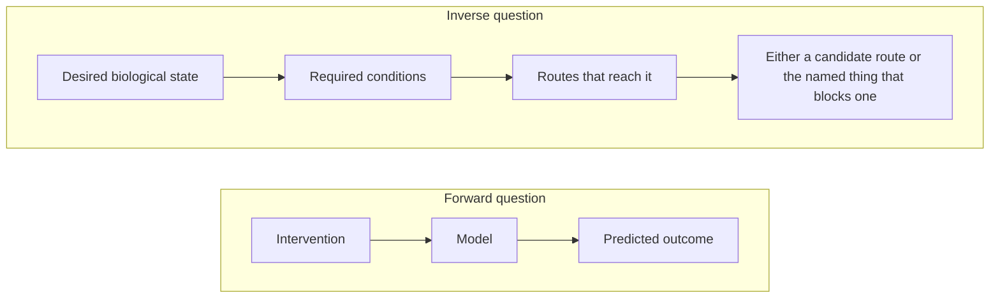
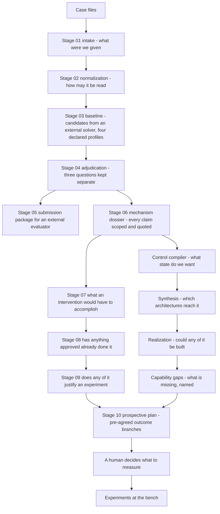

# What this is

**What this page is for.** This is the first page of the rarepipe wiki, written for anyone of any
discipline — a biologist, a clinician, a software engineer, a reviewer, someone who just arrived.
It explains what problem the project exists to attack, the one question it asks that most pipelines
do not, what it actually produces, and what it refuses to produce. It contains no biology you need
a background to follow and no code you need to read. If you want the running verdicts instead of
the reasoning behind them, skip to [Where to go next](#where-to-go-next).

---

## The problem

### One case

A child has **mosaic variegated aneuploidy** — cells across the body carry randomly varying
chromosome counts, with elevated premature separation of sister chromatids, confirmed
cytogenetically. The genetic cause is not in doubt: **compound heterozygous `BUB1B`**, one
truncating allele and one missense allele in the **protein kinase domain** of the BubR1 protein.

That is where this project starts, and the repository records it as exactly that — the starting
node `S0_CASE` in [`docs/control/MVA_CONTINGENT_ROUTE_MAP.yaml`](../control/MVA_CONTINGENT_ROUTE_MAP.yaml).

Note what is *not* on that line. No coordinate, no HGVS, no residue position. The domain the
missense allele falls in is public biology and the code treats it as such; the exact position is
not, and never leaves local compute. That boundary is enforced by a module, not by care — see
[The disclosure boundary](#the-disclosure-boundary) below.

### The general class

The case is an instance of a failure mode that is common and rarely named:

> **The causal variant is known, and nothing follows from knowing it.**

A diagnostic pipeline's job ends at "we found the gene". For a condition this rare, that is where
the useful information runs out: the published record covers other alleles in the same gene, and
nothing has ever been measured about this one. The honest state of knowledge is not "we do not know
what to do" — it is sharper and more useful than that:

| Question | Status in this case |
|---|---|
| Is the gene right? | The downstream stages take the causal genotype as given. Even so, the mechanism stage records that **phase between the two alleles is unresolved**, so the biallelic functional state is inferred from the disease model rather than observed here |
| Is the mechanism class understood? | Partly — kinase-domain substitutions are known to destabilise the protein, and two published ones, **I909T** and **L1012P**, recovered function when forced to normal abundance. But only **one of four** functional endpoints was measured under that condition |
| Does *this* child's allele behave that way? | **Nobody has ever measured it.** No experiment anywhere has expressed this exact substitution at matched abundance |

That last row is the whole case. It is a single, nameable, measurable gap. The published record is
also explicit that domain membership alone does not settle it: **Y155C** sits in the N-terminal TPR
domain, is expressed normally, localises normally, restores chromosome alignment — and still fails
to restore checkpoint activity. **Q921H** sits in the kinase domain and is normal in both level and
function. A protein at full abundance can still be half broken, and a kinase-domain substitution is
not automatically an abundance problem. (All of this is in
[`docs/control/MVA_CASE_DECISION.md`](../control/MVA_CASE_DECISION.md), computed rather than typed.)

So the problem rarepipe is built for is not "find the variant". It is: **given that the variant is
found, what is the next thing anyone could actually do, and what is the smallest measurement that
would decide it?**

---

## What rarepipe does differently

Most computational biology runs the question forwards:

> *Given this perturbation, what will happen?*

Feed in a compound, get out a predicted effect. The trouble is that this question is only
answerable with a model, and for a rare allele the model is mostly missing. Run it anyway and the
machinery fills the holes with plausible numbers, producing a confident-looking answer whose
confidence is manufactured.

rarepipe runs the question backwards:

> *What biological state do we want? What would have to be true for it? Can we get there — and if
> not, what exactly is stopping us?*

Formally, the core of the system is a compiler over a tuple of
*initial states, target region, unsafe region, models, controls, observations, evidence*. It asks
whether some strategy drives **every** state consistent with the evidence into the target without
any trajectory ever passing through a forbidden state. The specification and the formalism are in
[`docs/control/DESIGN.md`](../control/DESIGN.md); the implementation is
[`src/rarepipe/stages/control/compiler.py`](../../src/rarepipe/stages/control/compiler.py).

Three consequences of asking it this way matter more than the mathematics.

**"We cannot decide" is a result, not a failure.** The compiler returns one of seven explicit
result classes, and each ships with a fixed sentence of meaning so that a verdict cannot be
misread. `CURRENTLY_UNCONTROLLABLE` does not mean "biologically impossible".
`CONTROL_INDETERMINATE` is only allowed to be returned if it **names** the blocker. The report
object validates that its own contents support the headline it carries — there is no result by
prose. The classes are in
[`src/rarepipe/stages/control/result_types.py`](../../src/rarepipe/stages/control/result_types.py).

**Repair is not privileged.** Nothing in the search assumes the answer must be to fix the broken
gene, restore the original protein, follow a natural pathway, use one intervention, or correct
every cell. Repair is one route family among several — stabilisation, compensation, bypass,
suppression, replacement, rewiring — and the code is structurally unable to prefer it. That is the
job of the synthesis layer
([`src/rarepipe/stages/control/synthesis/`](../../src/rarepipe/stages/control/synthesis/),
design in [`docs/control/SYNTHESIS_DESIGN.md`](../control/SYNTHESIS_DESIGN.md)).

**The target is a state, not a mechanism.** For this case, success is defined as a region of
functional checkpoint behaviour: the checkpoint arrests when it should, releases when it should,
chromosomes align, chromosomes segregate correctly. Restoring the protein's abundance is
deliberately **not** part of the definition, because that is a candidate route and writing it into
the target would quietly reject any other way of getting there.

### Nothing may be answered from anything but evidence the project holds

This is the discipline the whole repository is organised around, and it is worth being concrete
about how far it goes.

- **Every quote is re-found in a stored document before it is accepted.** The hallucination guard
  is [`src/rarepipe/stages/mechanism/extract.py`](../../src/rarepipe/stages/mechanism/extract.py).
  A claim whose source is not in the corpus, or whose quoted sentence is not in the stored text, is
  recorded as an `InvalidInference` **with its reason, and kept** — not silently dropped.
- **A citation must resolve to a claim the repository already recorded.** Components in the
  physical-realization layer cite an evidence edge by id. There is no free-text citation field, so
  an invented reference has nothing to resolve against and is refused rather than graded.
- **A component cannot grade its own evidence.** How strong a claim may be is computed from what
  the repository recorded, by `entitle()` in
  [`src/rarepipe/stages/control/realization/evidence.py`](../../src/rarepipe/stages/control/realization/evidence.py).
  There is no field for a proposer to set.
- **There is no model-knowledge class.** The four epistemic classes are *observation*,
  *external_evidence*, *derived_inference* and *unknown* — see
  [`src/rarepipe/stages/mechanism/model.py`](../../src/rarepipe/stages/mechanism/model.py), whose
  comment reads "Deliberately no LLM_KNOWLEDGE". Anything an assistant produces must cite evidence
  or it becomes an invalid inference. A model's recollection of the literature is not a source.
- **No module in the pipeline path calls a model.** A test asserts
  `src/rarepipe/stages/mechanism/llm.py` does not exist and that the stage modules contain no API
  endpoint, key name or client call. The dossier records `pipeline_depends_on_an_llm: false`.
- **Evidence about other variants cannot stand in for evidence about this one.** Scope is a
  first-class field with separate values for *exact variant*, *same residue*, *nearby variant*,
  *variant class*, *gene level* and *disease level*. A claim at exact-variant scope is rejected
  unless a cited document actually mentions the case's own residue — checked locally.
- **A prediction inherits the weakest link on its path.** In the causal-chain simulator
  ([`src/rarepipe/stages/simulate/chain.py`](../../src/rarepipe/stages/simulate/chain.py)), adding
  more assertions can never raise a verdict, and none of the seven verdict strings means
  "established". Running the live chain today returns `ASSERTION_ONLY`, capped at exactly the edge
  the case turns on: whether the altered protein works once its abundance is restored.
- **A problem with the data is a recorded fact, not an exception.** Four severities and 63 issue
  codes in [`src/rarepipe/core/issues.py`](../../src/rarepipe/core/issues.py); stage status is
  *derived* from the worst severity present, so "blocked" is computed and never asserted.
- **Correcting evidence recomputes everything downstream.** An audit found that one citation the
  case rested on did not support the claim built on it, and that a directly relevant human trial
  was in the repository attached to nothing. Rather than editing the affected conclusions, each fix
  was recorded as a versioned repair and all eleven dependent layers were recompiled from scratch;
  **10 of 11 moved**. The result made the answer *weaker*, not stronger — withdrawing a refutation
  left an assertion with no evidence either way. See
  [`docs/control/MVA_FULL_RECOMPILE_DELTA.md`](../control/MVA_FULL_RECOMPILE_DELTA.md).

### The disclosure boundary

Because the subject is one identifiable child, "what may leave this machine" is a safety property,
not a preference. It is enforced by
[`src/rarepipe/stages/adjudicate/disclosure.py`](../../src/rarepipe/stages/adjudicate/disclosure.py),
which every outbound query passes through. It refuses coordinates, HGVS, protein shorthand, bare
residue positions, rsIDs, ClinVar ids and HPO codes, and it cross-checks every residue-shaped token
against the case's own private residues **first** — so a token that trips no pattern is still
caught. A refusal is "a bug to fix or a decision to escalate — never something to work around",
and the approval gate for exact-variant querying has no success path at all.

The guard fails closed on purpose. Its bare-residue pattern also matches ordinary strings such as a
mouse strain name, so legitimate gene-level queries sometimes get refused. That was the deliberate
choice after a bare residue slipped through ungated.

---

## What it produces

**Evidence states and falsifiable experiments. Not therapies.**

| It produces | It does not produce |
|---|---|
| Sealed, hashed artifacts recording what is known, at what scope, from which source | A diagnosis, a drug, a dose, a treatment plan |
| Named, falsifiable measurements, each pre-committed to what reading means what | A probability that any of it will work |
| An explicit list of what is missing, with whose job it is to supply it | Clinical advice of any kind |
| Verdicts carrying their own stated limits | A ranked list of interventions |

The refusal is structural, not editorial:

- Stage 09's hypothesis type declares `clinical_actionability: Literal["NOT_ASSESSED"]` and
  `treatment_recommendation: Literal[False]` — a recommendation is **unrepresentable**
  ([`src/rarepipe/stages/track2/model.py`](../../src/rarepipe/stages/track2/model.py)).
- Stage 10 rejects any selected action whose name contains `ADMINIST`, `PRESCRIB` or `TREAT`
  ([`src/rarepipe/stages/prospective/workflow.py`](../../src/rarepipe/stages/prospective/workflow.py)).
- Every generated control, synthesis, realization and discovery report carries a byte-fixed
  no-treatment-recommendation statement that a model validator forbids rewording, plus a scan that
  raises if the free text advises rather than reports.
- Stage 02 is mechanically held to no interpretation at all: a test asserts its report and
  sanitized artifact contain none of the words *pathogenic*, *benign*, *causal*, *candidate gene*,
  *diagnosis*, *compound het* or *drug*.
- Nothing is submitted, uploaded or sent by the pipeline. A person submits; a person sends.
  Outbound external sending is off by default, and the request layer returns a stored *unsent draft*
  instead of dispatching. Network access itself is confined to a handful of explicitly named
  retrieval commands — provisioning a pinned ontology or assembly report, refreshing a literature
  corpus, fetching a region prediction — and every one of their queries passes the disclosure guard
  first. Compilation and CI read frozen snapshots and need no connectivity at all.

### The shape of the system

Stage numbers and directory names do not line up, which trips up every new reader: `stages/track1/`
is Stage 05, `stages/intervention/` is Stage 07, `stages/discovery/` is Stage 08 and
`stages/track2/` is Stage 09. "Track 1" and "Track 2" are an external challenge's track names, not
pipeline positions.

Every arrow crosses a sealed boundary. Each stage writes an immutable run directory, staged under a
dot-prefixed incomplete name, atomically renamed only once every file is written, set read-only and
sealed with a `SHA256SUMS` file that `rarepipe verify-run` re-checks. No stage re-inspects the raw
case directory behind the previous stage's back, and re-running produces a sibling run rather than
an edit. Each artifact exists twice — a private copy and a sanitized copy produced by clearing
every field tagged `restricted()`, recursively, so the public/private split lives in the schema
rather than in a reviewer's discipline
([`src/rarepipe/core/redaction.py`](../../src/rarepipe/core/redaction.py)).

---

## Reason with agents. Prove with code.

This is the project's governing line. It opens the [README](../../README.md) and
[`docs/control/DESIGN.md`](../control/DESIGN.md), and it is printed at the head of the generated
control, architecture and realization maps. Unpacked:

> Agents may propose biological states, mechanisms, alternative routes, models, controls, actuators
> and experiments. Deterministic mathematical code must evaluate constraints, reachability,
> consistency, observability, provenance and safety wherever those concepts have formal semantics.
> Missing biological knowledge must remain an explicit unknown. The system must never manufacture
> quantitative semantics merely to complete a computation.

### What that means operationally

| Agents may | Only deterministic code may |
|---|---|
| Propose a state, a mechanism, a route, a building block, an architecture, a query, an experiment | Decide reachability, safety, robustness, observability |
| Read a retrieved document into a candidate claim | Decide whether a retrieved source establishes anything |
| Suggest where to look | Decide what was found |

Four mechanisms make the split real rather than aspirational:

1. **The gate assigns the epistemic type, never the proposer.**
   [`src/rarepipe/stages/control/proposals.py`](../../src/rarepipe/stages/control/proposals.py)
   accepts typed proposals and downgrades them: an agent-proposed relationship enters as a
   hypothesis at most, agent-asserted feasibility is reset to *unassessed*, an agent-proposed
   target becomes *proposed* rather than *approved*, and **no proposal may carry a result class** —
   a payload containing a word from the compiler's own result vocabulary is rejected outright.
2. **Approval requires an accountable human.** An approved target or safety definition requires a
   named human approver holding a scientific-lead or treating-clinician role. An agent cannot sign
   one. In this case none is appointed, so the live target accountability reads
   `PROPOSED_UNAPPROVED` and every verdict is explicitly conditional on a target definition that is
   still a proposal.
3. **No invented numbers.** There are no probabilities of success, no efficacy scores, no
   model-generated confidence values, and no expected-information-gain ranking anywhere in the
   control, synthesis, realization or discovery layers. Verdicts come from closed enumerations, and
   experiments are ranked by what their reading would *eliminate*, not by an invented prior. Where
   a quantity genuinely is numeric and unknown — in the causal-chain simulator
   ([`src/rarepipe/stages/simulate/chain.py`](../../src/rarepipe/stages/simulate/chain.py)) — the
   type system forces it to be declared as an unknown with an interval: a parameter carrying
   neither a value nor an interval raises at construction, so "we do not know this" can never
   silently become a point estimate.
4. **The verdicts are compiled, not written.** The architecture map, both realization maps, the
   two capability-gap reports, the discovery trace, the two evidence-repair deltas and the
   contingent route map under [`docs/control/`](../control/) are build outputs. The
   [CI workflow](../../.github/workflows/ci.yml) regenerates each of them and fails on any diff, so
   hand-editing a document is not a way to change a verdict. It also runs the test suite
   (**1032 tests** collected today) and two static source scans that read the code rather than its
   behaviour, precisely because a task's author writes both the code and its tests. The design
   documents sitting beside those reports *are* hand-written prose, and several have drifted — where
   prose and a generated report disagree, trust the report.

---

## What it says today

Being accurate about the current state matters more than making it sound finished.

| Layer | Current verdict |
|---|---|
| Control compiler | `CONTROL_INDETERMINATE`, with `OBSERVABILITY_INSUFFICIENT` and `TARGET_SPECIFICATION_INCOMPLETE` also true. One causal blocker is named: whether restoring the protein's abundance restores its function |
| Synthesis | `SYNTHETIC_ROUTE_FEASIBILITY_UNKNOWN` — a composition reaches the target in the mathematics under every evidence-compatible model, and every declared component has no demonstrated way to build it. This counts as a **successful** output |
| Realization | The bypass architecture compiles to `NO_GROUNDED_REALIZATION`; the abundance architecture to `CONTEXT_MISMATCH` |
| Capability gaps, against a frozen 91-document literature snapshot | **Capabilities grounded: 0.** Four previously-open interfaces changed epistemic state; each gap states which providers were searched, how big their corpora are, and why each candidate was rejected |
| Causal chain | `ASSERTION_ONLY`, limited by the same edge the control compiler names |
| Contingent route map | `ROUTE_MAP_VALID`: 240 nodes, 154 edges, 56 branches. No single branch gates every route. The cell-level target needs a minimum of **2** unresolved branches settled; the organism-level target needs **8** |
| Stage 10 prospective plan | `DRAFT` by design, and it cannot freeze — validation reports a large set of named scientific-readiness gaps, each with an owning role, because every assay method, threshold and analysis field is deliberately left null rather than filled in to make a view look complete. That is owned scientific work, not a software defect. `rarepipe prospective validate --json` is the live count; any figure quoted in prose is dated |

**No experiment has been run yet.** Every branch in the route map is still unresolved. The output
of the project so far is a precisely bounded statement of ignorance, three frozen bench questions
with pre-committed outcome branches, and the machinery to recompute every conclusion when a result
arrives.

### Known limitations, stated plainly

- **Generality is uneven.** Stages 01–05 are case-agnostic. Stage 06 onward is specialised to this
  one gene and disease: the thirteen mechanism claims, the assay regexes, the protein region table,
  the four intervention points and the report renderer all contain literals specific to this case.
  Running these stages on a different gene is unbuilt work, not a configuration change.
- **`rarepipe mechanism fetch-corpus` does not run today.** It imports a module that was deleted
  (and a test now asserts the deletion must stand). A corpus cannot currently be acquired from
  scratch through the CLI; the refresh and resolve paths work from an existing frozen corpus.
- **No solver beyond finite states.** There is no differential-equation integrator, no stochastic
  solver, no virtual cell. Interval-valued variables are recognised and **refused** at construction
  rather than quietly discretised. The scale path is an adapter to an established solver.
- **Not built at all:** no drug, gene or molecule catalogue; no chemical search, docking, structure
  prediction or molecular dynamics; no pharmacokinetics or delivery modelling; no biomedical
  knowledge graph; no recommendation or ranking engine; no live email or send transport; no generic
  multi-case orchestrator.
- **The full discovery loop has only fired on toy data.** The end-to-end path *external source →
  grounded claim → grounded capability → architecture change, with nobody editing anything* is
  gated by tests against in-memory toy corpora. It has never fired on real retrieved evidence, and
  a test asserts the real run grounds nothing.
- **Some design prose under `docs/control/` is stale relative to the code.** Where they disagree,
  trust the generated reports and the code. Several docstring counts have drifted too.
- **Reproducing the late stages from this checkout alone is not possible.** `research/` — the
  retrieved full texts and the verbatim quotes extracted from them — is gitignored, because this
  repository is expected to become public. The committed literature snapshot is titles and
  abstracts only.

---

## Where to go next

The rest of this wiki sits beside this page in `docs/wiki/`, numbered `NN-topic.md`.
[`README.md`](./README.md) is the index, routed by audience. The in-repo documents listed under each
heading below are the primary sources these pages draw on.

| Page | Read it if you want |
|---|---|
| [`02-architecture.md`](./02-architecture.md) — *Architecture overview* | How the system is put together: the layers, the rules each one obeys, and where a given piece of logic lives |
| [`03-the-pipeline.md`](./03-the-pipeline.md) — *The pipeline, stage by stage* | What actually runs, in what order: per stage, what it consumes, what it produces, the real module paths, and the invariant that matters most |
| [`04-control-compiler.md`](./04-control-compiler.md) — *The control compiler* | The conceptual heart: the inverse formulation, why mathematically synthesizable and physically buildable are kept rigidly apart, and what a run refuses to say |
| [`05-evidence-discipline.md`](./05-evidence-discipline.md) — *Evidence discipline* | Why the evidence base is trustworthy: the epistemic ladder, grounding versus retrieval, and the backward audit that made this project's own answer weaker |
| [`06-route-map.md`](./06-route-map.md) — *The contingent route map* | Every state the case can be in, every experiment that moves between them, every admissible outcome, and where reasoning runs out |
| [`07-for-developers.md`](./07-for-developers.md) — *For developers* | Setup, the test suite, the CI gate, the conventions that are enforced rather than encouraged, and your first contribution |
| [`08-for-clinicians-and-researchers.md`](./08-for-clinicians-and-researchers.md) — *For clinicians and researchers* | The science with the software skipped, and the three questions frozen for a bench |
| [`09-for-data-collaborators.md`](./09-for-data-collaborators.md) — *For data holders and collaborators* | What happens to your data, drawn from the code — including what is enforced versus merely asserted |
| [`10-for-commercial-and-strategy.md`](./10-for-commercial-and-strategy.md) — *For commercial and strategy* | The category, the real differentiators, the honest limits, and what must never be claimed |
| [`11-governance-and-safety.md`](./11-governance-and-safety.md) — *Governance and safety* | Every rule, where each is enforced, and which are tested versus policy |
| [`12-current-state.md`](./12-current-state.md) — *Current state* | The honest status page: what exists, what is partial, what is deliberately not built |
| [`13-next-steps.md`](./13-next-steps.md) — *Next steps and open frontiers* | Where the work is, with data, knowledge and engineering kept rigidly apart |
| [`14-glossary.md`](./14-glossary.md) — *Glossary* | Every term defined, with project vocabulary marked separately from standard biology |
| [`architecture/module-reference.md`](./architecture/module-reference.md) — *Module reference* | The per-subsystem detail reference. Its gotchas sections are the expensive knowledge |

Beyond those, by what you came here for:

**If you are a biologist or clinician** — start with
[`docs/control/MVA_CASE_DECISION.md`](../control/MVA_CASE_DECISION.md), which states what the
primary functional evidence establishes and what it does not, then
[`docs/control/MVA_BENCH_EXECUTION_MATRIX.md`](../control/MVA_BENCH_EXECUTION_MATRIX.md) for the
three questions frozen for the bench. The pre-agreed outcome branches are in
[`docs/prospective.md`](../prospective.md).

**If you want the reasoning engine** — read
[`04-control-compiler.md`](./04-control-compiler.md), then
[`docs/control/DESIGN.md`](../control/DESIGN.md) for the inverse problem and the decisions that
shape it, [`docs/control/REQUIREMENTS.md`](../control/REQUIREMENTS.md) for the proof gates mapped
requirement by requirement, and
[`docs/control/SYNTHESIS_DESIGN.md`](../control/SYNTHESIS_DESIGN.md) for how architectures are
searched without preferring repair.

**If you want to know what is actually reachable** — read
[`docs/control/MVA_CONTINGENT_ROUTE_MAP.md`](../control/MVA_CONTINGENT_ROUTE_MAP.md). It is large
and entirely generated: every state the case can be in, every experiment that moves between them,
every admissible outcome, and where reasoning runs out. Do not read a campaign count as an
experiment count — routes share experiments, which is why the engine reports minimal *sets* rather
than numbers.

**If you are an engineer** — the pipeline entry point is
[`src/rarepipe/cli.py`](../../src/rarepipe/cli.py). The reusable primitives every stage shares are
in [`src/rarepipe/core/`](../../src/rarepipe/core/): run directories, hashing, semantic digests,
the issue taxonomy, redaction, provenance and packaging. Per-stage documentation lives in
[`docs/intake.md`](../intake.md), [`docs/normalize.md`](../normalize.md),
[`docs/baseline.md`](../baseline.md), [`docs/mechanism.md`](../mechanism.md),
[`docs/track1.md`](../track1.md), [`docs/intervention.md`](../intervention.md),
[`docs/discovery.md`](../discovery.md), [`docs/track2.md`](../track2.md) and
[`docs/prospective.md`](../prospective.md). Note that the repository
[README](../../README.md) documents stages 01–03 only.

**If you are reviewing the project's honesty** — the three documents that make the discipline
checkable are
[`docs/control/MVA_EVIDENCE_REPAIR_DELTA.md`](../control/MVA_EVIDENCE_REPAIR_DELTA.md) (what was
found wrong and how it was fixed),
[`docs/control/MVA_FULL_RECOMPILE_DELTA.md`](../control/MVA_FULL_RECOMPILE_DELTA.md) (every layer
recomputed, with a stated reason even for the one that did not move), and
[`docs/control/MVA_CAPABILITY_GAPS_EXTERNAL.md`](../control/MVA_CAPABILITY_GAPS_EXTERNAL.md), whose
headline metric is not papers found but *previously-open interfaces whose epistemic state changed*,
and whose capability count is zero.

**If you want the outreach and coordination layer** — [`docs/network/PRD.md`](../network/PRD.md)
and [`docs/network/RUNBOOK.md`](../network/RUNBOOK.md). Nothing has been sent; external sending is
off by default and the dispatch path returns a stored unsent draft.

---

> This project produces evidence states and experiments. It does not produce therapies, and no
> statement anywhere in it is clinical advice.
