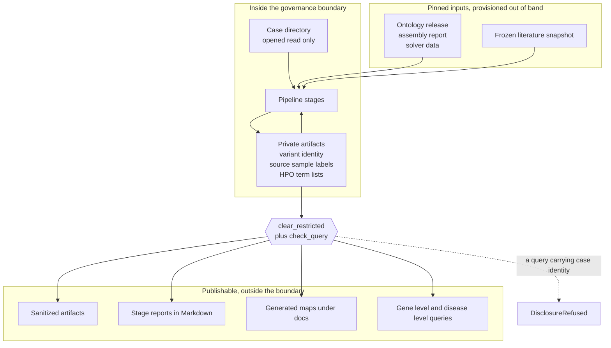
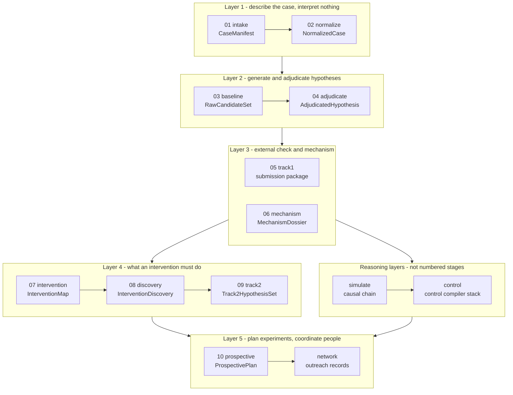
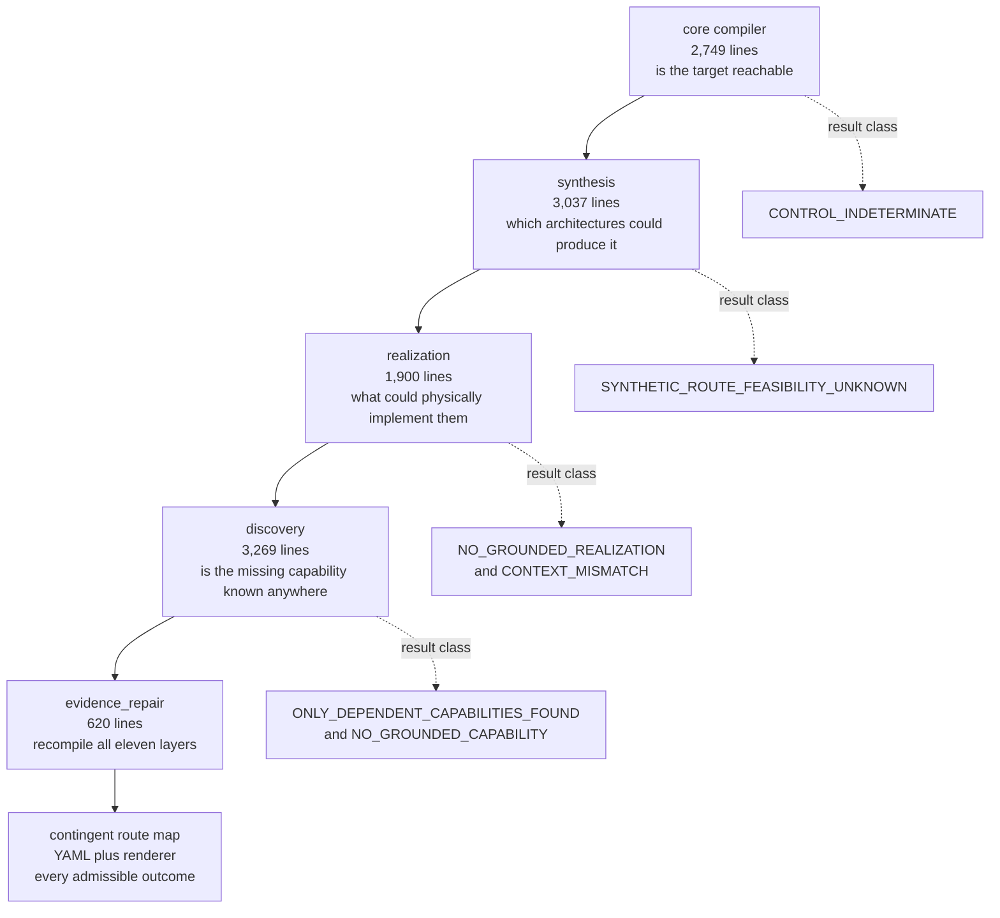

# Architecture overview

This page explains how rarepipe is put together: the system in one picture, then in layers, then
as a repository you can navigate. It is written for developers, architects and technical
stakeholders who need to know where a given piece of logic lives and what rules it has to obey.
If you want to know *what the project is for* rather than *how it is built*, start at
[`README.md`](../../README.md). If you want the biology, this is the wrong page.

Everything below was checked against the code in this checkout. Where something is designed but
not built, it says so.

---

## The system in one picture

A case arrives as a directory of files from a third party. It is opened read-only, described, and
never leaves the controlled working area. Everything the project can publish — sanitized
artifacts, human-readable reports, the generated maps under `docs/control/` — is produced by
clearing fields the schema marks restricted, and every outbound query to an external service is
screened for case identity before it is sent.



Two mechanisms do the work on that boundary, and both are code rather than convention:

| Mechanism | Where | What it does |
|---|---|---|
| `restricted()` / `clear_restricted()` | [`src/rarepipe/core/redaction.py`](../../src/rarepipe/core/redaction.py) | A Pydantic field declared `restricted()` carries `json_schema_extra={"restricted": True}` and exists only in a stage's `*.private.json`. `clear_restricted()` walks the model recursively and resets every tagged field to its default, producing the sanitized sibling. Adding a sensitive field means tagging it; there is no second list to keep in sync. |
| `check_query()` | [`src/rarepipe/stages/adjudicate/disclosure.py`](../../src/rarepipe/stages/adjudicate/disclosure.py) | Every outbound literature or evidence query passes through it. Nine pattern classes are refused — genomic coordinate, HGVS coding/genomic, HGVS protein, protein-change shorthand, bare residue position, dbSNP id, ClinVar variation id, HPO id, bare allele change — and residue-shaped tokens are additionally compared against the case's own private residues before any pattern scan. A refusal raises `DisclosureRefused`. |

Every stage report renderer asserts it was handed the sanitized artifact before it writes a line
(`assert ... visibility == "sanitized"`), so a report cannot leak a restricted field regardless of
what the report module does. That assertion is present in all seven renderers: intake, normalize,
baseline, adjudicate, mechanism, intervention and discovery.

Four modules in the whole repository touch the network, and each is reached only from a named
command: [`src/rarepipe/resources/fetch.py`](../../src/rarepipe/resources/fetch.py) (ontology and
assembly report), [`src/rarepipe/stages/mechanism/retrieve.py`](../../src/rarepipe/stages/mechanism/retrieve.py)
(Europe PMC), [`src/rarepipe/stages/mechanism/alphagenome.py`](../../src/rarepipe/stages/mechanism/alphagenome.py),
and [`src/rarepipe/stages/discovery/approval.py`](../../src/rarepipe/stages/discovery/approval.py)
(regulator records). Compilation and CI read frozen snapshots, so the whole gate runs offline.

`.gitignore` is part of this story rather than housekeeping: `*.private.json`, every genomic file
extension, Track 1 prediction CSVs, `/secure/`, `/work/`, `/out/` and the entire `research/`
directory are excluded, because this repository is expected to become public.

### One deliberate exception

`track1_submission.csv` from Stage 05 is the only artifact that carries exact variant identity and
is meant to leave the working area. It goes to the external evaluator and nowhere else, it is
gitignored, and no stage uploads it — a person submits it deliberately.

---

## The artifact discipline

This is the single rule that makes the rest of the architecture work, and it is stated in the
README as well: **every stage consumes versioned artifacts and emits immutable, versioned
artifacts with provenance, and no stage re-inspects raw directories behind the previous stage's
back.**

Concretely, for every stage run:

1. **A fresh run directory.** `RunDirectory.open()` in
   [`src/rarepipe/core/artifacts.py`](../../src/rarepipe/core/artifacts.py) raises `FileExistsError`
   if the final path exists. Run ids look like `RUN_20260101T000000Z_a1b2c3` — a UTC timestamp plus
   three random bytes.
2. **Files staged, then atomically renamed.** Writes go into `<output>/.incomplete-<run_id>/` with
   mode `x` (exclusive create). The only way files appear at the final path is one `os.replace`
   after every write succeeded, so a crashed run never looks finished.
3. **Sealed and read-only.** `seal()` writes a `SHA256SUMS` over every file the run wrote, chmods
   them all to `0444`, and then renames. `rarepipe verify-run` re-checks that seal.
4. **A private artifact and a sanitized sibling.** Produced by `clear_restricted()`, as above.
5. **Provenance.** [`src/rarepipe/core/provenance.py`](../../src/rarepipe/core/provenance.py)
   records the rarepipe version, the git commit plus a dirty flag, the Python version and
   implementation, the platform and machine, and library versions including the htslib and samtools
   strings bundled by pysam. Git is shelled out to with a timeout and degrades to
   `commit="unknown"` rather than failing the run.
6. **A semantic digest.** `semantic_digest()` in
   [`src/rarepipe/core/digest.py`](../../src/rarepipe/core/digest.py) hashes the artifact minus its
   execution-specific sections, so two runs over the same inputs are byte-comparable despite
   different run ids, paths and timings.

**Re-running never edits.** A second run produces a sibling run directory. There is no update path.

### Why the digest rule has its own guard

`digest.py` carries a shared `volatile_fields()` check that walks a payload and reports anything
run-specific — keys containing `elapsed`, `peak_rss`, `started_at`, `finished_at`, `timestamp`,
`wall_clock`, or values containing `/RUN_`. Its docstring records that this broke twice: Stage 02
once carried the VCF stream time inside the digested payload, Stage 03 carried per-profile
wall-clock, peak RSS and run-specific paths. Exactly two paths are allowed to contain a run id,
listed in `UPSTREAM_POINTERS`, because a different upstream run genuinely is a different input.
[`tests/test_digest_invariants.py`](../../tests/test_digest_invariants.py) asserts the volatile
list is empty for three stage artifacts and that the check itself catches a planted field.

### What "no stage reaches behind the previous one" means in practice

| Stage | What it is allowed to open |
|---|---|
| 01 `intake` | The case directory, read-only. It is the only stage that walks it. Output must be outside the case root or the stage raises. |
| 02 `normalize` | The `CaseManifest` is the only description of the case it trusts. It never walks the case directory, so a file Stage 01 did not record cannot be consumed. It opens exactly the primary VCF, its index and the phenotype asset — a test makes the FASTQs unreadable and the stage still succeeds. |
| 03 `baseline` | Resolves the source VCF *through* the recorded manifest: it reads the manifest path out of the `NormalizedCase`, checks the manifest's own SHA-256 against what the `NormalizedCase` recorded, then picks the asset by `asset_id` (see `resolve_source_vcf` in [`src/rarepipe/stages/baseline/stage.py`](../../src/rarepipe/stages/baseline/stage.py)). |
| 04 and later | Sealed upstream run directories, passed by path. No stage from 04 on reads a case directory at all. |

Each consuming stage also refuses the *sanitized* copy of its input where it needs identity —
`tests/test_normalize.py::test_sanitized_manifest_is_refused` and
`tests/test_baseline.py::test_sanitized_normalized_case_is_refused` pin that.

A problem with the data is a recorded fact, not an exception.
[`src/rarepipe/core/issues.py`](../../src/rarepipe/core/issues.py) defines four severities —
`BLOCKER`, `ACTION_REQUIRED`, `WARNING`, `INFO` — with an explicit rank, and 63 `IssueCode`
members grouped by subject. Stage status is derived from the worst severity present, so "blocked"
is computed rather than asserted, and nothing raises past a stage boundary for a data problem.
Only invalid invocation raises, and that becomes exit code 2.

**Exit code contract:** `0` complete, with or without warnings · `2` usage error · `3` blocked.

Eleven artifact schemas are committed under [`schemas/`](../../schemas/) and emitted by
`rarepipe schema --artifact <name>`; drift tests fail when the code and the committed schema
disagree, and the Stage 01 schema is frozen against a git tag.

---

## The stage pipeline, in layers

Thirteen subsystems live under `src/rarepipe/stages/`. Ten of them are numbered pipeline stages
(01–10). The other three — `control/`, `simulate/`, `network/` — are not numbered stages: they are
libraries and compilers that read what the numbered stages recorded.



Read the arrows as *artifact dependency*, not as a schedule. Nothing runs automatically: every
stage is a separate CLI invocation against a sealed upstream run, and Stages 06, 08 and 09 require
a person to run retrieval, read the bundle and import a reviewed file before they can proceed.

### Every stage subsystem

Sizes are lines of Python counted with `wc -l`, excluding `__pycache__`. They are here because
relative weight tells you where the complexity actually is, and the answer is not where a reader
of the stage numbering would guess.

| # | Path | Lines | Purpose in one line |
|---|---|---:|---|
| 01 | [`src/rarepipe/stages/intake/`](../../src/rarepipe/stages/intake/) | 3,176 | Walk a case directory read-only and record exactly what was supplied, as a `CaseManifest`. No interpretation, no transformation, no network. |
| 02 | [`src/rarepipe/stages/normalize/`](../../src/rarepipe/stages/normalize/) | 1,919 | Turn the manifest into a `NormalizedCase`: canonical contig identities, a full dual-pass VCF characterization, HPO normalization against a pinned release, and readiness stated per capability rather than as one yes/no. |
| 03 | [`src/rarepipe/stages/baseline/`](../../src/rarepipe/stages/baseline/) | 1,413 | Ask Exomiser for candidate causal hypotheses under four explicitly declared analytical profiles and record what it said, unaltered, plus a cross-profile stability comparison. |
| 04 | [`src/rarepipe/stages/adjudicate/`](../../src/rarepipe/stages/adjudicate/) | 1,745 | Decompose one hypothesis into separate claims — mechanism, per-allele function, biallelic configuration — and build an evidence dossier that refuses to merge them into a score. Also owns the repository's disclosure guard. |
| 05 | [`src/rarepipe/stages/track1/`](../../src/rarepipe/stages/track1/) | 1,007 | Build one Track 1 submission package against a frozen, hashed snapshot of what the pipeline knew beforehand, and later record the evaluator's verdict as case state. |
| 06 | [`src/rarepipe/stages/mechanism/`](../../src/rarepipe/stages/mechanism/) | 4,011 | Resolve what the alleles do, with every statement carrying an epistemic class and a scope and no statement entering the record unless a verbatim quote can be re-found in a stored document. |
| 07 | [`src/rarepipe/stages/intervention/`](../../src/rarepipe/stages/intervention/) | 1,097 | State what an intervention would have to accomplish — which biological state, in which direction, measured how — without naming any medication. |
| 08 | [`src/rarepipe/stages/discovery/`](../../src/rarepipe/stages/discovery/) | 1,220 | Search the published record for anything approved that has already been tried, verify approval against a regulator's own record, and keep "nobody tried it" separate from "someone tried it and it failed". |
| 09 | [`src/rarepipe/stages/track2/`](../../src/rarepipe/stages/track2/) | 1,429 | The gate is the stage: a research hypothesis reaches Track 2 only by passing every check, and a run that finds nothing still seals the pre-network baseline. |
| 10 | [`src/rarepipe/stages/prospective/`](../../src/rarepipe/stages/prospective/) | 3,133 | Record, before any result exists, what each experiment would measure and which pre-written branch fires on each admissible outcome, in immutable plan versions. |
| — | [`src/rarepipe/stages/control/`](../../src/rarepipe/stages/control/) | **11,575** | The control compiler stack: given the state we have and the state we want, which biological variables would have to be controlled, what architectures could produce them, what could physically implement those, and what is missing. See below. |
| — | [`src/rarepipe/stages/simulate/`](../../src/rarepipe/stages/simulate/) | 2,592 | A causal-chain library whose governing rule is that a prediction inherits the weakest-supported link on its path, so the link where reasoning breaks survives into the output instead of being multiplied away. |
| — | [`src/rarepipe/stages/network/`](../../src/rarepipe/stages/network/) | **12,660** | Turn "ask an outside research group a bounded question" into typed, auditable records — drafting, gating, structuring replies, and practising request ordering against a synthetic world. It sends nothing in this build. |

**The two largest subsystems are not pipeline stages.** `network/` (12,660 lines across 24 files)
and `control/` (11,575 lines across 70 files) together are roughly as large as all ten numbered
stages combined. The next largest subsystem, `mechanism/`, is 4,011 lines. If you are budgeting
time to understand this repository, that is where it goes.

### Directory names do not match stage numbers

This trips up every new reader. `track1/` is Stage 05 and `track2/` is Stage 09 — "Track 1" and
"Track 2" are an external challenge's track names, not pipeline positions. `intervention/` is
Stage 07 and `discovery/` is Stage 08.

Worse, **`discovery` names two unrelated subsystems**:
`src/rarepipe/stages/discovery/` is Stage 08, approved-intervention discovery, while
`src/rarepipe/stages/control/discovery/` is capability-gap discovery inside the control compiler.
`tests/test_discovery_gates.py` tests the latter; `tests/test_discovery.py` tests the former.

---

## The control compiler layers

The control stack asks the inverse of the usual question. Not "given this intervention, what
happens?" but "given the state we have and the state we want, which biological variables would
have to be controlled to get there without ever passing through a forbidden state?" Each layer
takes the previous layer's problem and asks a strictly harder question about it, and each layer
can legitimately end by naming exactly what prevents an answer.



The result classes on the right are not placeholders — they are the headline verdicts the
committed maps under `docs/control/` carry today, regenerated by CI.

| Layer | Path | Question | Committed headline |
|---|---|---|---|
| Core compiler | [`src/rarepipe/stages/control/compiler.py`](../../src/rarepipe/stages/control/compiler.py) and its siblings | Does some control strategy drive every evidence-compatible initial state into the target without any trajectory entering the unsafe region? | `CONTROL_INDETERMINATE`, with `OBSERVABILITY_INSUFFICIENT` and `TARGET_SPECIFICATION_INCOMPLETE` also true — [`MVA_CONTROL_MAP.md`](../control/MVA_CONTROL_MAP.md) |
| Synthesis | [`src/rarepipe/stages/control/synthesis/`](../../src/rarepipe/stages/control/synthesis/) | Given the target state, which compositions of declared building blocks would produce it, and separately, is there any known way to build them? | `SYNTHETIC_ROUTE_FEASIBILITY_UNKNOWN` — a successful output. [`MVA_ARCHITECTURE_MAP.md`](../control/MVA_ARCHITECTURE_MAP.md) |
| Realization | [`src/rarepipe/stages/control/realization/`](../../src/rarepipe/stages/control/realization/) | Can each required transformation be decomposed into real components, each citing an evidence claim the repository already holds? | `NO_GROUNDED_REALIZATION` for the bypass architecture, `CONTEXT_MISMATCH` for the abundance one — [`MVA_REALIZATION_BYPASS.md`](../control/MVA_REALIZATION_BYPASS.md), [`MVA_REALIZATION_ABUNDANCE.md`](../control/MVA_REALIZATION_ABUNDANCE.md) |
| Discovery | [`src/rarepipe/stages/control/discovery/`](../../src/rarepipe/stages/control/discovery/) | Turn "we would need a piece that does X" into a formal search specification, search providers, and let deterministic validators decide whether any retrieved source establishes that the piece exists. | Four gaps end `ONLY_DEPENDENT_CAPABILITIES_FOUND`, `NO_GROUNDED_CAPABILITY`, `NO_GROUNDED_CAPABILITY`, `CONTEXT_ONLY_CAPABILITY` — [`MVA_CAPABILITY_GAPS_EXTERNAL.md`](../control/MVA_CAPABILITY_GAPS_EXTERNAL.md) |
| Evidence repair | [`src/rarepipe/stages/control/evidence_repair/`](../../src/rarepipe/stages/control/evidence_repair/) | When a citation turns out not to support the claim built on it, correct the evidence and recompile every conclusion that rested on it. | Four repairs; 10 of 11 dependent layers moved — [`MVA_FULL_RECOMPILE_DELTA.md`](../control/MVA_FULL_RECOMPILE_DELTA.md) |
| Contingent route map | [`tools/control/compile_route_map.py`](../../tools/control/compile_route_map.py) over [`MVA_CONTINGENT_ROUTE_MAP.yaml`](../control/MVA_CONTINGENT_ROUTE_MAP.yaml) | Hold the whole space of experiments the case could run — every admissible outcome of each — as a validated graph with no probabilities in it. | `ROUTE_MAP_VALID` — [`MVA_CONTINGENT_ROUTE_MAP.md`](../control/MVA_CONTINGENT_ROUTE_MAP.md) |

Three structural notes that matter if you intend to change any of this:

- **The layering is real in the import graph.** `synthesis/` imports the core compiler's
  `Problem`, `reachability`, `controls` and `provenance`; `realization/` imports `synthesis`;
  `discovery/` imports `realization`; `evidence_repair/` imports all four. There is one upward
  edge: the agent-proposal gate `control/proposals.py` imports `synthesis.architecture`,
  `synthesis.building_blocks` and `synthesis.kinds`, because it has to type proposals the
  synthesis layer will consume. Each layer deliberately *re-compiles* the layer below rather than
  trusting a prior report — `realization/compiler.py` calls `compile_synthesis()` itself — which
  is also why `recompile.observe()` is slow.
- **The route map is not another compiler.** `tools/control/compile_route_map.py` is 1,618 lines
  and imports nothing from `src/rarepipe` — it reads the YAML, validates it against seven closed
  vocabularies, and renders. The document's own header calls it "case data and a renderer, not a
  new compiler layer". Today's map holds 240 nodes (94 state, 86 terminal, 56 branch, 4 `all_of`),
  154 edges, 10 control variables, 4 strategy families, 4 campaigns and 11 grounded facts.
- **`simulate/` sits underneath, not alongside.** The realization and discovery layers read the
  case's evidence inventory by walking `simulate.mva.mva_chain()`, which is how a capability is
  forced to cite an evidence claim the repository already holds rather than free text.

### Scope limit, stated plainly

The control stack's *machinery* is general; its *instances* are not. `mva.py`,
`synthesis/mva_synthesis.py`, `realization/mva_realization.py` and `discovery/mva_gaps.py` encode
one case. `render.py` additionally hard-codes case-specific prose into the generated control map,
so a second case needs the renderer changed, not just a new `Problem`. Generalising Stages 06–09
to another gene–disease pair is also unbuilt work.

---

## Repository layout

```
rarepipe/
├── src/rarepipe/
│   ├── cli.py                 one Typer app, 977 lines, 30 commands + 8 mounted sub-apps
│   ├── __main__.py            three lines
│   ├── core/                  586 lines, 8 modules every stage reuses
│   ├── stages/                13 subsystems — the table above
│   ├── resources/             provision and pin external resources
│   └── testing/               synthetic case fixtures, and a fake solver
├── tools/                     5,832 lines: static scanners and document compilers
│   ├── control/               the compile_mva_*.py family and compile_route_map.py
│   ├── network/               check_invariants.py, check_branch_reachability.py, …
│   └── m5/                    review-packet and consistency tooling
├── tests/                     61 test files, 1,032 tests collected
├── docs/                      per-stage guides, docs/control/, docs/network/, docs/adr/, this wiki
├── schemas/                   11 committed JSON Schemas
├── data/                      frozen literature snapshots, the repair baseline, seed nodes
└── .claude/skills/            16 agent-facing skills, 15 of them vocabulary-checked by tools
```

### `src/rarepipe/core/` — the shared primitives

Eight small modules, 586 lines in total, that every stage reuses. Small on purpose: they are the
part that must not surprise anyone.

| Module | What it owns |
|---|---|
| [`artifacts.py`](../../src/rarepipe/core/artifacts.py) | Immutable, versioned run directories. Staging, exclusive-create writes, the `SHA256SUMS` seal, chmod `0444`, atomic rename. |
| [`digest.py`](../../src/rarepipe/core/digest.py) | `semantic_digest()` and the shared `volatile_fields()` guard. |
| [`hashing.py`](../../src/rarepipe/core/hashing.py) | Streaming SHA-256 in 8 MiB chunks, plus a `DigestCache` keyed on relative path, size, `mtime_ns` and inode so an interrupted intake resumes without re-reading finished files. |
| [`issues.py`](../../src/rarepipe/core/issues.py) | Four severities with an explicit rank, 63 issue codes, and deterministic de-duplicating sort so manifests are idempotent. |
| [`redaction.py`](../../src/rarepipe/core/redaction.py) | `restricted()` and `clear_restricted()`. Stage 01 deliberately keeps its own frozen copy of the same mechanism so its schema cannot drift. |
| [`provenance.py`](../../src/rarepipe/core/provenance.py) | The "this exact software" half of every artifact. |
| [`package.py`](../../src/rarepipe/core/package.py) | Submission packages that carry their own `MANIFEST.sha256` over archive-relative paths, verified by actually unpacking and running `shasum -a 256 -c` before the zip is returned. A sealed run's own `SHA256SUMS` cannot verify an export, because it covers private files that are never exported. |
| [`console.py`](../../src/rarepipe/core/console.py) | Operator output and the run log. Progress output is terminal-only and deliberately not logged. |

### `src/rarepipe/cli.py` — one operator surface

977 lines, 30 commands, plus eight mounted sub-apps (`mechanism`, `track2`, `discovery`,
`alphagenome`, `research`, `export`, `prospective`, `resources`); the `prospective` sub-app
contributes 12 more commands of its own. Every stage import happens lazily inside its command body,
so startup stays fast and an import failure stays local to one command. The one exception is the
`prospective` sub-app, imported at module scope.

The network subsystem's CLI is **not** mounted on the top-level app; it is invoked as
`python -m rarepipe.stages.network.cli`.

### `tools/` — scanners and document compilers

Two kinds of thing live here. The `compile_mva_*.py` family and `compile_route_map.py` load case
data plus a compiler from `src/rarepipe/stages/` and render Markdown into `docs/control/`. The
scanners under `tools/network/` read *source* rather than behaviour — deliberately, because a
task's author writes both the code and its tests. `check_invariants.py` runs five such checks, each
tied to a defect that actually occurred here, and prints an explicit `not_checked` list alongside
its findings.

**The Markdown under `docs/control/` is a build output, not prose.** Hand-editing a generated map
passes review and then fails CI on the staleness diff. Regenerate with the tool.

### What CI enforces

[`.github/workflows/ci.yml`](../../.github/workflows/ci.yml) runs on every push and pull request:
four setup steps, then eleven checks.

1. The test suite, `uv run pytest -q -m "not integration"`. Its exit status is the job's status and
   is never piped into `tail`, `head` or `grep` — the file's own header records that doing so once
   hid a real failure.
2. Two static invariant scans, over `src/rarepipe/stages/network` and `src/rarepipe/stages/control`.
3. Six staleness checks: regenerate a committed document, then `git diff --exit-code`. They cover
   the architecture map, both realization maps, the capability gap report, the external capability
   reports, both evidence-repair deltas, and the contingent route map.
4. Two reports: decision-branch reachability and endpoint discrimination.

The whole gate runs offline, with no case data and no controlled drive. One known hole is recorded
in the workflow itself: the branch-reachability step runs with `|| true`, so a currently
unreachable branch set is reported without failing the build, and the comment says to remove that
once the blocking experiment is resolved.

---

## What is not here

Marked explicitly, because inventing plausible architecture is the failure mode this project is
built against:

- **No generic multi-case orchestrator.** Every stage is a separate CLI invocation, and the
  `tools/control/` compilers are case-specific by their own admission.
- **No numerical integrator, no ODE / interval / stochastic support.** Those formalisms are named
  in the model contract and refused by the control engine until an adapter to an established
  solver is added. `INTERVAL` variables raise at construction rather than being silently
  discretised.
- **No live transport in the network subsystem.** There is a `Transport` ABC and a test transport;
  external send is disabled, so an authorised request becomes a stored unsent draft. Nothing has
  been sent.
- **No HTTP layer or database anywhere.** Storage is sealed run directories and plain files.
- **No treatment recommendation, anywhere, by construction.** Several report types carry a
  byte-fixed no-recommendation statement that a model validator refuses to let anyone reword, and
  Stage 09 types `treatment_recommendation` as `Literal[False]` so the claim cannot be represented
  at all.
- **`docs/wiki/architecture/` exists and is empty.** This page is the architecture documentation;
  that directory is a leftover.

One subsystem is broken today and worth knowing about before you plan work:
`rarepipe mechanism fetch-corpus` does not run, because
`src/rarepipe/stages/mechanism/corpus_stage.py` imports a module that was deliberately deleted.
`--help` works, because the import is lazy inside the CLI function. `mechanism refresh-corpus` and
`mechanism resolve` work from an existing frozen corpus run, so a corpus cannot currently be
acquired from scratch through the CLI.

---

## Where to go next

- **The control compiler, in depth** — [`docs/control/DESIGN.md`](../control/DESIGN.md) and
  [`docs/control/REQUIREMENTS.md`](../control/REQUIREMENTS.md), which map proof gates and
  invariants requirement-by-requirement. Then
  [`SYNTHESIS_DESIGN.md`](../control/SYNTHESIS_DESIGN.md),
  [`REALIZATION_DESIGN.md`](../control/REALIZATION_DESIGN.md),
  [`DISCOVERY_DESIGN.md`](../control/DISCOVERY_DESIGN.md) and
  [`EXTERNAL_DESIGN.md`](../control/EXTERNAL_DESIGN.md) in that order. Note that the three later
  design documents are partly stale relative to the evidence repair; the generated maps and the
  code are the source of truth.
- **A specific stage** — the per-stage operator guides under `docs/`:
  [`intake.md`](../intake.md), [`normalize.md`](../normalize.md), [`baseline.md`](../baseline.md),
  [`mechanism.md`](../mechanism.md), [`track1.md`](../track1.md),
  [`intervention.md`](../intervention.md), [`discovery.md`](../discovery.md),
  [`track2.md`](../track2.md), [`prospective.md`](../prospective.md).
- **The research-network subsystem** — [`docs/network/PRD.md`](../network/PRD.md) and
  [`docs/network/RUNBOOK.md`](../network/RUNBOOK.md). The other files in that directory are
  successive PRD drafts kept as history.
- **The contracts themselves** — read each subsystem's `model.py` or `kinds.py` first. The enums
  are the clearest available statement of what that subsystem believes, and they are closed on
  purpose so a proposer cannot invent a category.
- **What is already known to be imperfect** —
  [`docs/POTENTIAL_IMPROVEMENTS.md`](../POTENTIAL_IMPROVEMENTS.md).
