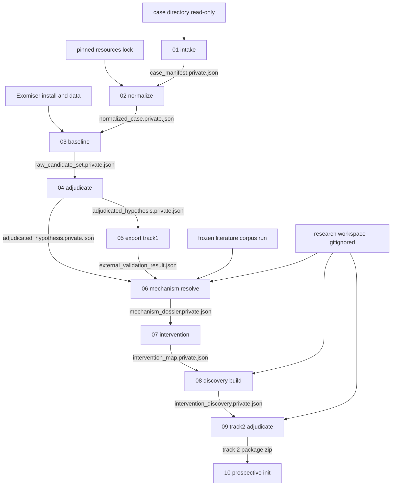
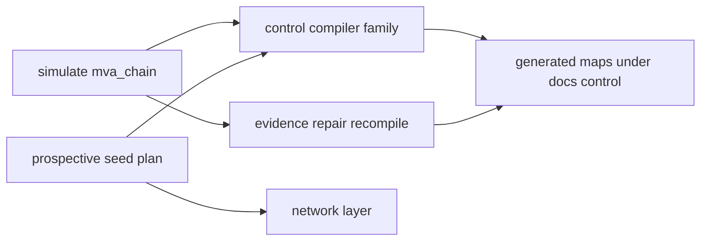

# The pipeline, stage by stage

**What this page is for.** This is the walk-through of what rarepipe actually runs, in what order,
and what each step hands to the next. For every stage subsystem you get four things: what it
consumes, what it produces, the real module paths, and the single invariant that matters most. If
you want to know which command to run, which file a stage reads, or whether a given capability is
finished — you are in the right place. If you want the *why* behind the control layer's refusal
semantics, go to [the control compiler page](./04-control-compiler.md) instead.

Two warnings before anything else. First, stage numbers and directory names do not line up — there
is a table for that below, and getting it wrong will waste your afternoon. Second, several things
described here are deliberately *not* built, and one command is broken today; both are called out
explicitly rather than smoothed over.

---

## The shape every stage shares

Before the per-stage detail, the mechanics all the numbered stages have in common. They are
implemented once, in `src/rarepipe/core/`, and reused.

| Property | How it works | Where |
|---|---|---|
| Immutable run directory | Files are staged under `<output>/.incomplete-<run_id>/`, created with exclusive-create, then the directory is atomically renamed into place. A crashed run never looks finished. | `src/rarepipe/core/artifacts.py` |
| Sealed output | Every written file is chmod `0444` and listed in a `SHA256SUMS` file. Re-checkable with `rarepipe verify-run`. | `src/rarepipe/core/artifacts.py` |
| Private / sanitized pair | Each artifact exists twice. A Pydantic field declared with `restricted()` lives only in `*.private.json`; `clear_restricted()` walks the model and resets every tagged field for the sanitized sibling. | `src/rarepipe/core/redaction.py` |
| Human report | Rendered **only** from the sanitized artifact. Several stages assert `visibility == "sanitized"` before writing a line, so a report cannot leak a restricted field regardless of what the report module does. | per-stage `report.py` |
| Issues, not exceptions | A problem with the data is a recorded fact with a severity — `BLOCKER`, `ACTION_REQUIRED`, `WARNING`, `INFO` — and the stage status is *derived* from the worst severity present. Nothing raises past a stage boundary for a data problem. | `src/rarepipe/core/issues.py` |
| Semantic digest | A hash of what the artifact *says*, excluding the `execution` block. Two identical runs produce the same digest despite different run ids, paths and timings. | `src/rarepipe/core/digest.py` |
| Exit codes | `0` complete, `2` usage error, `3` blocked. | `src/rarepipe/cli.py` |

Re-running never edits anything. It produces a sibling run directory.

**A caution about exit codes:** `0` covers both the clean and the with-warnings status, so a caller
that only checks the exit code will miss `ACTION_REQUIRED` items. The readiness and
actions-required fields in the artifact are the real gate.

---

## Stage numbers vs. directory names

The numbers come from the pipeline. Some directory names come from an external challenge's track
names. They are not the same thing, and two of the collisions are genuinely nasty.

| Stage | Package | CLI |
|---|---|---|
| 01 | `src/rarepipe/stages/intake/` | `rarepipe intake` |
| 02 | `src/rarepipe/stages/normalize/` | `rarepipe normalize` |
| 03 | `src/rarepipe/stages/baseline/` | `rarepipe baseline` |
| 04 | `src/rarepipe/stages/adjudicate/` | `rarepipe adjudicate` |
| 05 | `src/rarepipe/stages/track1/` | `rarepipe export track1`, `rarepipe record-validation` |
| 06 | `src/rarepipe/stages/mechanism/` | `rarepipe mechanism resolve` |
| 07 | `src/rarepipe/stages/intervention/` | `rarepipe intervention` |
| 08 | `src/rarepipe/stages/discovery/` | `rarepipe discovery build` |
| 09 | `src/rarepipe/stages/track2/` | `rarepipe track2 adjudicate` |
| 10 | `src/rarepipe/stages/prospective/` | `rarepipe prospective …` |
| — | `src/rarepipe/stages/simulate/` | none — a library |
| — | `src/rarepipe/stages/control/` | none — driven by `tools/control/compile_*.py` |
| — | `src/rarepipe/stages/network/` | `python -m rarepipe.stages.network.cli` |

Two name collisions to internalise:

- `src/rarepipe/stages/discovery/` is Stage 08 — approved-intervention discovery. It is a
  completely different subsystem from `src/rarepipe/stages/control/discovery/`, which is
  capability-gap discovery for the control compiler. `tests/test_discovery_gates.py` tests the
  *latter*; `tests/test_discovery.py` tests Stage 08.
- "Track 1" and "Track 2" are an external challenge's track names, not pipeline positions.

---

## Artifact handoffs

Each arrow is a file one stage writes and the next reads. No stage re-inspects the raw case
directory behind the previous stage's back: after Stage 01, the manifest is the only description of
the case anything trusts.

The unnumbered layers hang off the same evidence rather than off the artifact chain:

---

## Stage 01 — case intake

A case arrives as an arbitrary directory from a third party: variant calls, maybe reads, maybe a
reference, a phenotype list, a pedigree, plus junk. Stage 01 answers one question — *what were we
given?* — and answers nothing else.

| | |
|---|---|
| **Consumes** | A case directory opened read-only (`--case-root`), a `--case-id`, an `--output` root **outside** the case root, plus optional `--reference` FASTAs, `--primary-variant`, `--exclude` globs and a `--config` JSON |
| **Produces** | `case_manifest.private.json`, `case_manifest.sanitized.json`, `intake_report.md`, `intake.log`, `SHA256SUMS` |
| **Status** | `INTAKE_COMPLETE` / `INTAKE_COMPLETE_WITH_WARNINGS` / `INTAKE_BLOCKED` |

Key modules:

- `src/rarepipe/stages/intake/stage.py` — orchestration in seven steps: discover, variants,
  reads/reference, phenotype/pedigree, checksums, cross-validate, write.
- `src/rarepipe/stages/intake/manifest.py` — the `CaseManifest` contract, schema version `1.0.0`.
  All the enums live here; read them first.
- `src/rarepipe/stages/intake/discovery.py` — walks the tree read-only, never following directory
  symlinks, and records *why* it thinks two assets are related.
- `src/rarepipe/stages/intake/formats.py` — content-first format detection. The filename *claims* a
  format; the bytes *are* one. Both are recorded and disagreement is surfaced as an issue, never
  reconciled.
- `src/rarepipe/stages/intake/reference.py` — genome build from nuclear contig length tables for
  GRCh37 / GRCh38 / T2T-CHM13.
- `src/rarepipe/stages/intake/redact.py` — the frozen, Stage-01-local copy of the redaction walk.

**The invariant that matters most:** nothing is inferred that the data does not state. A sample's
asserted role is typed `Literal["unknown"]`; phenotype polarity defaults to `unspecified`, so
listing a term is never read as "observed"; filenames are never pedigree or sample-identity
evidence. Where a computation genuinely cannot establish a fact, the only channel in is
`src/rarepipe/stages/intake/validation.py`'s explicitly-asserted pedigree section plus the
`CaseAssertions` contract that Stage 02 reads.

Worth knowing:

- Genome build is decided by **contig lengths**, not by the `##reference` header text. This is a
  documented, deliberate inversion of the PRD's stated preference order; the module docstring in
  `reference.py` explains why. A header claim contradicting the lengths becomes an issue.
- `asset_id` is derived from the relative path, so renaming or moving a file changes its ID.
  Content identity is `checksum_sha256`. That split is why there are two fingerprints —
  `input_fingerprint` ignores renames, `inventory_fingerprint` does not.
- Stage 01 parses only the **first** VCF record, to prove the body is readable. Corruption deeper in
  the file is invisible here.
- Sanitized is **not** anonymous. The sanitizer's own note says so: internal aliases remain and the
  artifact still describes one real individual's case structure.

Deeper: **[docs/intake.md](../intake.md)**.

---

## Stage 02 — case normalization

Stage 01 asked what we were given. Stage 02 asks whether it can become one coherent analysis-ready
representation — and refuses to answer "ready" globally.

| | |
|---|---|
| **Consumes** | `--manifest` pointing at `case_manifest.private.json` (a sanitized manifest is refused — it carries no asset locations), optional `--resources` holding `resources.lock.json`, optional `--assertions` |
| **Produces** | `normalized_case.private.json`, `normalized_case.sanitized.json`, `normalization_report.md`, `normalization.log`, `SHA256SUMS` |
| **Status** | `NORMALIZATION_COMPLETE` / `…_WITH_WARNINGS` / `NORMALIZATION_BLOCKED` |

Key modules:

- `src/rarepipe/stages/normalize/stage.py` — orchestration in seven steps, ending with the Stage 01
  seal check and a full VCF stream.
- `src/rarepipe/stages/normalize/model.py` — the `NormalizedCase` contract, schema version `1.1.0`.
- `src/rarepipe/stages/normalize/vcf_scan.py` — **two independent full passes** over the complete
  VCF: a strict byte-level text parser that accumulates aggregate counters only, cross-checked
  against an htslib read that must agree on record count. No record, allele or genotype value is
  retained.
- `src/rarepipe/stages/normalize/readiness.py` — six per-capability verdicts.
- `src/rarepipe/stages/normalize/assertions.py` — the `CaseAssertions` contract, v1.0.0.

Readiness is stated per capability, not as a single yes/no. The six are
`phenotype_based_prioritization`, `vcf_based_prioritization`, `trio_analysis`,
`phase_aware_analysis`, `variant_decomposition_left_alignment` and `read_level_analysis`, each with
machine-readable `blocking_reasons` and `conditions`.

**The invariant that matters most:** no transformation, anywhere. No rewriting, decomposition,
left-alignment, filtering, sorting, liftover, alignment, calling, phasing, annotation or
prioritization. Every step is recorded in `provenance.operations` with
`transforms_source_data: false`. A test asserts the Stage 02 report and sanitized artifact contain
none of the words *pathogenic*, *benign*, *causal*, *candidate gene*, *diagnosis*, *compound het* or
*drug* — the no-interpretation rule is enforced mechanically, not by convention
(`tests/test_normalize_invariants.py::test_no_biological_interpretation_vocabulary`).

Worth knowing:

- Stage 02 never walks the case directory. The manifest is the only description of the case it
  trusts, so a file Stage 01 did not record cannot be consumed.
- Every asset it opens is SHA-256 verified against the manifest first, and the manifest itself is
  checked against the Stage 01 `SHA256SUMS` seal.
- It opens exactly the primary VCF, its index, and the phenotype asset(s). FASTQs are never opened:
  `tests/test_normalize.py` makes them mode `0o000` and the stage still succeeds.
- No network. `REF_PATH` / `REF_CACHE` are pinned to a nonexistent path for the duration, because
  htslib otherwise downloads CRAM references from EBI. Tests run both stages with Python sockets
  disabled and under an OS network sandbox, and a test asserts no stage imports
  `rarepipe.resources.fetch`.
- A pinned resource whose bytes differ from the lock is refused as a `BLOCKER`, so a silently
  updated ontology cannot change a result. Re-running against a newer HPO release yields a
  different `semantic_digest` — tested explicitly.
- Two variant files with no `--primary-variant` is only `ACTION_REQUIRED` in Stage 01 but a
  `BLOCKER` here. Stage 01 may describe an ambiguity it cannot resolve; Stage 02 may not guess.

Deeper: **[docs/normalize.md](../normalize.md)**.

---

## Stage 03 — baseline causal-hypothesis generation

The first stage permitted to produce biological hypotheses, and it deliberately produces none of
its own. It asks Exomiser — a mature off-the-shelf solver — what it ranks as the strongest causal
candidates, four times, under four explicitly declared sets of assumptions.

| | |
|---|---|
| **Consumes** | A private `NormalizedCase`, the source VCF it declares (resolved through the recorded manifest, re-verified against the upstream SHA-256), a locally provisioned Exomiser installation plus its hg38 and phenotype data |
| **Produces** | `raw_candidate_set.private.json`, `raw_candidate_set.sanitized.json`, `baseline_report.md`, `baseline.log`, `SHA256SUMS`; the solver's native outputs separately under `<output>/native/<run_id>/<profile>/` |
| **Status** | `BASELINE_ANALYSIS_COMPLETE` / `…_WITH_WARNINGS` / `BASELINE_ANALYSIS_BLOCKED` |

The 2×2 profile matrix (`src/rarepipe/stages/baseline/profiles.py`) varies exactly two things
across four otherwise identical runs:

| Profile | Phenotype term rule | `failedVariantFilter` step |
|---|---|---|
| `PROFILE_A` | `phenotypic_abnormality_only` | present — non-PASS dropped |
| `PROFILE_B` | `phenotypic_abnormality_only` | absent — non-PASS permitted |
| `PROFILE_C` | `all_supplied_terms` | present |
| `PROFILE_D` | `all_supplied_terms` | absent |

Key modules: `stage.py` (orchestration), `model.py` (the `RawCandidateSet` contract, schema version
`1.1.0`), `profiles.py` (the matrix and job-file generation), `exomiser.py` (locating and running
the solver, classifying out-of-memory / rejected-input / timeout), `ingest.py` (TSV parsing),
`compare.py` (cross-profile stability), `report.py`, `schema.py` — all under
`src/rarepipe/stages/baseline/`.

**The invariant that matters most:** no reranking, rescoring or filtering by rarepipe. Ranks and
scores are copied verbatim from the solver and candidates are sorted only by
`(rank, gene symbol, inheritance model)`. Relatedly, `FilterPolicy.source_filter_labels_modified`
is typed `Literal[False]`, so a profile that modified source FILTER labels is unrepresentable.

Worth knowing:

- The solver's own TSV `FILTER` column is **not** the source VCF's FILTER — it reads `PASS` for
  every variant that survived the solver's filter chain. `ingest.py` therefore re-opens the source
  VCF and fetches the label at that exact locus. Taking the solver's column at face value would
  record a quality-failed variant as `PASS`.
- `analysisMode: PASS_ONLY` and `failedVariantFilter` are different things. `PASS_ONLY` is the
  solver's memory strategy and is constant across all four profiles; `failedVariantFilter` is the
  step that reads the VCF's FILTER column. Conflating them would silently flatten the experiment.
- No disease name, gene panel, seed gene or candidate list is ever written into the solver's job
  files. A test greps the generated documents to keep it that way.
- A gene can appear more than once per profile, once per mode of inheritance, so `candidate_count`
  counts gene/inheritance-model rows, not distinct genes.
- Blocking is a result, not a crash: a missing solver, an out-of-memory host or a changed source VCF
  all produce a complete artifact with `BLOCKER` issues and exit code `3`, with profiles recorded as
  `not_run` with a reason.
- Native outputs live *outside* the sealed run directory precisely because the run directory is made
  read-only at seal time.
- Two test tiers: offline tests driven by a fake solver (`src/rarepipe/testing/baseline_fixtures.py`),
  plus `tests/test_baseline_solver.py`, which only runs when a real installation is provisioned via
  `RAREPIPE_EXOMISER_HOME` / `RAREPIPE_EXOMISER_DATA`.

Deeper: **[docs/baseline.md](../baseline.md)**. Note that document says `RawCandidateSet v1.0.0`
while `model.py` declares `SCHEMA_VERSION = "1.1.0"`; the code is right.

---

## Stage 04 — evidence adjudication

Takes one candidate hypothesis and asks three questions *separately*, refusing to merge them into a
score: is the gene-disease mechanism appropriate, does each allele impair function, and is the
biallelic configuration established.

| | |
|---|---|
| **Consumes** | The private `raw_candidate_set.private.json` (sanitized is refused), the native solver `*.variants.tsv`, the case's VCF, and an optional pinned-resources directory with local ClinVar / ClinGen / UniProt / literature snapshots |
| **Produces** | `adjudicated_hypothesis.private.json`, `adjudicated_hypothesis.sanitized.json`, `adjudication_report.md`, `adjudication.log` |
| **Status** | `ADJUDICATION_COMPLETE` / `ADJUDICATION_COMPLETE_WITH_GAPS` / `ADJUDICATION_BLOCKED` |

Key modules under `src/rarepipe/stages/adjudicate/`:

- `model.py` — `EvidenceAssertion` (the durable unit: source, strength, direction,
  `strength_basis`, limitations), `Claim` over five fixed subjects
  (`gene_disease_mechanism`, `variant_a`, `variant_b`, `configuration`,
  `prior_classification_transfer`), the ranked `EvidenceClass`, `PhaseEvidence`, `Action`.
- `disclosure.py` — **the disclosure boundary for the whole repository.** Stage 06 and Stage 08
  import it too.
- `local_evidence.py` — predictors and call quality from the pinned solver bundle plus the case VCF.
- `external.py` — ClinVar region-queried locally with pysam, ClinGen CSV, UniProt JSON, literature
  JSON. All local reads of pinned snapshots.
- `stage.py`, `report.py`, `schema.py`.

`EvidenceClass.rank` is ordered so a predictor cannot outrank an assay:
`human_observation` (0), `functional` (1), `population` (2), `molecular_mechanistic` (3),
`computational` (4), `technical_call` (5), `phase` (6). **Lower is stronger**, and `min()` is used
to find the best evidence — this inversion catches people out.

**The invariant that matters most:** `disclosure.check_query` refuses any outbound query matching a
case-identity pattern — coordinate, HGVS, protein shorthand, bare residue, rsID, ClinVar id, HPO
code. The private-residue cross-check runs **first** and unconditionally, on every residue-shaped
token, so a token that trips no pattern is still compared against the case's own residues. A residue
derived from the case is refused however well attested it is elsewhere. The single narrow exception
is `PublicResidueProvenance`: a residue token may leave only if it is named *and* found verbatim in
committed snapshot text under `data/literature`, whose roots must resolve inside that committed tree
so a directory written during the call cannot attest anything. `approval_gate()` has no success
path — exact-variant external querying is unimplemented by design.

Worth knowing:

- Only REVEL has ClinGen-calibrated ACMG bands. AlphaMissense, MVP, CADD, PolyPhen, SIFT and
  MutationTaster are recorded at strength `indeterminate` with a note that no calibrated mapping
  exists. That is a refusal, not a gap in the code.
- The disclosure regexes fail closed and are intentionally broad. The bare-residue pattern also
  matches ordinary strings such as a `C57` mouse strain, so legitimate gene-level queries can be
  refused. Tightening was rejected deliberately, after a bare residue once slipped through ungated.
- `variant_a` / `variant_b` are reordered inside Stage 04 so `variant_a` carries the more severe
  consequence. Downstream code does not trust the role names.
- Actions carry a lifecycle and split at write time into `next_actions` (outstanding) and
  `actions_taken` (completed, with what they yielded). Reading only `next_actions` hides what the
  run did.
- Stage 04 is gene-agnostic: no gene is named in its source. Stage 06 onward is not.

**Partially built:** in practice the stage only ever emits `ADJUDICATION_COMPLETE_WITH_GAPS`.
`ADJUDICATION_COMPLETE` and `ADJUDICATION_BLOCKED` are defined in the `Status` enum but never
assigned anywhere in the code. `evidence_requests` is a single hardcoded parental-transmission
request, and `ProvisionalClassification` is modelled but never built.

There is no `docs/adjudicate.md`. The code and `tests/test_adjudicate.py` /
`tests/test_disclosure.py` are the documentation for this stage.

---

## Stage 05 — Track 1 submission and external validation

One query against a hidden clinical answer key, made after everything upstream is frozen. The stage
generates a file; **a person submits it.** Nothing is uploaded.

| | |
|---|---|
| **Consumes** | `raw_candidate_set.private.json` + `adjudicated_hypothesis.private.json` (private required — the sanitized sibling carries no variant identity), optionally `normalized_case.sanitized.json` to close the intake→submission provenance chain, optionally the challenge's public `evaluation.py` |
| **Produces** | the predictions CSV (the only artifact carrying exact variant identity), `track1_methods.md`, `submission_manifest.json`, `track1_submission_package.private.json`, `validation_snapshot.json`; and later `external_validation_result.json` from `record-validation` |
| **Terminal token** | `READY_TO_SUBMIT` or `NOT_VALID_DO_NOT_SUBMIT`, with a non-zero exit on the latter |

Key modules under `src/rarepipe/stages/track1/`: `stage.py`, `select.py` (the frozen selection rule
for rows 2–10, as six documented steps plus tie-breaks), `export.py` (CSV rendering plus 17 schema
checks, and a local run of the challenge's own parser via `load_submission`, which never sees the
answer key), `epcr.py` (the confidence-surrogate schedule), `methods.py`, `model.py`.

**The invariant that matters most:** the `ValidationSnapshot` is hashed and written *before* the
oracle is queried, asserting `created_before_ground_truth_query`. Its digest is what makes later
feedback auditable rather than retroactively absorbable as tuning. Supplying a `NormalizedCase` the
baseline never consumed, or whose digest does not match what the baseline recorded, is a hard error
— the snapshot may not record a chain that never happened.

Worth knowing:

- EPCR is a documented, strictly-decreasing surrogate (rank 1 → `0.90`, each later rank `0.08`
  less, so rank 10 → `0.18`), asserted distinct and decreasing so the evaluator's F-max sweep can
  separate every row. `EpcrSchedule.disclaimer` states in the artifact itself that these are
  rank-preserving surrogates, not calibrated probabilities.
- Row 1 is always the Stage 04 adjudicated hypothesis, with its alleles in genomic coordinate order
  and `phase` defaulting to `unresolved` rather than asserting trans phase.
- The package is `valid` only if all 19 checks pass — 17 schema checks plus provenance-chain-complete
  and a complete AI-assistance disclosure.
- `tests/test_track1.py::test_official_parser_accepts_the_file` skips unless the challenge's
  `evaluation.py` is provisioned, so the second of the two validation layers is **not** exercised by
  default in CI.
- The submission budget recorded here is `6`; the Track 2 manifest records `3`. Two different
  external limits, not a typo.

Deeper: **[docs/track1.md](../track1.md)**.

---

## Stage 06 — mechanism resolution

Track 1 answered *which* variants are causal. Stage 06 asks what they do, and is built so a fluent
story cannot pass for evidence. Every scientific sentence carries an epistemic class and a scope,
and no statement enters the record unless a verbatim quote can be re-found in a stored document.

| | |
|---|---|
| **Consumes** | A sealed corpus run (`corpus_index.json` plus `docs/*.txt`), the private Stage 04 artifact (required — exact-allele matching is local), optionally Stage 05's `external_validation_result.json`, optionally a research workspace, optionally AlphaGenome evidence, optionally frozen runs to compare against |
| **Produces** | `mechanism_dossier.private.json`, `mechanism_dossier.sanitized.json`, `mechanism_graph.json`, `mechanism_dossier.md`, `mechanism.log`; plus `direction_corrections.json`, `comparison_with_baseline.md` and copies of reviewed input YAML when those inputs were present |
| **Status** | exactly two: `MECHANISM_READY_FOR_INTERVENTION_SEARCH` or `MECHANISM_BLOCKED` |

Key modules under `src/rarepipe/stages/mechanism/`:

- `model.py` — the contract. `EpistemicClass` has four values — observation, external_evidence,
  derived_inference, unknown — and deliberately **no model-knowledge class**. `Scope` separates
  `exact_variant` / `same_residue` / `nearby_variant` / `variant_class` / `gene_level` /
  `disease_level`. `TaskProgress` separates "we fetched it" from "a reasoning process read it".
  `Readiness` keeps two booleans apart.
- `stage.py` — the offline resolve run, building thirteen claims `MC_0001`–`MC_0013` and the
  mechanism graph.
- `retrieve.py` — the only networked part, and it never opens a case artifact. Europe PMC search
  with two gates on every query: the Stage 04 disclosure guard, then a therapeutic-intent filter.
- `extract.py` — the deterministic extractor and the hallucination guard. `verify()` requires the
  quote to be re-found in the stored text; a failure becomes an `InvalidInference` and is **kept**,
  not dropped.
- `claims.py` — turns evidence into claims without counting, with a topic guard and an
  establishing-levels guard.
- `research.py` — the human-in-the-loop brief and import gate.
- `experiments.py` — extracts experiments rather than sentences, and grades each one's directness
  against the case allele into a restricted field.

**The invariant that matters most:** no module in the stage path calls a model. A test asserts
`src/rarepipe/stages/mechanism/llm.py` does not exist and that `stage.py`, `research.py`,
`retrieve.py`, `claims.py` and `extract.py` contain no API endpoint, key name or client call. The
dossier states `pipeline_depends_on_an_llm: false`. A human may operate an assistant and paste its
proposal in; the import gate then rejects it unless every cited source was retrieved into the
bundle, every quote is found in the stored document, the scope is legal, and — for an exact-variant
claim — a cited document actually mentions the case residue, checked locally.

Worth knowing:

- The gate is about the **disease-level** chain only. `MECHANISM_READY_FOR_INTERVENTION_SEARCH` does
  not mean the specific allele's effect is known; `Readiness.exact_allele_mechanism_complete` is a
  separate field and the dossier says so explicitly.
- Only levels in the `MEASURED` set can *establish* a claim. A predictor score or a domain
  annotation is visible on the claim, in `indirect_evidence`, and can never change its status. A
  claim with no establishing evidence stays `UNRESOLVED` with `epistemic_class = unknown` and a
  stated `unknown_reason`.
- Directness grades are withheld entirely unless the case allele is numbered on the canonical
  transcript, because a nearby published variant would localise the case residue. The child's own
  missense allele is only ever described at domain level — the kinase domain — which the code treats
  as public biology.
- Quote matching is **not uniform**: `extract.verify` does an exact raw substring check, while
  `research._normalise` and `experiments._normalise` collapse whitespace, strip tags and lowercase
  first. A quote that passes one path can fail the other.
- Direction corrections are keyed by source id plus a quote substring, not by evidence id, because
  evidence ids are renumbered whenever the corpus grows.
- AlphaGenome region queries are refused below a 2000 bp window: a window tight enough to identify
  one variant stops being a public question.

**BROKEN TODAY:** `rarepipe mechanism fetch-corpus` does not run.
`src/rarepipe/stages/mechanism/corpus_stage.py` imports
`rarepipe.stages.mechanism.llm` (deleted, and a test now asserts it stays deleted) and `AgentRun`
(not defined in `model.py`). Invoking it raises `ModuleNotFoundError`, and no test covers the
module — `--help` works only because the import is lazy inside the CLI function. A corpus therefore
cannot currently be acquired from scratch through the CLI. `mechanism refresh-corpus` and
`mechanism resolve` work fine from an existing frozen corpus run.

**Scope limit:** Stage 06 is not gene-agnostic. The thirteen claims, the graph node/edge spec, the
seed knowledge tasks, the assay and scope regexes and the protein region table are literals specific
to BUB1B / BUBR1 / mosaic variegated aneuploidy. Generalising it to another gene-disease pair is
unbuilt work.

**Also designed but not reachable:** `MechanismEdge.best_evidence_level` is always `None`.
`MechanismState.causal_genotype_externally_validated` is hardcoded `True` regardless of whether a
validation artifact was supplied — the separate `provenance.causal_pair_validated_by` is the field
that is honest about it.

Deeper: **[docs/mechanism.md](../mechanism.md)**.

---

## Stage 07 — intervention logic

Between a supported mechanism and a drug search sits a layer most workflows skip: *what would an
intervention actually have to do?* Stage 07 builds it, names no medication, and consults no drug
database.

| | |
|---|---|
| **Consumes** | A sealed Stage 06 run whose status is `MECHANISM_READY_FOR_INTERVENTION_SEARCH` — anything else is refused — plus an optional research workspace |
| **Produces** | `intervention_map.private.json`, `intervention_map.sanitized.json`, `intervention_logic.md`, `intervention.log` |
| **Status** | `INTERVENTION_LOGIC_READY_FOR_APPROVED_DRUG_SEARCH` or `INTERVENTION_LOGIC_BLOCKED` |

`src/rarepipe/stages/intervention/model.py` is the clearest statement of what this stage believes.
`MechanisticAxis` records support per evidence level instead of collapsing it.
`NegativePredictionEvidence` has its `consequence` fixed to `deprioritize` and a prefilled
`does_not_establish` field, so a model that did not light up can lower a priority and never close a
question. `ForbiddenEffect` — a direction expected to worsen the disease process — is derived only
from the mechanism graph or functional evidence, never from a computational prediction, and is
explicitly not clinical safety advice. `InterventionSearchSpec` carries acceptable, insufficient and
disallowed mechanisms.

`src/rarepipe/stages/intervention/stage.py` derives the axes and four intervention points from the
frozen dossier's own claims and rescue evidence, classifies each rescue record as `establishing` or
merely `related`, and reads negative computational signal from AlphaGenome attribution shares.

**The invariant that matters most:** a supported intervention point without an explicit direction, a
cellular endpoint, or establishing rescue evidence **blocks** the stage. A target without a
direction is how a search finds a compound that pushes the wrong way.

**Not generic:** `stage.py` indexes specific Stage 06 claim ids (`MC_0001`, `MC_0005`,
`MC_0008`–`MC_0010`) and hardcodes four intervention points `IP_001`–`IP_004` with BUBR1-specific
text. Running this on another gene would require reworking those functions.

Deeper: **[docs/intervention.md](../intervention.md)**.

---

## Stage 08 — approved intervention and experience discovery

Asks whether anything already approved has credible evidence of producing the change Stage 07
specified — and what happened when people tried. Ranks nothing, proposes no dose, recommends no
treatment.

| | |
|---|---|
| **Consumes** | A sealed Stage 07 run whose map is READY, plus a research workspace holding retrieved lane bundles and a reviewed YAML of intervention experiences; network calls to Drugs@FDA / openFDA NDC / RxNorm unless `--offline` |
| **Produces** | `intervention_discovery.private.json`, `intervention_discovery.sanitized.json`, `intervention_discovery.md`, `discovery.log` |
| **Status** | `APPROVED_DRUG_CANDIDATES_FOUND` / `ONLY_LOW_CONFIDENCE_CANDIDATES` / `NO_DEFENSIBLE_APPROVED_DRUG_CANDIDATE_FOUND` |

The four lanes live in `src/rarepipe/stages/discovery/lanes.py` as `LANE_TASKS` with five seeded
knowledge tasks `KT_D01`–`KT_D05`: A direct restoration, B rescue in deficient biology, C
mechanistic leads, **D failure and harm**. Lane D is a first-class discovery lane, not a safety
afterthought. `lanes.check_intervention_query` is the one place in the repository where the
therapeutic-intent filter is lifted — the Stage 04 case-identity guard still applies, and that is
the only filter that lifts.

`src/rarepipe/stages/discovery/approval.py` holds the approval rule, and
`src/rarepipe/stages/discovery/stage.py` the branch order and assembly.

**The invariant that matters most:** approval is `verified` only by a Drugs@FDA application whose
number starts `NDA` / `ANDA` / `BLA` and which has a submission with status `AP`. Presence in the
openFDA NDC Directory is recorded as identity and marketing evidence and can **never** set
`verified`. An unapproved ingredient becomes a `MechanisticReferenceCompound`, not a candidate.

Worth knowing:

- An `InterventionExperience` enters only if its cited source was actually retrieved into a lane
  bundle and the quoted passage is verbatim in the stored document text. A search that found nothing
  produces no experience at all — it becomes an unresolved evidence need and a `NodeQuerySpec`.
- `SearchOutcome` carries `result`, `interpretation` and, in its own field, `does_not_mean`, so
  `NO_EVIDENCE_FOUND` can never render as "shown not to work".
- A `CONTRADICTED` or `INSUFFICIENT_EVIDENCE` ingredient appears in **both** `candidates` and
  `rejected`. `candidates` is not a shortlist; reading it as one inverts the stage's meaning.
- Approval verification covers the US regulator only. Non-US approval is recorded as unverified,
  never as absent.
- **A real limitation:** every ingredient is matched against only the first search spec —
  `spec_id = next(iter(specs), "SPEC_001")` at `stage.py:164` — and `intervention_point="IP_001"` is
  hardcoded at the candidate construction sites. Additional Stage 07 specs are recorded in
  provenance but are not independently matched.
- `_directness` matches on the strings `bub1b` / `bubr1` / `mva`, so this stage is case-specific too.

Deeper: **[docs/discovery.md](../discovery.md)**.

---

## Stage 09 — Track 2 research-hypothesis adjudication

Stage 08 asked whether an approved medication has *already been shown* to produce the change the
mechanism needs. Stage 09 asks a strictly weaker question: is there one for which the evidence
justifies **testing** the hypothesis? The gate is the stage.

| | |
|---|---|
| **Consumes** | A sealed Stage 08 run, a research workspace of imported hypothesis sessions, and optionally the Stage 07 and Stage 06 runs so the mechanism link in the baseline resolves |
| **Produces** | `track2_hypothesis_set.private.json`, `track2_hypothesis_set.sanitized.json`, `candidate_adjudication.md`, `track2_baseline_snapshot.json`, `rejected_hypotheses.json`, `stage09_actions.json`, `track2.log` — plus a submission report, manifest and pitch **only** when the gate passes |
| **Status** | `TRACK2_RESEARCH_HYPOTHESIS_READY` or `TRACK2_SUBMISSION_BLOCKED_NO_DEFENSIBLE_HYPOTHESIS` |

`src/rarepipe/stages/track2/stage.py::gate()` applies **15** `GateCheck` items — all must pass — to
each imported hypothesis. Passing hypotheses get an `EvidenceGrade` and a `TRACK2_ELIGIBLE_*` state;
failures are recorded with the specific checks they failed.

**The invariant that matters most:** a recommendation is structurally unrepresentable.
`clinical_actionability` is typed `Literal["NOT_ASSESSED"]` and `treatment_recommendation` is typed
`Literal[False]`. Stage 10 enforces the same boundary at the point of decision:
`src/rarepipe/stages/prospective/workflow.py::review_decision` rejects any selected action whose
name contains `ADMINIST`, `PRESCRIB` or `TREAT`.

Worth knowing:

- The sealed `BaselineSnapshot` is written on **both** branches, with
  `created_before_network_search: true`, so the pre-network "before" state exists even when nothing
  passes. Proving where public evidence ends is itself the result.
- `docs/track2.md` and the `gate()` docstring both say "thirteen" checks. The code defines 15. The
  docs lag.
- One of those 15 is vacuous as written: the "exact-allele dependency is stated" check tests
  `hypothesis.exact_allele_dependency is not None`, and the field is a non-optional `bool` with a
  default, so it can never fail (`stage.py:126`).
- `export track2-package` ships the run's own `SHA256SUMS` as `verification/run_SHA256SUMS.txt` for
  cross-checking only; it names private files that are never exported, so `shasum -c` against that
  file cannot pass inside the package. The package's own gate is the root `MANIFEST.sha256`, which
  `src/rarepipe/core/package.py` verifies by actually unpacking before returning.
- `PediatricContext` / `PediatricMetadata` are collected but explicitly never evaluated.

Deeper: **[docs/track2.md](../track2.md)**.

---

## Stage 10 — prospective plans and decision rules

A versioned, offline planning layer that writes down, *before any result exists*, what each
experiment would measure, what direction is expected, what pattern would disconfirm it, and which
pre-written branch fires on each outcome. A human then interprets the branch, and the plan version
that held the prediction stays immutable.

| | |
|---|---|
| **Consumes** | A verified Stage 09 package (zip or directory with `MANIFEST.sha256`) as the pinned baseline; observation JSON plus an optional raw result file re-hashed against `raw_result_sha256`; hypothetical scenario JSON for previews; a local private-terms file for public export; per-command actor identity, role and actor type |
| **Produces** | Under `<workspace>/<plan_id>/`: immutable `versions/*.json`, a `HEAD` pointer, content-addressed `observations/`, `decisions/`, `reviews/`, plus `execution.json`, `idempotency.json` and `audit.jsonl` (ids, kinds and reasons only, never observation values). Also a four-part validation report, a `DecisionRecord` per ingested result, a sealed export run, static offline HTML views, a three-way change classification and a replay verdict |

Key modules under `src/rarepipe/stages/prospective/`: `model.py` (the normative contracts — read the
enums first), `rules.py` (the outcome-branch engine, `RULES_VERSION = "stage10-rules-1.2.0"`),
`workflow.py` (the operations, which double as the service interface), `store.py` (canonical JSON
digests and the write-once version store), `policy.py` (six permissions over nine roles),
`seed.py` (the one real plan), `baseline.py`, `nodes.py`, `export.py`, `cli.py`.

`rules.py` evaluates 19 branches `B00`–`B18` as three-valued **Kleene** predicates over an
observation vector. `UNKNOWN` is `None`, never zero. `B00` and `B01` are the admissibility gates:
conclusions that would have matched but were inadmissible are listed in `inadmissible_matches`, not
dropped. There is **no precedence** — every matching branch is kept, and when proposed actions
contradict each other the record becomes `DECISION_REVIEW_REQUIRED` and a human must choose.

**The invariant that matters most:** a hash proves which bytes you have, not when you saw a result.
A freeze is `PRE_RESULT_EVIDENCED` only if timestamp evidence is non-empty *and* no result access or
generation time is recorded; otherwise the `TemporalStatus` is `TEMPORAL_STATUS_UNVERIFIED` and the
system claims **no preregistration**. Editing a forecast after results exist marks it
`POST_RESULT_AMENDMENT` and the original scoring stands.

Worth knowing:

- Freezing additionally requires `APPROVE_FOR_FREEZE` reviews from scientific_lead, assay_scientist
  and statistician, each by a `HUMAN` actor, each naming the current `review_digest`. An `AGENT` or
  `SYSTEM` actor can never obtain `SCIENTIFIC_REVIEW` or `FREEZE`.
- `EXTERNAL_SEND` always raises in this deployment, and `nodes.send` additionally raises
  `NotImplementedError` — there is no transport to disable.
- **The real plan is `DRAFT` by design and cannot freeze.** Running `validate` on the seed today
  reports **116** scientific-readiness gaps — 72 owned by assay_scientist, 40 by statistician, 3 by
  research_operations, 1 by scientific_lead — plus 2 provenance items for an unverified CANDIDATE
  baseline, and 0 structural and 0 policy items. The seed deliberately leaves every assay method,
  threshold, analysis field and model availability null so they surface as **owned** gaps. That is
  scientific work outstanding, not a software defect.
- The seed plan `PP_MVA_001_RH_001` holds 7 hypotheses, 22 endpoint specs, 3 experiments, 5
  qualitative forecasts, 4 capability requests and 5 tasks.
- **A gap the descriptors do not advertise:** `descriptors()` declares `B08`, `B10`, `B14`, `B15`
  and `B16` for every `ExperimentKind`, but `rules.evaluate` only computes them on the
  non-`ALLELE_FUNCTION` path. `tools/network/check_branch_reachability.py` cannot see this, because
  it only checks whether an experiment's endpoint set can supply a branch's endpoint-keyed inputs.
- That reachability tool currently exits non-zero with `UNREACHABLE_BRANCHES`: `EXP03/B06` and
  `EXP03/B11` cannot fire because EXP03's endpoint set omits `sirt2_activity` and
  `k668_acetylation` — the replication experiment cannot test the mechanism it is replicating. CI
  runs it with `|| true`, so it is advisory; the comment there says to remove that once EXP03 is
  resolved.
- `preview()` defaults all four quality gates to `True`, so scenario output is optimistic about
  admissibility unless the scenario JSON overrides `qc`.
- Plan versions are write-once; **decisions are not** — `store.put_decision` deliberately chmods an
  existing decision file back to `0644` to rewrite it when `review_version` increases, then re-seals
  it. Nothing locks: concurrency safety is `expected_parent` / `expected_review_version` comparison,
  caught after the fact as a `VersionConflict`.
- **Not yet built,** with contracts in place so their outputs can never be typed as observations:
  node transport, `SimulationRun` adapters, quantitative/calibrated forecasting (no calibration
  source exists, so every seed forecast is qualitative with a null probability and a stated reason),
  and any HTTP layer.

Deeper: **[docs/prospective.md](../prospective.md)** and
**[docs/adr/ADR-0010-stage10-prospective.md](../adr/ADR-0010-stage10-prospective.md)**.

---

## simulate — the causal-chain library

`src/rarepipe/stages/simulate/` is not a numbered stage and has **no CLI command**. It is a library
reached from tests and from `src/rarepipe/stages/control/` code. Its working question is not "what
will the cells do" but "which measurement would change what we do, and where does the reasoning
break".

| | |
|---|---|
| **Consumes** | In-process Python objects only. No files, no network, no patient data |
| **Produces** | Frozen Pydantic records, every one carrying `origin="synthetic"`, plus `render()` / `narrative()` text generated from those records. Nothing is written to disk |

Key modules: `chain.py` (the whole design in one file — read the `Support` and `Strength` enums
first), `mva.py` (the one concrete chain), `engine.py` (Monte Carlo propagation), `sensitivity.py`
(Sobol indices from a Saltelli design, numpy only), `experiments.py`, `validate.py`,
`contradict.py`, `negatives.py`.

**The invariant that matters most:** a prediction inherits the weakest link on its path.
`CausalChain.predict()` picks the best-supported route to a target and still caps the reported
verdict at that route's weakest edge, so adding more assertions can never raise a verdict. None of
the seven verdict strings means "established", and a `PredictionClaim` whose verdict contains
`ESTABLISH` or `PROVEN` raises at construction.

Verified live behaviour as of this writing: `mva_chain()` has 14 nodes, 16 edges and 7 unmeasured
parameters, all of which are unknowns with explicit intervals — a `Parameter` with no value and no
prior interval raises, so "we don't know this" can never silently become a point estimate.
`predict("nicotinic_acid_exposure", "missegregation")` returns verdict `ASSERTION_ONLY` with
weakest support `asserted_only`, capped at the `bubr1_abundance -> bubr1_residual_function` edge —
the unresolved question the whole case turns on.

Worth knowing:

- `DistributionSummary` refuses to exist without a verdict and a limiting edge. A number without its
  cap is not a result.
- `assess_stability()` ranks the unknowns at N and again at 2N and reports whether the order
  survives. For this chain it does not, so `ExperimentReport.ordering_is_reportable` is `False` and
  the rendered report is explicitly UNORDERED with every position `None`.
- Only 7 of the 16 edges carry a `Parameter`. The other 9 propagate as a bare sign, so the
  simulated magnitude is a product over a sparse subset of links — not a kinetic model.
- Unknowns are sampled uniformly over their interval. The uniform shape is itself an assumption the
  records do not flag.
- There is deliberately **no accuracy metric** and no score against case outcomes, because the
  case's own experiments have never run. The only benchmark is qualitative agreement with published
  literature.
- `NegativeStore` is append-only and in-memory only — no persistence layer. It keeps "measured and
  found nothing", "informative negative with validated controls and power" and "nobody looked" as
  structurally different record types, because those are different facts.
- `docs/network/SIM01-contract.md` lists six unmeasured parameters; there are now seven, and
  `MEASUREMENT_FOR` in `experiments.py` has no entry for the seventh, so it is silently dropped from
  the priority list. Six of seven appear in the rendered report with no note that one is missing.
- Several concrete figures in `experiments.py` are prose in the module docstring and `render()`
  text: they are claims about past runs, not values computed at call time.

---

## control — the compilers that ask the inverse question

`src/rarepipe/stages/control/` is a family of deterministic compilers, not a numbered stage. It asks
"given the state we have and the state we want, which biological variables would have to be
controlled to get there without ever passing through a forbidden state?" and reports either a
candidate route or the exact named thing that prevents an answer. Agents may propose; deterministic
code decides reachability, safety, observability and provenance.

There is **no CLI command**. It is driven by `tools/control/compile_*.py`, each of which renders a
Markdown report into `docs/control/`. Those documents are **build outputs, not prose** — editing one
by hand passes review and then fails CI on the staleness diff.

Its four subpackages — `synthesis/`, `realization/`, `discovery/`, `evidence_repair/` — and the
core engine are the subject of their own page: **[./04-control-compiler.md](./04-control-compiler.md)**.
Current committed headline results, for orientation only:

| Map | Result |
|---|---|
| `docs/control/MVA_CONTROL_MAP.md` | `CONTROL_INDETERMINATE`, with `OBSERVABILITY_INSUFFICIENT` and `TARGET_SPECIFICATION_INCOMPLETE` also true, target accountability `PROPOSED_UNAPPROVED` |
| `docs/control/MVA_ARCHITECTURE_MAP.md` | `SYNTHETIC_ROUTE_FEASIBILITY_UNKNOWN`, with `SPECIFICATION_INCOMPLETE` also true |
| `docs/control/MVA_REALIZATION_BYPASS.md` | `NO_GROUNDED_REALIZATION` |
| `docs/control/MVA_REALIZATION_ABUNDANCE.md` | `CONTEXT_MISMATCH` |
| `docs/control/MVA_CONTINGENT_ROUTE_MAP.md` | `ROUTE_MAP_VALID`, 94 state / 56 branch / 4 all_of / 86 terminal nodes, 154 edges, 202 admissible outcomes, 10 control variables, 4 strategy families, 4 campaigns |

"Feasibility unknown" is a success in this layer, not a failure. A reader expecting a ranked list of
interventions will find the opposite, and that is the designed output.

One thing to note from the pipeline's point of view: `docs/control/MVA_CONTROL_MAP.md` is the one
generated control document **not** covered by a CI staleness step —
`tools/control/compile_mva.py` is not invoked in `.github/workflows/ci.yml`, while the architecture
map, both realization maps, both gap reports, both repair deltas and the route map are.

---

## network — outreach records, and nothing sent

`src/rarepipe/stages/network/` turns "ask an outside research group a bounded question" into typed,
auditable records: drafting the request, gating whether anything may ever be sent, structuring
whatever comes back, and learning a good order of actions in a synthetic world. It is reached as
`python -m rarepipe.stages.network.cli` with three commands — `views`, `evaluate`, `verify` — and is
**not** registered on the top-level `rarepipe` app.

| | |
|---|---|
| **Consumes** | Hand-entered public institutional profiles and six campaign questions, seeded in `registry.py` and mirrored in `data/network/seed_nodes.json` (9 candidate nodes); a `Campaign` with scope, mode, owner and budget cadence; `Authorization` records each carrying the issuing human's confirmation; raw inbound reply text treated as untrusted inert data; the pinned native Stage 10 plan; and, for simulation, a master seed plus world-split and reward declarations |
| **Produces** | A per-campaign append-only hash-chained journal; `OutboxEntry` task states; `PreparedDispatchArtifact` drafts that were never sent; typed `Contribution` / `OperationalResponse` / `ScientificFinding` / `Assessment` records; evaluation run records; a generated Markdown report and restriction-scanned public export; seven operator view payloads; and `docs/network/OUTREACH_HANDOVER.md` |

Key modules: `model.py` (the vocabulary and most of the enforcement), `eventlog.py` (the hash-chained
journal), `outbox.py` + `scheduler.py` (request lifecycle), `authorization.py` (the dispatch gate),
`transport.py` (the ABC and a test transport that delivers nothing), `registry.py`, `intake.py` +
`extract.py` (the reply pipeline), `adapter.py` (the only module allowed to touch the native Stage
10 plan), `sim/` (the synthetic world, 7 modules), `policy_q.py` (tabular Q-learning).

**The invariant that matters most:** operational facts and scientific facts are structurally
distinct. A reply about capacity, permission, refusal or silence is a different type from a
measurement, and the two `Literal` unions make the distinction unrepresentable to confuse. An
`OperationalResponse` of `NO_RESPONSE`, `NOT_SEARCHED`, `DECLINED` or `CANNOT_DISCLOSE` cannot
confirm resource or permission, and can never become a measured-no-effect finding. Relatedly,
derived `origin` must equal the inherited origin of its parents, with synthetic dominating any mix,
so a derivative cannot launder a synthetic ancestor.

**Nothing has been sent.** There is no live email or SMTP transport, only the `Transport` ABC and a
`TestTransport`. `Permission.EXTERNAL_SEND` defaults to off, so `dispatch_request()` returns a
prepared unsent artifact and never invokes a transport. The authentic-institutional-pilot milestone
is pending with no verified recipient route, no appointed clinical lead and no imported authentic
reply. Seeded nodes carry no contact route at all, so the composer falls back to a synthesised
placeholder address.

Worth knowing:

- There are **two** dispatch paths and they behave differently. `dispatch_request()` checks
  authorization and returns a prepared artifact *before* calling `outbox.begin_attempt`, so under
  the default policy no dispatch event is journaled and no budget is reserved. The claim / limit /
  reconcile machinery in `outbox.py` is only exercised when external send is enabled or the outbox
  is driven directly.
- The journal stores opaque digests, not identifiers, so a reader needs the real task id to replay.
  The numbered event files are authoritative; `HEAD` is a recoverable cache.
- The writer lock is a `.writer` directory that is never stolen on timeout. A crashed writer leaves
  it in place and every later write raises `StoreBusy` until an operator clears it — deliberate,
  because a slow writer might still be dispatching.
- `require_verified_recipient` only raises when **both** a node and a `node.contact_route` are
  supplied, so a node with no contact route at all — which is every seeded node today — passes the
  verification check.
- Evaluation runs at engineering scale, not the PRD's stated scale: the `EvaluationConfig` defaults
  are small, and the PRD's episode counts are not the shipped default.
- Extraction is regex and pattern matching, not a model. Hostile instructions found in a reply are
  flagged and never executed.
- Native plan writes require a controlled volume to be mounted; simulation, drafting, evaluation,
  reporting and export work without it.
- `docs/network/` contains five successive PRD drafts for the response simulator alongside `PRD.md`.
  `PRD.md` plus `T01-native-interfaces.md` are the ones the code tracks; the others are history.

Deeper: **[docs/network/PRD.md](../network/PRD.md)** and
**[docs/network/RUNBOOK.md](../network/RUNBOOK.md)**.

---

## Where a stage is only partly built

Collected honestly in one place, because this is the part a reader most needs and is least likely to
find by skimming.

| Stage | What is not built | Consequence |
|---|---|---|
| 02 | Binding an exact analysis reference FASTA. `AnalysisReference` is always constructed with status `not_yet_bound`; the `unresolved` arm of that `Literal` is never produced | `variant_decomposition_left_alignment` is hard-coded `ready="no"` with blocking reason `analysis_reference_fasta_not_bound`, and `read_level_analysis` is always `"no"` |
| 02 | Family-structure modelling. `PedigreeSection.relationships` is a pass-through `list[dict]` of the Stage 01 edges. Per-sample FORMAT/GT breakdown for multi-sample VCFs. Phenopacket subject/family blocks and clinical prose are recorded as assets, not parsed | Three `NormIssueCode` members are declared but never emitted |
| 03 | Read-backed phase adjudication, variant decomposition, left-alignment, contig renaming, reference binding, non-coding/REMM scoring, parsing of the solver's JSON output | Four `BaselineIssueCode` members are declared but never emitted; `CandidatePhase.status` only ever takes the value `unresolved` |
| 04 | Exact-variant external querying — `approval_gate()` has no success path, by design | `ADJUDICATION_COMPLETE` and `ADJUDICATION_BLOCKED` are never assigned; `evidence_requests` is one hardcoded request |
| 06 | `rarepipe mechanism fetch-corpus` — broken import, no test coverage | A corpus cannot be acquired from scratch through the CLI |
| 06 | Generalisation past one gene-disease pair | The thirteen claims, graph spec, regexes and region table are case-specific literals |
| 07–09 | Generalisation past one case's biology | Specific claim ids, intervention point ids and gene-name string matches are hardcoded |
| 08 | Matching against more than the first Stage 07 search spec; non-US approval | Extra specs are recorded in provenance but not matched |
| 09 | One gate check is vacuous as written | 14 of 15 checks can actually fail |
| 10 | Node transport, simulation-run adapters, calibrated forecasting, any HTTP layer | Contracts exist so their outputs can never be typed as observations |
| control | Numerical integration. ODE / interval / stochastic formalisms are named and **refused** rather than silently discretised | No virtual cell, no treatment recommendation |
| network | Live transport, persistence of authorizations and opt-outs, a contributor web form | Nothing has been sent |

Also: `research/` is gitignored, so the lane bundles, verbatim quotes and imported sessions Stages
08 and 09 depend on are **not** in the public repository. Reproducing a Stage 08 or Stage 09 run from
this checkout alone is not possible.

---

## The CLI surface

Drawn from `src/rarepipe/cli.py` — 30 commands, plus the 12-command `prospective` sub-app mounted
from `src/rarepipe/stages/prospective/cli.py`. Every stage import happens lazily inside the command
body, so an import failure stays local to one command (which is why the broken
`mechanism fetch-corpus` still prints `--help`). The one exception is the `prospective` sub-app,
imported at module scope.

### Stage runs

| Command | Stage | Network |
|---|---|---|
| `rarepipe intake` | 01 — case directory → `CaseManifest` | no |
| `rarepipe normalize` | 02 — `CaseManifest` → `NormalizedCase` | no |
| `rarepipe baseline` | 03 — `NormalizedCase` → `RawCandidateSet` | no |
| `rarepipe adjudicate` | 04 — `RawCandidateSet` → `AdjudicatedHypothesis` | no |
| `rarepipe export track1` | 05 — build the submission package | no |
| `rarepipe record-validation` | 05 — record the evaluator's verdict as case state | no |
| `rarepipe mechanism resolve` | 06 — resolve mechanism from the local corpus | no |
| `rarepipe intervention` | 07 — build the `InterventionMap` | no |
| `rarepipe discovery build` | 08 — assemble discovered interventions | yes, unless `--offline` |
| `rarepipe track2 adjudicate` | 09 — run the promotion gate, seal the baseline | yes, unless `--offline` |

### Evidence intake and the research workspace

| Command | What it does | Network |
|---|---|---|
| `rarepipe mechanism fetch-corpus` | Acquire the public literature corpus | yes — **broken today** |
| `rarepipe mechanism refresh-corpus` | Reopen a frozen corpus as a new run; re-attempt licensed full text and supplements | yes |
| `rarepipe research create-task` | Record a `KnowledgeTask`; validates each query through the disclosure guard | no |
| `rarepipe research adopt-task` | Bring a task an existing corpus run already retrieved into the workspace | no |
| `rarepipe research retrieve` | Build a task's evidence bundle | yes, unless `--corpus-run` is given |
| `rarepipe research brief` | Emit the brief a person hands to an assistant | no |
| `rarepipe research import-analysis` | Validate a proposed analysis against the evidence store | no |
| `rarepipe discovery import-experiences` | Validate proposed intervention experiences against the lane bundles | no |
| `rarepipe track2 import-hypotheses` | Validate proposed hypotheses arrow by arrow | no |
| `rarepipe alphagenome fetch-region` | Query a public gene region of the Atlas | yes |
| `rarepipe alphagenome match` | Match this case's alleles against a cached region | no |

### Packaging, verification and operator utilities

| Command | What it does |
|---|---|
| `rarepipe export track2-package` | Assemble a Track 2 zip whose `MANIFEST.sha256` is verified by unpacking before the package is returned |
| `rarepipe track2 check-pitch` | Check that every sentence of an edited pitch traces to a sealed artifact. Never edits the pitch |
| `rarepipe verify-run` | Check a run directory's files against its `SHA256SUMS` seal |
| `rarepipe schema` | Emit one of 11 artifacts' JSON Schema. Committed copies live under `schemas/` and drift tests fail if code and committed schema diverge |
| `rarepipe fixtures` | Materialize synthetic development cases. No real data |
| `rarepipe resources fetch-hpo` | Download `hp.obo` for a release and pin it. **Networked** |
| `rarepipe resources fetch-assembly-report` | Download the NCBI assembly report and pin it. **Networked** |
| `rarepipe resources register` | Pin a manually provisioned resource file |
| `rarepipe resources verify` | Check every pinned resource against its locked SHA-256 |

### Stage 10 — `rarepipe prospective`

`init`, `validate`, `preview`, `review-plan`, `freeze`, `ingest`, `review`, `diff`, `replay`,
`export`, `views`, `demo`. All offline against a `--workspace` directory. Exit codes here add `4`
for a version conflict on top of the usual `2` usage and `3` blocked.

### Not on the `rarepipe` app

| Entry point | What it does |
|---|---|
| `python -m rarepipe.stages.network.cli {views,evaluate,verify}` | Operator views, evaluation runs, and implementation/environment/acceptance verification for the network layer |
| `tools/control/compile_mva.py` and its siblings | Regenerate the control, synthesis, realization, gap, repair and route-map documents under `docs/control/` |
| `tools/control/retrieve_capability_evidence.py` | The only networked tool in the control family. Writes a frozen corpus snapshot; compilation reads only that |
| `tools/network/check_invariants.py` | Static, test-independent source scan, run twice in CI over the network and control packages |
| `tools/network/check_branch_reachability.py` | Reports unreachable decision branches. Exits non-zero today; CI runs it with `|| true` |
| `tools/network/endpoint_discrimination.py` | Endpoint discrimination report |

---

## Where to go next

- **The control compiler family** — the inverse question, result classes, synthesis, physical
  realization, capability-gap discovery and evidence repair:
  [./04-control-compiler.md](./04-control-compiler.md)
- **Per-stage reference docs** — [intake](../intake.md), [normalize](../normalize.md),
  [baseline](../baseline.md), [mechanism](../mechanism.md), [track1](../track1.md),
  [intervention](../intervention.md), [discovery](../discovery.md), [track2](../track2.md),
  [prospective](../prospective.md), [alphagenome](../alphagenome.md). Stage 04 has no reference doc;
  read `src/rarepipe/stages/adjudicate/model.py` and `tests/test_disclosure.py` instead.
- **The design documents behind the control layer** — [DESIGN.md](../control/DESIGN.md),
  [SYNTHESIS_DESIGN.md](../control/SYNTHESIS_DESIGN.md),
  [REALIZATION_DESIGN.md](../control/REALIZATION_DESIGN.md),
  [DISCOVERY_DESIGN.md](../control/DISCOVERY_DESIGN.md),
  [EXTERNAL_DESIGN.md](../control/EXTERNAL_DESIGN.md). Be aware these are partly stale relative to
  the generated reports; where they disagree, trust the generated documents and the code.
- **The gate that keeps all of this honest** — `.github/workflows/ci.yml`. It runs the test suite
  (1032 tests collected under `-m "not integration"`), two static invariant scans, the endpoint
  discrimination report, the branch-reachability report as advisory only, and six staleness checks
  that regenerate a committed document and fail on any diff.
- **Reading order if you are new to the code**: start with the enums. `intake/manifest.py`,
  `normalize/model.py`, `adjudicate/model.py`, `mechanism/model.py`, `simulate/chain.py` and
  `control/synthesis/kinds.py` are each the clearest available statement of what their subsystem
  believes, and they are deliberately closed vocabularies so that nothing can smuggle in a category
  the compiler does not own.
