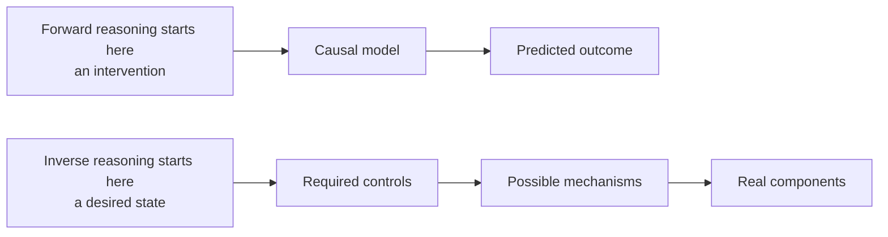
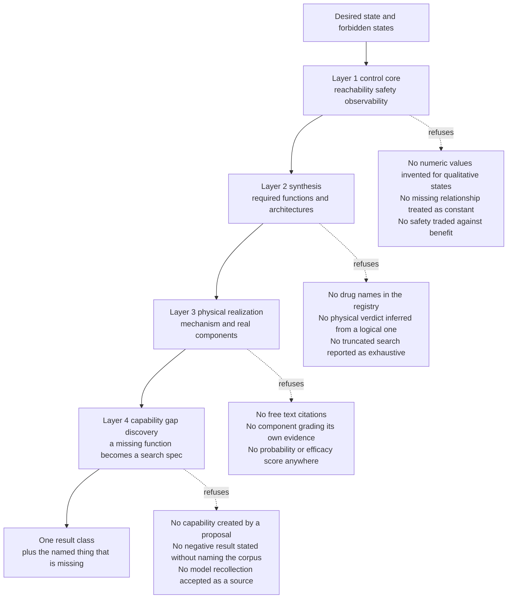
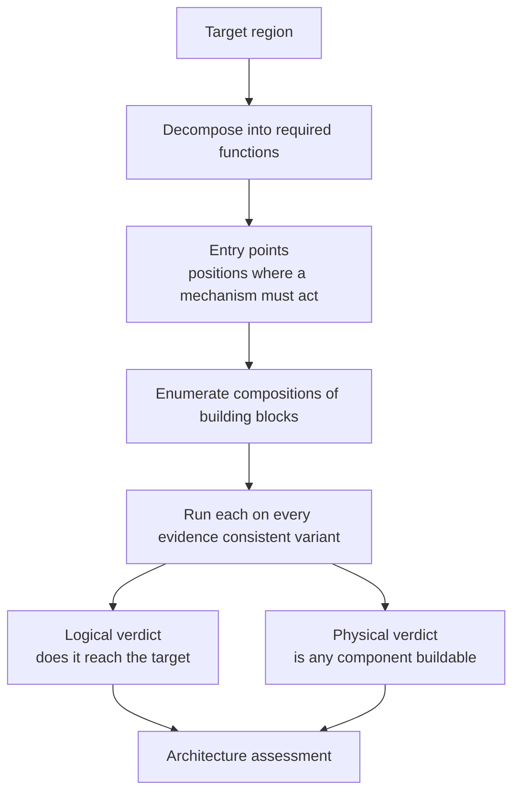
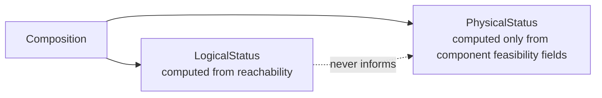

# The control compiler

**What this page is for.** This is the conceptual heart of rarepipe. The stages before it establish
what a case contains and what the published record says about it; the control compiler asks a
different kind of question — *given the biological state we have and the state we want, what would
have to be controlled to get from one to the other, and is there any known way to do it?* Read this
if you want to understand the inverse formulation, the four layers that implement it, why
"mathematically synthesizable" and "physically buildable" are kept rigidly apart, and why a run
that ends in **"we cannot build this yet, and here is exactly what is missing"** is a success rather
than a failure. It assumes no background in control theory, and it names the real modules so you can
read the code next.

Everything on this page is a statement about software and about published evidence. Nothing here is
a therapy, a dose, a treatment plan or a clinical claim, and the compiler is built so that it cannot
produce one.

---

## 1. The inverse problem

Most computational biology runs forward: *perturb this, predict what happens*. That is useful, and
it is the wrong starting question when the thing you actually want is a specified cellular state
and you have no idea which lever reaches it.

The control compiler inverts the direction.



Formally, the compiler is handed one problem

```
P = (X0, X_target, X_unsafe, M, U, Y, E)
```

and asks a single question: **is there a control strategy that drives *every* evidence-compatible
initial state into the target region, without *any* trajectory passing through a forbidden state?**

| Symbol | What it is | Where it lives |
|---|---|---|
| `X0` | the set of states the case could currently be in | computed in `uncertainty.initial_states` |
| `X_target` | what counts as success, as a conjunction of membership predicates | `target_constraints.TargetRegion` |
| `X_unsafe` | forbidden states, as a disjunction | `safety_constraints.UnsafeRegion` |
| `M` | one or more causal models, each with its unknowns made explicit | `dynamics.Model` |
| `U` | candidate control variables — biological transformations, never drugs | `controls.ControlVariable` |
| `Y` | what an experiment can actually measure | `observability.ObservationModel` |
| `E` | what the case evidence says about the current state | `uncertainty.StateEvidence` |

The entry point is `compile_problem()` in
[`src/rarepipe/stages/control/compiler.py`](../../src/rarepipe/stages/control/compiler.py). A
`Problem` is a frozen object constructed in code — it is not parsed from a user-supplied file — and
the output is one immutable `ControlCompilationReport` carrying exactly one `ResultClass`, a content
digest, and the reasons behind the headline. The compiler version string is
`control-compiler-0.1.0`.

### Why "we cannot answer this" is a result

For a rare-disease case, the honest answer is usually that the decision turns on one specific thing
nobody has measured. A system that resolves that into a confident prediction has destroyed the only
information worth having. So the compiler has seven legitimate endings, and five of them are
non-answers with the blocker named:

| `ResultClass` | What it means, in the compiler's own words |
|---|---|
| `CONTROL_SOLUTION_CANDIDATE` | a causally defensible strategy reaches the target under the single accepted model |
| `ROBUST_CONTROL_SOLUTION_CANDIDATE` | a strategy reaches the target under every evidence-compatible model and every candidate for each unknown relationship |
| `CONTROL_INDETERMINATE` | whether the target is reachable depends on something not yet known; the blocker is named |
| `CURRENTLY_UNCONTROLLABLE` | unreachable under the current model and the current control set — not biologically impossible forever |
| `TARGET_SPECIFICATION_INCOMPLETE` | success has not been sufficiently defined, so reachability cannot be evaluated |
| `OBSERVABILITY_INSUFFICIENT` | a route may exist, but the available measurements cannot establish that it was taken or that it stayed safe |
| `MODEL_DISAGREEMENT` | evidence-compatible models imply materially different control strategies |

Those sentences are not documentation. They live in `MEANING` in
[`result_types.py`](../../src/rarepipe/stages/control/result_types.py) and are rendered into every
report, specifically so that `CURRENTLY_UNCONTROLLABLE` cannot be misread as "biologically
impossible".

The headline is also ordered so it can never overstate. `compile_problem` applies a fixed
precedence — most fundamental limitation first:

1. `TARGET_SPECIFICATION_INCOMPLETE` — success is not defined, so nothing else can be evaluated.
2. `CONTROL_INDETERMINATE`, fail-closed — a relevant variable has no defining relationship, an
   unknown is too broad to enumerate, or no model variant is consistent with the evidence.
3. A strategy that reaches the target under every consistent variant with every control's
   feasibility established — robust if more than one variant was in play, otherwise plain; unless
   its target or safety cannot be observed, which gives `OBSERVABILITY_INSUFFICIENT`.
4. `MODEL_DISAGREEMENT`.
5. `CONTROL_INDETERMINATE` — something works somewhere but not unconditionally; every blocker named.
6. `CURRENTLY_UNCONTROLLABLE`.

And the report validates itself. A model validator on `ControlCompilationReport` raises if the
contents do not support the class it carries: a solution class requires a strategy that is robust,
feasible and safe under every consistent variant; `CONTROL_INDETERMINATE` must name what blocks it;
`MODEL_DISAGREEMENT` must name the disagreement; `CURRENTLY_UNCONTROLLABLE` is refused outright if
any strategy worked anywhere. There is no result by prose.

---

## 2. The layer stack, and what each layer refuses to do

Four layers sit on top of one another. Each takes the previous layer's output as a specification and
each refuses a specific tempting shortcut. The refusals are the design.



A rule that cuts across all four: **reason with agents, prove with code.** Language-model skills may
propose states, mechanisms, routes, controls, building blocks and experiments. Only deterministic
code decides reachability, safety, observability, robustness, entitlement and whether anything was
found. The boundary is enforced in
[`proposals.py`](../../src/rarepipe/stages/control/proposals.py), and section 7 describes it.

---

## 3. Layer 1 — the control core

A dozen small modules, each carrying one concept. Read them in this order.

### State space — qualitative values stay qualitative

[`state_space.py`](../../src/rarepipe/stages/control/state_space.py) defines `Variable` and
`StateSpace`. Variables are `CATEGORICAL` or `ORDINAL` only. The notable thing is what it refuses:

- An `INTERVAL` variable **raises at construction**, with a message saying to add an adapter to an
  established solver rather than discretising silently. Nothing here maps `impaired` to 0 and
  `normal` to 1 to make arithmetic convenient.
- An ordinal variable must state what its order means, or the order is arbitrary.
- Declaring a variable `exogenous` asserts that nothing in the model drives it, so it must say why —
  otherwise a missing relationship is being hidden behind a flag.

### Dynamics — there is no third state

[`dynamics.py`](../../src/rarepipe/stages/control/dynamics.py). A `Relationship` is either a
**total explicit lookup table** (`RelationshipKind.TABLE`, validated to cover every input
combination and to produce only in-domain values) or **explicitly `UNKNOWN_FUNCTION`**. There is no
third state in which a relationship is merely absent and the variable quietly keeps its value.

That distinction is load-bearing twice over. A single unresolved relationship produces
`CONTROL_INDETERMINATE` naming it. Two *fully specified*, evidence-compatible models that disagree
produce `MODEL_DISAGREEMENT`. The compiler treats "we do not know this function" and "two camps
disagree about this mechanism" as different results, because they call for different work.

A `NamedHypothesis` lets a specific candidate function carry a label, so a competing mechanistic
hypothesis appears in the output by name rather than as `unnamed_3`.

### Uncertainty — unknowns are sets, fixed per trajectory

[`uncertainty.py`](../../src/rarepipe/stages/control/uncertainty.py) does two things.

**Unknown functions are universally quantified.** An `UNKNOWN_FUNCTION` expands into every function
consistent with what is known about it; each candidate becomes a separate `Variant`, and the
function is **held fixed for that variant's entire trajectory**. Biology does not change its laws
mid-experiment, and letting the search pick the unknown's value afresh at each step would let it
exploit ignorance and report reachability no single biology supports. Enumeration is capped
(`CANDIDATE_LIMIT = 64`, with a pre-check at sixteen times that) and raises `TooBroadToEnumerate`
rather than truncating.

**The initial state is a set.** `X0` is every state that is both compatible with the recorded
evidence and at steady state under that variant's uncontrolled dynamics. A variant admitting no such
state is **falsified by the evidence** — it is excluded, and reported as excluded, because "the
strategy works for every initial state" is vacuously true of an empty set. `run_strategy` raises
rather than accept an empty `X0`. Separately, a `SIMULATED_PREDICTION` is refused as state evidence:
simulation is not observation.

### Reachability — all interleavings, hard safety

[`reachability.py`](../../src/rarepipe/stages/control/reachability.py) is the finite-state engine,
and its semantics are chosen rather than inherited:

- **Asynchronous updates, every interleaving.** With controls held, any relationship whose output
  disagrees with its function may fire. Biology chooses the order, so every reachable state under
  every interleaving is explored by breadth-first search. A step is safe only if *none* of them is
  unsafe. Finding one path that happens to dodge the unsafe region would not be a control guarantee.
- **Attractors, not single paths.** After a step, the belief is wherever the system settles: the
  union of the terminal strongly connected components, found with an iterative Tarjan.
- **Safety aborts early and returns the path.** The offending trajectory comes back with the
  violated constraint ids, so the rejection is inspectable.
- **Controls accumulate and are held.** Release is not modelled in the core engine: exogenous
  variables have no restoring dynamics here, and allowing release would let a transient control lock
  in an effect no mechanism maintains.
- **Everything that reaches an output is sorted.** Iterating a set of string tuples gives a
  different order in every process under hash randomisation — which is exactly how a "fixed" result
  stops being reproducible, and would silently break the content digest.

Strategy search is breadth-first over subsets of the remaining controls, bounded by `max_depth`
(1–6, default 3). Caps raise; they never degrade quietly.

### Controllability — a blocker has to earn the name

[`controllability.py`](../../src/rarepipe/stages/control/controllability.py) turns per-variant
outcomes into what can honestly be said. The important derivation: an unknown relationship **blocks**
a strategy only if flipping that relationship's candidate, with everything else held fixed, flips
the outcome. An unknown that does not change the answer is reported in `irrelevant_unknowns`, not as
a blocker — over-reporting blockers hides the real one in noise. The consequence to understand is
that the blocker list is deliberately *narrower* than the list of things nobody knows.

It also derives per-model `ALL` / `SOME` / `NONE` verdicts, flags model disagreement, and names
feasibility blockers by control id.

### Observability — can we tell that we caused it?

[`observability.py`](../../src/rarepipe/stages/control/observability.py) runs two checks, kept
separate because they fail for different reasons.

1. **Direct observation.** Every variable the target or safety is defined on must be measured by the
   verifying experiment. Safety in particular **cannot be certified by a model's prediction that a
   variable will not move** — the model's omissions are precisely why that variable is measured, and
   using the prediction in its place would be treating simulation as observation.
2. **Distinguishability.** Two states that project to identical measurements cannot be told apart.
   When they differ in something that matters, the observation set is insufficient for that question.

### Objective — lexicographic, and safety is not a term

[`objective.py`](../../src/rarepipe/stages/control/objective.py) explicitly refuses the familiar
weighted form `J(u) = αD + βR + γC + δU`: none of the four weights is grounded for this case, and
choosing them would be inventing constants. Ranking is lexicographic with safety as the **first
key**. A strategy unsafe under any evidence-consistent variant ranks below every strategy that is
safe under all of them, however many variants it works in. No amount of benefit can buy back a
safety violation, because the two are never added together.

### Controls — biological transformations, never drugs

[`controls.py`](../../src/rarepipe/stages/control/controls.py). A `ControlVariable` says *"this
protein's abundance is held at restored"*, never *"administer compound X"*. There are 13
`BiologicalControlKind` values and 7 `RouteClass` values — `REPAIR`, `STABILIZATION`,
`COMPENSATION`, `BYPASS`, `SUPPRESSION`, `REPLACEMENT`, `REWIRING`. Repair is one family among
seven and is not the privileged one; the target is the invariant and the route is solved for.

A control that declares a release value must state what returns the variable there, or stability
would rest on an unstated mechanism.

### Target and safety — separate, first-class, and accountable

The target region ([`target_constraints.py`](../../src/rarepipe/stages/control/target_constraints.py))
is a conjunction describing **what the cell must achieve**, deliberately not how. Restoring a
protein's abundance is a candidate *route*, so it is kept out of the target definition — otherwise
any synthetic route reaching the same functional endpoint another way would be rejected for taking
the wrong path.

The unsafe region ([`safety_constraints.py`](../../src/rarepipe/stages/control/safety_constraints.py))
is a disjunction checked as a hard filter on every state a trajectory can visit.

Both carry an `Approval`. `APPROVED` requires a named **human** holding a scientific-lead or
treating-clinician role; an agent cannot approve a target or a safety definition. A constraint whose
threshold nobody has set is `UNSPECIFIED`, must say so, and must omit its predicate — at which point
the compiler returns `TARGET_SPECIFICATION_INCOMPLETE` rather than guessing.

### Experiment design — which measurement would settle it

[`experiment_design.py`](../../src/rarepipe/stages/control/experiment_design.py) picks the
measurement whose reading differs between the surviving possibilities: a variable discriminates two
groups of variants when the sets of values it can take under them are **disjoint**, so one reading
identifies the group.

The subtle half is the confounding check. A reading only discriminates if nothing outside the model
could produce it. If the measured variable descends from an exogenous variable the experiment does
not hold, that variable could move for reasons the model omits and fake the reading — so it is
listed in `confounded_by`, and the compiler credits an experiment only when it measures those
confounders too. A `DiscriminatingMeasurement` whose confounders go unmeasured is reported, not
counted.

Expected information gain is deliberately **not** computed: it needs a probability distribution over
the variants, none is grounded here, and fabricating one would put a made-up number at the centre of
the experiment choice.

### Actuators and external models come last, and for a reason

Two registries are consulted only after the control question has an answer.

`map_actuators()` in
[`actuator_registry.py`](../../src/rarepipe/stages/control/actuator_registry.py) raises
`RouteRequired` if no control lies on a route that reaches the target under at least one
evidence-consistent variant. There is no intervention list before a control objective exists. When
it does run, it lists `ActuatorClass` options with their own evidence and an explicit note that none
is recommended and none has been assessed for feasibility in the relevant cell type.

`admit()` in [`model_registry.py`](../../src/rarepipe/stages/control/model_registry.py) imports an
external model only if it supplies a relationship for a currently unresolved control variable or a
required benchmark. Otherwise it is refused with the reason stated in the code: *"it would add
detail where nothing is in doubt and resolve nothing that is."*

### Fail-closed: missing is not constant

`_missing_relationships` in `compiler.py` walks the causal ancestors of every target and safety
variable. A non-exogenous variable with no defining relationship produces a blocker of the form
`missing_relationship:<name>` and the compiler stops. Treating it as constant would fill an unknown
with an assumption nobody made.

---

## 4. Layer 2 — synthesis

The control core answers *"do these candidate controls reach the target?"*. The synthesis layer
([`src/rarepipe/stages/control/synthesis/`](../../src/rarepipe/stages/control/synthesis/)) answers
the prior question: *"given the target state, what architectures could produce it at all?"*



### The inversion

[`requirements.py`](../../src/rarepipe/stages/control/synthesis/requirements.py) turns the target
region into `RequiredFunction` records. For each constraint it computes the values the variable
actually takes across the evidence-consistent initial states, the causal ancestors through which it
could be moved, the **entry points** — ancestors that nothing in the model drives, so a mechanism
has to act *there* — and the unresolved relationships lying between an entry point and the
requirement.

The entry points are the specification handed onward. They say **where** a mechanism must act and
never **what** mechanism. That separation is the whole reason the layer exists.

### A registry of what a piece can *do*

[`building_blocks.py`](../../src/rarepipe/stages/control/synthesis/building_blocks.py) is the
design decision this page most wants you to notice. A registry of drug names would answer "what
could we give?", which is the question the project is built to stop asking first. A `BuildingBlock`
is stored as a typed transformation of state — *holds this variable at this value, in this cell
type, under these conditions* — with its direction, scale, reversibility, validity domain,
uncertainty, provenance and its own feasibility status. Components therefore compose without the
compiler ever consulting a therapeutic indication.

Two validators keep it honest:

- **Off-target and population effects are transformations too.** A block that depletes a population
  declares that as a state transformation, not a footnote, so the hard safety filter sees it. A
  declared risk living only in prose cannot reject anything.
- **Reversibility must say what reverts.** A reversible block must give a release value for every
  transformation *and* say what returns it. A magnitude or time dependence with no citation is
  refused outright — it is left empty unless measured, never estimated.

### Composition and search

[`composition.py`](../../src/rarepipe/stages/control/synthesis/composition.py) translates a
composition into the control strategy the existing reachability engine already understands, so the
engine's guarantees apply unchanged. It owns three composition-level checks: a conflict (one
variable held at two values) is **refused rather than resolved by sort order**; a block's declared
precondition is checked against the belief at the step where it acts; and `order_matters` re-runs
permutations plus the all-at-once collapse, so `SEQUENTIAL` is called load-bearing only when some
alternative actually gives a different verdict.

[`search.py`](../../src/rarepipe/stages/control/synthesis/search.py) enumerates typed compositions
deterministically — not free generation by an agent — bounded by `COMPOSITION_LIMIT = 25_000` and
raising `TooBroadToSynthesize` instead of truncating. The reason is stated in the module: a silently
truncated search would report "no architecture found" in the same words as an exhaustive one.
`_minimal()` then drops any architecture whose component set strictly contains a reported one with
the same outcome, so no free passenger is presented as load-bearing.

### The two verdicts, and why they never merge

[`synthesizability.py`](../../src/rarepipe/stages/control/synthesis/synthesizability.py) is sixty
lines long and is the most important file in the layer:



- `LogicalStatus` — `TARGET_REACHABLE`, `REACHABLE_UNDER_SOME_MODELS`, `TARGET_UNREACHABLE`,
  `UNSAFE`, `NOT_REPRESENTABLE`. A composition reaching the target *in the mathematics*.
- `PhysicalStatus` — `PHYSICALLY_FEASIBLE`, `SYNTHETIC_ROUTE_FEASIBILITY_UNKNOWN`,
  `PHYSICALLY_INFEASIBLE`. Computed from the components' own feasibility fields **and nothing
  else**.

`physical_status()` reads only `BuildingBlock.feasibility_status`. It never looks at the logical
result. And `ArchitectureAssessment`'s validator in
[`architecture.py`](../../src/rarepipe/stages/control/synthesis/architecture.py) raises if a report
tries to be `PHYSICALLY_FEASIBLE` while any component has no established implementation:
*"logical synthesizability does not transfer."* `TARGET_REACHABLE` must name the variants it holds
under; `ROBUST_CONTROL_CANDIDATE` is impossible with any failing variant.

Alongside those sit `RobustnessClass` (robustness over the set of evidence-compatible models, where
`MODEL_DISAGREEMENT` outranks the favourable half) and `StabilityClass`, where
`UNKNOWN_STABILITY` is the default whenever withdrawal cannot be evaluated — the absence of a decay
mechanism is never read as a maintenance mechanism.

### Overrides are named, not absorbed

If an architecture holds a variable that a model relationship already defines, that relationship is
listed as **overridden**, with its epistemic status. A bypass works precisely by asserting that some
mechanism can supply a value the model attributes elsewhere, so each override becomes an unmet
requirement of its own; overriding an *established* relationship earns an extra note saying it
contradicts the best-supported part of the model. This is intentional friction.

### Synthesis result classes

| `SynthesisResultClass` | Meaning |
|---|---|
| `ARCHITECTURE_SYNTHESIZED` | reaches the target under every evidence-compatible model, stays safe, and every component's implementation is established |
| `SYNTHETIC_ROUTE_FEASIBILITY_UNKNOWN` | reaches the target in the mathematics, but at least one declared transformation has no demonstrated way to implement it — **a successful output, not a failure** |
| `ARCHITECTURE_INDETERMINATE` | depends on biology that is not yet known; the blockers are named |
| `ARCHITECTURE_MODEL_DISAGREEMENT` | evidence-compatible models imply different architectures |
| `ARCHITECTURE_OBSERVABILITY_INSUFFICIENT` | measurements cannot distinguish it from a process that merely looks the same |
| `NO_ARCHITECTURE_SYNTHESIZED` | no composition of the registered blocks reaches the target safely — not a claim that none exists |
| `SPECIFICATION_INCOMPLETE` | what counts as success is not sufficiently defined |

The report additionally carries a byte-fixed no-treatment-recommendation statement that a model
validator forbids rewording, and a narrow scan over all free text that raises if the report advises
rather than reports. The scan is a fixed phrase list, tested *not* to fire on ordinary scientific
language such as "dose-dependent" or "the authors recommend caution".

---

## 5. Layer 3 — physical realization

A logically sufficient design is not something anyone can build. The realization layer
([`src/rarepipe/stages/control/realization/`](../../src/rarepipe/stages/control/realization/))
tries to cross that frontier and is built to refuse to fake it. It forces one decomposition:

```
required function  ->  mechanism  ->  biological operation  ->  physical piece
```

and every step must cite an evidence claim the repository already holds.

### Citations must resolve, and nothing grades itself

[`evidence.py`](../../src/rarepipe/stages/control/realization/evidence.py) builds the evidence
inventory by walking the case's own causal chain rather than typing in biology. On the current
checkout `inventory_from_repo()` returns **16 evidence edges, 13 of them carrying one of 5
references** (verified by running it). A `Capability` cites edge ids in `evidence_edges`, never
free text, and `EvidenceInventory.edge()` raises `Unentitled` for an id the repository does not
hold — so an invented citation has nothing to resolve against and is refused rather than graded.

A `PhysicalPrimitive` has no entitlement field to set. `entitle()` derives what a step may claim
from the support level the chain already recorded. **A component cannot grade its own evidence.**

### Two questions kept apart

- **Entitlement** asks whether the evidence supports the mechanism at all. `Entitlement` has six
  values: `SUPPORTED`, `CONDITIONAL`, `UNSUPPORTED`, `CONTRADICTED`, `UNKNOWN`, `CONTEXT_MISMATCH`.
- **Transfer gap** asks the separate question of whether the measurement was made in the system this
  case needs. Folding the second into the first would make every step fail for the same blanket
  reason and hide which step actually breaks.

### The burden is read, not set

`EpistemicBurden` is derived from the epistemic status of the relationship being replaced —
`unresolved`, `assumed` or `established` — not from whoever proposes the realization. The
`SUFFICIENT_ENTITLEMENT` table in
[`kinds.py`](../../src/rarepipe/stages/control/realization/kinds.py) then sets the bar: replacing an
established relationship requires `SUPPORTED`; `CONDITIONAL` is only ever enough where the thing
being replaced is itself unsettled.

### Realization results

`RealizationResult` has seven members, and only the first is a chain of real components with
sufficient evidence — *and even that is a candidate, not a demonstrated treatment*:

| Result | Meaning |
|---|---|
| `GROUNDED_REALIZATION_CANDIDATE` | every required transformation has a chain of real components whose evidence meets the burden |
| `PARTIAL_REALIZATION` | some transformations grounded, at least one not; the missing piece is named exactly |
| `NO_GROUNDED_REALIZATION` | nothing found in **this registry and this inventory** — a statement about what we hold, not about biology |
| `CONTEXT_MISMATCH` | a mechanism exists, but the evidence came from a different agent, compartment or system |
| `EVIDENCE_INSUFFICIENT` | a plausible proposal exists, but the evidence does not entitle turning it into a transformation of the model |
| `UNSAFE_REALIZATION` | the required function is produced by a route that enters a forbidden state |
| `NOT_REPRESENTABLE` | the mechanism needs variables the state model cannot represent |

[`checks.py`](../../src/rarepipe/stages/control/realization/checks.py) runs nine deterministic
checks — sign, direction, connectivity, dependency, compatibility, safety, confounding, provenance
and redundancy — and `assess()` resolves their findings through a fixed `STATUS_ORDER`. Safety is a
**filter** that returns `UNSAFE_REALIZATION` first; it is never a cost weighed against a benefit.

And there are no numbers anywhere in this layer. No probability of success, no efficacy score, no
model-generated confidence — the module docstring says so, because none of them would come from a
justifiable distribution.

---

## 6. Layer 4 — capability-gap discovery

When realization says *"we would need a piece that does X"*, that sentence is the beginning of the
next computation rather than the end of the run.
[`src/rarepipe/stages/control/discovery/`](../../src/rarepipe/stages/control/discovery/) turns it
into a formal object.

### A gap is a specification, not a question

[`gaps.py`](../../src/rarepipe/stages/control/discovery/gaps.py) defines `CapabilityGap`: the
required transformation, required input and output, required value and direction, the
`forbidden_dependencies` that make a bypass a bypass, the `RequiredContext` (agent, compartment,
system), the biological scale, forbidden states, and the epistemic burden. `specification()` reduces
it to a `SearchSpecification` handed to providers.

The module states the reasoning plainly: *"Investigate the checkpoint"* invites a model to retrieve
whatever it associates with the word; a contract stating the required output, the forbidden
dependency and the context is something a provider can be **wrong about in a way a validator can
catch**.

### Validators decide what exists

[`validators.py`](../../src/rarepipe/stages/control/discovery/validators.py) runs 19 named
deterministic checks over each candidate — `vocabulary`, `provenance`, `sources_resolve`,
`contradiction`, `entity_match`, `input_match`, `output_match`, `direction_match`, `gap_direction`,
`span_grounded`, `causal_grade`, `effect_constitutes_state`, `forbidden_named_in_span`,
`chain_complete`, `forbidden_dependency`, `independence_asserted`, `context_match`,
`forbidden_state`, `source_verified`. `build()` is the **only** constructor of a
`GroundedCapability` and raises `NotEntitled` on anything the validators did not pass.

Three subtleties worth knowing if you extend this:

- **A quoted span must appear verbatim in the stored document** after whitespace normalisation only.
  A paraphrase fails as `SPAN_NOT_GROUNDED`.
- **The ancestry walk starts from the candidate's own mechanism**, not upward from the required
  output. Walking upward would find the forbidden component for *every* candidate, because the
  inventory records precisely that it drives these outputs — that is why the gaps exist. The wrong
  version of this was shipped first; the docstring now says why.
- **Independence is never a default.** A newly discovered entity has no ancestry in the inventory at
  all, so an ancestry check alone would certify anything unfamiliar as independent. A bypass
  candidate no source asserts independence for is `INDEPENDENCE_UNESTABLISHED`.

### Three verification levels that never merge

`SOURCE_VERIFIED` (the paper exists and says this) → `CLAIM_GROUNDED_IN_SOURCE` (it really is about
this entity, input, output and direction) → `CAPABILITY_ENTITLED_FOR_CONTEXT` (and it transfers
here). Only the third licenses a grounded capability.

### Bounded negatives

`GapResult` has six members, and **every negative names the universe inspected rather than the
world**: `CAPABILITY_FOUND`, `PARTIAL_CAPABILITY`, `ONLY_DEPENDENT_CAPABILITIES_FOUND`,
`CONTEXT_ONLY_CAPABILITY`, `CONTRADICTED_CAPABILITY`, `NO_GROUNDED_CAPABILITY`. The report prints
each provider's corpus size, the queries and the counts, so a null from a 16-claim inventory cannot
read the same as a null from a literature index.

`ONLY_DEPENDENT_CAPABILITIES_FOUND` is a *stronger* negative than `NO_GROUNDED_CAPABILITY`, not a
weaker one: candidates were found and every one routes through the forbidden node.

### The recompile delta is the result

This is what makes the layer more than retrieval. A newly grounded capability is converted into a
physical primitive, its claim is added to the realization inventory, the architecture is
**recompiled**, and the delta is reported — including when the delta is zero, with its reason. The
headline metric in `DiscoveryReport` is not papers or candidates but
`interfaces_whose_state_changed`: previously-open functional interfaces whose epistemic state moved
against a recorded baseline.

Retrieval and compilation are separate steps. The networked tool
[`tools/control/retrieve_capability_evidence.py`](../../tools/control/retrieve_capability_evidence.py)
writes a frozen, versioned corpus snapshot of titles and abstracts; the compiler reads only that
snapshot, so verdicts are reproducible and CI needs no connectivity. A test asserts the compiler
never touches the network. There is deliberately **no provider that asks a language model what it
remembers about the literature** — a model's recollection is not a source. A model may propose where
to look and may read a retrieved document into a claim; it never establishes that anything exists.

---

## 7. The agent boundary

[`proposals.py`](../../src/rarepipe/stages/control/proposals.py) is where skills meet the compiler.
The rule that matters: **the gate assigns the epistemic type, never the proposer.** A guard keyed on
a flag the proposer sets is not a guard.

| An agent proposes | What the gate does |
|---|---|
| a relationship claiming to be established | enters as `INFERRED_HYPOTHESIS`, status forced to `unresolved` or `assumed` |
| a control it says is feasible | `feasibility` reset to `UNASSESSED`, with a note recording why |
| a building block with a magnitude | the magnitude field is stripped unless it came from a measurement |
| an architecture | enters as `PROPOSED_ARCHITECTURE`; the compiler, not the proposer, decides what it reaches |
| a target constraint | becomes `PROPOSED`, never `APPROVED` |
| anything claiming to be a `GROUNDED_CAPABILITY` | refused outright — that type is produced by the validators, so a proposal asking for it is asking to skip them |
| any payload containing a result-class word | refused; only the compiler produces a result, and never from prose |

`EpistemicType` in [`provenance.py`](../../src/rarepipe/stages/control/provenance.py) has 22 members,
and `promote()` is the only legal type change. It refuses to turn a derived type — a simulated
prediction, an inferred hypothesis, a proposed architecture — into an empirical one without an
external measurement to cite, because *a result produced by this software is not evidence for
itself*.

Seven control skills and eight synthesis skills live under `.claude/skills/control-*/` and
`.claude/skills/synthesis-*/`, and
[`tools/control/check_skills.py`](../../tools/control/check_skills.py) checks their vocabulary
against the compiler's.

---

## 8. What the first case actually compiles to

One case is encoded: a BUB1B / mosaic variegated aneuploidy problem in
[`mva.py`](../../src/rarepipe/stages/control/mva.py). The child's own missense allele is described
only at domain level — the kinase domain — which is the level the code itself treats as public
biology. No coordinate, no residue position and no variant notation attributable to the child
appears in any compiled report; `tests/test_realization_gates.py` and
`tests/test_discovery_gates.py` each carry a test asserting that no case-level genomic content
reaches their reports, and `tests/test_external_gates.py` asserts that no query in the committed
corpus snapshot was case-specific.

Verified by running the code on this checkout:

| | |
|---|---|
| State variables | 12, all categorical or ordinal |
| Causal models | 1 accepted model, 8 relationships |
| Unknown relationships | 1 (`REL_BUBR1_ABUNDANCE_FUNCTION`), with two named hypotheses `H01` and `H02` |
| Target constraints | 4 |
| Safety constraints | 3 |
| Candidate controls | 2 |
| Actuator candidates | 5 |
| Existing experiments compiled | 3 |
| Building blocks | 8 — **every one `unassessed`** |
| Architecture families asked about | 8 |
| Physical primitives | 6 |
| Candidate mechanism chains | 4 |
| Capability gaps | 4 |
| Frozen external corpus | 91 documents under `data/literature/mva-external-v1/` |

And the committed, regenerated reports:

| Layer | Result | Document |
|---|---|---|
| Control core | `CONTROL_INDETERMINATE`, also `OBSERVABILITY_INSUFFICIENT` and `TARGET_SPECIFICATION_INCOMPLETE`; target accountability `PROPOSED_UNAPPROVED` | [`MVA_CONTROL_MAP.md`](../control/MVA_CONTROL_MAP.md) |
| Synthesis | `SYNTHETIC_ROUTE_FEASIBILITY_UNKNOWN`, also `SPECIFICATION_INCOMPLETE`; 3144 compositions enumerated over 8 blocks at depth 2, 1492 dropped as non-minimal, 6 architectures reported, 17 discriminators of which 2 no existing experiment can read, 2 model variants carried and 1 excluded by the evidence | [`MVA_ARCHITECTURE_MAP.md`](../control/MVA_ARCHITECTURE_MAP.md) |
| Realization | `NO_GROUNDED_REALIZATION` for the bypass architecture; `CONTEXT_MISMATCH` for the abundance architecture | [`MVA_REALIZATION_BYPASS.md`](../control/MVA_REALIZATION_BYPASS.md), [`MVA_REALIZATION_ABUNDANCE.md`](../control/MVA_REALIZATION_ABUNDANCE.md) |
| Discovery | gap A `ONLY_DEPENDENT_CAPABILITIES_FOUND`, gaps B and C `NO_GROUNDED_CAPABILITY`, gap D `CONTEXT_ONLY_CAPABILITY`; **capabilities grounded: 0** | [`MVA_CAPABILITY_GAPS.md`](../control/MVA_CAPABILITY_GAPS.md), [`MVA_CAPABILITY_GAPS_EXTERNAL.md`](../control/MVA_CAPABILITY_GAPS_EXTERNAL.md) |

Read that table the way the compiler intends. Nothing was proven; nothing was recommended; nothing
can be built yet. What the run produced is a precisely located open problem: the strongest routes
reach the target state in the mathematics under every biology the evidence allows, the target
definition is still a proposal because no accountable scientist has approved it, the whole thing
turns on one unresolved relationship, no component has a demonstrated implementation, and 2 of the
17 discriminating measurements — both readings of the functional-sufficiency variable itself — are
ones that **no existing experiment in the case can take**, which the report labels a gap in the
measurement set rather than an experiment anybody can run. That paragraph is the output. It is more
useful than a ranked list of compounds would have been, and it is the only one the evidence
supports.

Every one of those documents is a **generated artefact**. The committed Markdown under
`docs/control/` is produced by the `tools/control/compile_mva*.py` scripts and staleness-tested in
CI: hand-editing a document to change a verdict fails the build. One renderer caveat for anyone
adding a second case — `render.py` hard-codes a case-specific sentence into the control map, so a
new `Problem` would need the renderer changed too, not just new data.

---

## 9. What is deliberately not built

Stated here because inventing plausible architecture is the worst thing this layer could do.

- **No numerical integrator, no ODE / interval / stochastic support.** Those formalisms are *named*
  in `model_registry.Formalism` and refused by this engine; `INTERVAL` variables raise at
  construction. The scale path is an adapter to an established solver, never silent discretisation.
- **No virtual cell**, no universal biomedical knowledge graph.
- **No drug, gene, molecule or protein catalogue**; no chemical search, docking, structure
  prediction, molecular dynamics, pharmacokinetics or delivery modelling.
- **No recommendation or ranking engine**, no treatment recommendation, no expected-information-gain
  scoring, and no probabilities anywhere in the realization or discovery layers.
- **Control release is not modelled in the core engine.** `ControlVariable.released_to` and
  `releasable` exist and are consumed only by the synthesis subpackage
  (`synthesis/stability.py`, `synthesis/feedback.py`); `reachability.py` holds controls permanently
  by design.
- **The full discovery loop has only ever fired on toy data.** Gates 11–15 of
  `tests/test_external_gates.py` exercise external source → grounded claim → grounded capability →
  architecture delta, but against in-memory toy corpora in `tests/external_toys.py`. On the real
  corpus the committed report records **capabilities grounded: 0**, and a staleness test
  byte-compares that report against a fresh compilation, so the figure cannot drift unnoticed.
- **Scaling is not addressed.** Strategy search is exponential in the control set, and
  `assess_composition` re-runs the reachability engine per candidate per variant. The caps
  (`max_depth ≤ 6`, `CANDIDATE_LIMIT = 64`, `STATE_LIMIT = 1 << 18`, `COMPOSITION_LIMIT = 25_000`)
  raise rather than degrade, which is correct and is not the same as scaling.
- **Only one case is encoded.** The core engine is case-agnostic; `mva.py`,
  `synthesis/mva_synthesis.py`, `realization/mva_realization.py` and `discovery/mva_gaps.py` are the
  one populated instance. The one populated primitive registry covers six of the thirteen
  declared `PrimitiveClass` component classes.

### Proof status

| Suite | Tests |
|---|---|
| `tests/test_control_gates.py` + `tests/test_control_invariants.py` | 29 |
| `tests/test_synthesis_gates.py` + `tests/test_synthesis_mva.py` + `tests/test_synthesis_invariants.py` | 80 |
| `tests/test_realization_gates.py` + `tests/test_discovery_gates.py` + `tests/test_external_gates.py` | 114 |

All 223 pass on this checkout (run during the writing of this page). Proof gates and invariants are
mapped requirement-by-requirement in [`REQUIREMENTS.md`](../control/REQUIREMENTS.md) and the
synthesis, realization, discovery and external requirements documents beside it. Those documents
also record that the gate suites were mutation-tested — each confirmed to fail when the property it
guards was deliberately broken. That mutation exercise is a recorded claim in the docs, not
something re-verified here.

---

## Where to go next

- **The design rationale, in the authors' own words** —
  [`docs/control/DESIGN.md`](../control/DESIGN.md) for the control core, then
  [`SYNTHESIS_DESIGN.md`](../control/SYNTHESIS_DESIGN.md),
  [`REALIZATION_DESIGN.md`](../control/REALIZATION_DESIGN.md),
  [`DISCOVERY_DESIGN.md`](../control/DISCOVERY_DESIGN.md) and
  [`EXTERNAL_DESIGN.md`](../control/EXTERNAL_DESIGN.md).
  A warning the repository gives itself: parts of those design documents predate a later
  evidence-repair phase and no longer match the generated reports. **Trust the generated reports and
  the code over the design prose**, and see
  [`MVA_EVIDENCE_REPAIR_DELTA.md`](../control/MVA_EVIDENCE_REPAIR_DELTA.md) and
  [`MVA_FULL_RECOMPILE_DELTA.md`](../control/MVA_FULL_RECOMPILE_DELTA.md) for what moved and why.
- **Requirement-to-test maps** — [`REQUIREMENTS.md`](../control/REQUIREMENTS.md),
  [`SYNTHESIS_REQUIREMENTS.md`](../control/SYNTHESIS_REQUIREMENTS.md),
  [`REALIZATION_REQUIREMENTS.md`](../control/REALIZATION_REQUIREMENTS.md),
  [`DISCOVERY_REQUIREMENTS.md`](../control/DISCOVERY_REQUIREMENTS.md),
  [`EXTERNAL_REQUIREMENTS.md`](../control/EXTERNAL_REQUIREMENTS.md).
- **The compiled case output** — start with
  [`MVA_CONTROL_MAP.md`](../control/MVA_CONTROL_MAP.md) (short) and then
  [`MVA_ARCHITECTURE_MAP.md`](../control/MVA_ARCHITECTURE_MAP.md) (long).
- **The space of experiments the case could run**, with every admissible outcome and no
  probabilities — [`MVA_CONTINGENT_ROUTE_MAP.md`](../control/MVA_CONTINGENT_ROUTE_MAP.md),
  generated from [`MVA_CONTINGENT_ROUTE_MAP.yaml`](../control/MVA_CONTINGENT_ROUTE_MAP.yaml).
- **Reading the code in the right order** — `result_types.py` → `state_space.py` → `dynamics.py` →
  `uncertainty.py` → `reachability.py` → `compiler.py`; then
  `synthesis/kinds.py` → `synthesis/synthesizability.py` → `synthesis/compiler.py`; then
  `realization/kinds.py` → `realization/evidence.py`; then `discovery/gaps.py` →
  `discovery/validators.py`. The enum modules are the clearest statement of what each layer believes.
- **Regenerating everything** — the `tools/control/compile_mva*.py` scripts. Only
  `tools/control/retrieve_capability_evidence.py` touches the network, and it is run deliberately.

Other pages in this wiki directory cover the case intake and normalization stages, the baseline
solver comparison, the mechanism-evidence dossier and the late submission tracks. This page is the
one that explains why the pipeline ends in a stated gap rather than a proposal.
