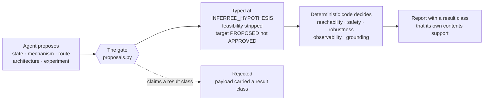

# Evidence discipline

This is the part of rarepipe that makes the rest of it worth trusting, and it is the hardest thing
to add later. Everything here is a rule about *what may be believed and on what grounds* — not a
style guide, not a review checklist. Each rule below is enforced somewhere in the code, and this
page says where.

It is written for researchers, clinicians, data collaborators, and any developer about to touch a
claim. You do not need to read the code to follow it, but every assertion names the file that
holds it so you can check.

The short version: a fluent narrative that reads like a result is the easy failure mode in
rare-disease work. Every mechanism on this page exists to make that failure expensive.

---

## 1. The epistemic ladder, and who gets to climb it

Every scientific statement in the system carries a class saying what kind of knowledge it is.
The vocabulary is closed, and it is short:

| `EpistemicClass` | Means |
|---|---|
| `observation` | Something was measured, in this case or in a cited one |
| `external_evidence` | A published source reports it |
| `derived_inference` | It follows from other recorded statements |
| `unknown` | Nobody has established it, and the record says so |

The vocabulary lives in
[`src/rarepipe/stages/mechanism/model.py`](../../src/rarepipe/stages/mechanism/model.py). Read it
and you will notice what is missing: **there is no class for "a model knows this".** The omission
is the point. An assistant's recollection of the literature is not a source, so anything an agent
produces must cite evidence the system holds or it becomes an `InvalidInference` — recorded with
its reason, and kept rather than quietly dropped.

A parallel ladder exists in the control compiler:
[`src/rarepipe/stages/control/provenance.py`](../../src/rarepipe/stages/control/provenance.py)
defines `EpistemicType` with 22 members, and `promote()` is the only legal way to change one. It
refuses to turn a derived result into an observation without an external citation.

### The gate assigns the type, never the proposer

This is the single most load-bearing rule in the project, and the reason the README's governing
line is *"Reason with agents. Prove with code."*

An agent may propose a state, a mechanism, a route, a control, an architecture or an experiment.
It submits a typed `Proposal` to the gate in
[`src/rarepipe/stages/control/proposals.py`](../../src/rarepipe/stages/control/proposals.py), and
the gate decides what that proposal *is*:

- An agent-proposed causal relationship enters as `INFERRED_HYPOTHESIS` at most.
- Agent-asserted feasibility is stripped and downgraded to `unassessed`.
- An agent-proposed target becomes `PROPOSED`, never `APPROVED`.
- No proposal may carry a result class at all. A payload containing a word from a vocabulary the
  compiler owns is rejected outright.
- The gate never assigns `GROUNDED_CAPABILITY`, `OBSERVED_EMPIRICAL` or `EXTRACTED_PARAMETER`, and
  refuses any proposal claiming to be a `GROUNDED_CAPABILITY`.

So an agent cannot promote its own work. Only deterministic code decides reachability, safety,
robustness, observability and whether anything was synthesized. And approval of a target or a
safety constraint requires a named human holding a scientific-lead or treating-clinician role —
`ActorType.HUMAN` is checked explicitly, so an agent cannot sign one.

One honest wrinkle, recorded because it bites: the gate's result-claim check is a case-insensitive
substring scan over the whole payload for every word in the compiler's result vocabularies — and
that includes the bare word `UNSAFE`. A perfectly honest proposal whose prose mentions avoiding
unsafe states gets rejected as "carrying a result class". The scan errs toward refusal on purpose.

---

## 2. Retrieval is not grounding

Finding a source and a source supporting your claim are two different questions, and conflating
them is how an evidence base rots. rarepipe keeps them in separate fields, separate code paths and
separate verdicts.

Three verification levels are tracked, and they are never merged
([`src/rarepipe/stages/control/discovery/`](../../src/rarepipe/stages/control/discovery/)):

| Level | What it establishes |
|---|---|
| `SOURCE_VERIFIED` | The paper exists and says this |
| `CLAIM_GROUNDED_IN_SOURCE` | It really is about this entity, this input, this output, this direction |
| `CAPABILITY_ENTITLED_FOR_CONTEXT` | …and it transfers to the system this case needs |

Only the third licenses a `GROUNDED` verdict. `validators.build()` is the only constructor of a
`GroundedCapability` and it raises `NotEntitled` unless the assessment can actually ground.

The same split appears in the mechanism stage as `TaskProgress` / `TaskState`, which track
`retrieval`, `deterministic_extraction`, `semantic_review` and `adjudication` **separately** —
because fetching documents is not reading them. Today three public knowledge tasks sit at
`DETERMINISTICALLY_EXTRACTED`: retrieved, pattern-matched, never read by a reasoning process. The
model makes that visible rather than letting it pass as done.

### Scope: the distinction the mechanism stage exists to preserve

A `Scope` travels with every claim: `exact_variant`, `same_residue`, `nearby_variant`,
`variant_class`, `gene_level`, `disease_level`. Evidence about *other* variants in the same protein
domain is `variant_class`, and it **cannot** stand in for an `exact_variant` claim. A claim at
`exact_variant` or `same_residue` scope is rejected outright unless at least one cited document
actually mentions the case's own residue — checked locally, against the private artifact, with
nothing leaving the machine.

### Establishing vs indirect evidence

Not every source that bears on a claim may decide it. The `MEASURED` set in
[`src/rarepipe/stages/mechanism/stage.py`](../../src/rarepipe/stages/mechanism/stage.py) names the
levels that can *establish* a claim. A computational predictor score or a protein-domain annotation
lands in `indirect_evidence`: visible on the claim, unable to change its status. A claim with no
establishing evidence stays `UNRESOLVED` with `epistemic_class = unknown` and a stated
`unknown_reason`.

Two further guards sit on top:

- **A topic guard.** Per-claim regexes stop a sentence counting as evidence for a claim it is not
  about — a sentence about transcript levels cannot satisfy a nonsense-mediated-decay claim.
- **Independence groups.** Correlated predictors are not independent witnesses. A composite score
  records what it `embeds`, so a report can say how many genuinely independent sources sit behind
  a bundle instead of counting the same model three times.

And a subtlety worth stating because it inverts intuition: in both `EvidenceClass.rank` and
`EvidenceLevel.rank`, **a lower number means stronger**. `min()` finds the best evidence. A
predictor cannot outrank an assay.

---

## 3. Every quote is re-found in the stored source

No statement enters the record on the strength of someone — human or model — reporting what a paper
said. The quote has to be found again, verbatim, in the document the system actually holds.

Three code paths enforce it, each at its own boundary:

| Path | Where | Behaviour on failure |
|---|---|---|
| `extract.verify` | [`mechanism/extract.py`](../../src/rarepipe/stages/mechanism/extract.py) | Source must be in the corpus and the quote re-found in stored text; otherwise the record becomes an `InvalidInference` and is **kept**, not dropped |
| `research.import_analysis` | [`mechanism/research.py`](../../src/rarepipe/stages/mechanism/research.py) | A proposal is rejected unless every cited source was retrieved into the bundle and every quote is found in the stored document |
| `experiments.load_experiments` | [`mechanism/experiments.py`](../../src/rarepipe/stages/mechanism/experiments.py) | Readout, identity and authors'-interpretation quotes are each re-verified on load; **one failure rejects the whole file** |

A quoted span must appear after whitespace normalisation only. A paraphrase fails
(`SPAN_NOT_GROUNDED`). The matching is deliberately not uniform across paths —
`extract.verify` does an exact raw substring check while the research and experiment loaders
collapse whitespace, strip tags and lowercase first — so a quote that passes one path can fail
another. That asymmetry is a real gotcha, not a design flourish.

A citation also has to *resolve*. In the realization layer, an invented citation has nothing to
resolve against and is refused as `Unentitled` rather than graded; in discovery, a cited id no
provider returned is marked `FABRICATED`. There are no free-text citations anywhere in the physical
layers, because a physical layer could be populated with invented biology faster than anyone could
check it.

---

## 4. A bounded negative is a statement about the corpus, never about biology

"We did not find it" and "it is not there" are different claims. The system is built so the first
can never render as the second.

Every negative result names the universe that was inspected. Reports print each provider's corpus
size, the queries run and the counts returned, so a null from a 16-claim internal inventory cannot
read the same as a null from a literature index. Three states are kept structurally apart that are
usually collapsed into one: **provider unavailable**, **search returned zero documents**, and
**search returned documents in which nothing survived validation**.

The route map's terminal vocabulary makes the same distinction in the case data: it has separate
terminal states for `SEARCHED_EXTERNAL_UNIVERSE_EXHAUSTED`, `NOT_IN_LOCAL_CASE_CORPUS` and
`PHYSICALLY_INCOMPATIBLE_WITH_EVIDENCE`. The strongest of the three has to earn it.

Elsewhere the same rule shows up as:

- `SearchOutcome` carries a `does_not_mean` field in the artifact itself, so
  `NO_EVIDENCE_FOUND` cannot render as "shown not to work"
  ([`stages/discovery/model.py`](../../src/rarepipe/stages/discovery/model.py)).
- A search that found nothing produces **no experience record at all** — it becomes an unresolved
  evidence need and a generated query for a future data holder.
- A missing search is reported as `none_looked_for`, never as clearance
  ([`stages/simulate/negatives.py`](../../src/rarepipe/stages/simulate/negatives.py)).
- Operational refusals can never become evidence: `NO_RESPONSE`, `NOT_SEARCHED`, `ACCESS_DENIED`
  and `CANNOT_DISCLOSE` are classified `may_become_observation=False`, so "they would not tell us"
  never becomes "measured, no effect".
- Negative and non-results get a durable, append-only, content-addressed store with a discriminated
  union that keeps *measured and found nothing*, *informative negative with validated controls and
  power*, and *nobody looked* as structurally different records. No update, no delete.

And an ordering that reads backwards until you see why: `ONLY_DEPENDENT_CAPABILITIES_FOUND` is a
**stronger** negative than `NO_GROUNDED_CAPABILITY`. Candidates were found, and every one routes
through the forbidden dependency. When two gaps moved from the former to the latter that was
progress — three candidates now failing for three different named reasons instead of sharing one
blocker.

---

## 5. The backward evidence audit

Every rule above constrains what enters. None of them helps with what is already believed. So the
grounding rule gets run **in reverse**, over the citations the project already rests on.

[`discovery/external/citation_audit.py`](../../src/rarepipe/stages/control/discovery/external/citation_audit.py)
derives one attribution per cited chain edge, checks the endpoints' literature spellings against
the retrieved document, and grades it. It is **asymmetric by construction**: it can disqualify an
attribution and it cannot confirm one. Three of its nine checks are reported as
`not_machine_checkable` — including *does the claim follow from the source* — because implying
otherwise would overstate what a string match establishes. Reading `SUPPORTS_ATTRIBUTION` as "this
citation checks out" is the wrong reading. It means only that the document could be about that
relation.

### The worked example, and why it is the best thing in the repository

The audit was run over every load-bearing citation in the causal chain. Fourteen attributions were
graded:

| Audit state | Count, before repair |
|---|---|
| `SUPPORTS_ATTRIBUTION` | 8 |
| `ATTRIBUTION_AMBIGUOUS` | 3 |
| `DOES_NOT_SUPPORT_ATTRIBUTION` | 2 |
| `PARTIALLY_SUPPORTS_ATTRIBUTION` | 1 |

**Two attributions were disqualified.** One was already suspected. The other was found only because
the audit ran over everything rather than over the one that had already failed — which is the
entire argument for running it backwards.

One of the two is worth stating concretely. A citation the chain rested on, carrying the verdict
`contradicted`, turned out to be a study of white adipocytes adapting to cooler temperatures. Its
stored text contains neither the compound's name nor any spelling of the protein, so it cannot
report a null effect of one on the other.

Before anything was retired, the system searched for the reference that was *meant*: the plan seed,
the curated corpus ids, the simulator's own reference constants, the commit that introduced the
citation, and targeted external queries. Outcome: `NO_INTENDED_REFERENCE_FOUND`. A `RecoveryAttempt`
records that search, and its validator allows exactly two honest endings — a named recovered
reference, or nothing named at all. **Inventing a replacement is not representable.**

Four repairs were recorded, from a closed vocabulary of exactly three repair kinds:

| Repair | Kind | What it did |
|---|---|---|
| `REPAIR_R1` | `RETIRE_ATTRIBUTION` | Retired the citation that was about a different subject entirely |
| `REPAIR_R2` | `CONNECT_EVIDENCE` | Connected a human trial the repository already held and no edge had cited |
| `REPAIR_R3` | `LIFT_STALE_LABEL` | Lifted a stale unverified-retrieval label |
| `REPAIR_R4` | `RETIRE_ATTRIBUTION` | Retired the second unsupported attribution, the one only the full audit found |

Every repair must record the previous claim version, the previous source assignment, the previous
verdict, the reason for invalidation, the new version and the new support level — plus
`computed_not_chosen`, a required field explaining why the new state is **what the code computes**
rather than a substitute that looked right. The new support level was not a judgement call: the
causal chain's own validator says an edge with no evidence reference may only be `asserted_only`,
so retiring a citation determined the outcome mechanically.

Then all eleven dependent layers were recompiled from scratch — `source_inventory` through
`control_model` to `experiment_implications` — by importing and re-running the control, synthesis,
realization and discovery compilers plus the causal chain, reading nothing cached. **Ten of the
eleven moved.** Every layer emits a delta whose `why` field is required and at least 20 characters
long, so "unchanged" without a reason is indistinguishable from "not recomputed" and therefore not
allowed.

### The result: the answer got weaker, and that is the headline

Withdrawing the refutation meant the direct route stopped being excluded as falsified. It is now an
assertion with no evidence either way — so it contributes to propagation and **caps the verdict at
`ASSERTION_ONLY`**.

The system stopped knowing something it never had grounds for. A reader expecting "we fixed the
evidence, so the answer improved" has it exactly backwards, and the delta document opens by saying
so: *the test is not whether the old answer survives, but whether the answer changes correctly when
the evidence changes.*

Five existing tests had to be rewritten during the repair. Two of them had asserted the historical
conclusion directly — that the case's direct route *is* contradicted — which would have made the
correct answer unreachable. They now assert the property on constructed chains, so the invariant
holds while the conclusion stays free to move. Three others asserted counts that legitimately
changed. **A count is not a property.**

---

## 6. The corpus snapshot pattern

Retrieval is a separate, deliberate, networked step. Compilation never touches the network.

The only networked retrieval tool for the control layers is
[`tools/control/retrieve_capability_evidence.py`](../../tools/control/retrieve_capability_evidence.py).
It writes a versioned snapshot under `data/literature/<version>/` — documents, metadata, the
query-by-query log, and corpus counts. Compilers read **only** that snapshot.

Three things follow, and all three matter:

1. **Verdicts are reproducible.** The corpus *is* the record. Europe PMC will return different
   results next month; the snapshot will not change.
2. **CI needs no connectivity.** The whole gate runs offline, with no case data and no network.
   A test asserts it: `test_compilation_never_touches_the_network`.
3. **Queries are auditable before they leave.** Every outbound query passes the case-identity guard
   and then a therapeutic-intent filter. Tests assert that no query in the committed snapshot was
   case-specific and that none was a gene-name lookup rather than a functional question.

Two bounds on the snapshot are worth knowing because they cap what can be concluded from it. The
control-layer snapshots store **abstracts and metadata only**, never full text — so a claim whose
support lives in a figure or a methods section cannot be grounded there, and the
`PARTIALLY_SUPPORTS_ATTRIBUTION` verdict exists precisely because a term absent from an abstract
may simply not have been mentioned. And the frozen mechanism corpus is never edited: `refresh`
copies it into a new sealed run. Bot-detection challenges are recorded as
`inaccessible_bot_challenge` and never solved or bypassed; a hand-supplied file's bytes are checked
against the publisher's checksum, and a mismatch is recorded rather than hidden.

There is also, deliberately, **no provider that asks a language model what it remembers about the
literature.** A model may propose where to look — mechanism classes, query strings — and may read a
retrieved document into a candidate claim. It never establishes that anything exists.

---

## 7. How the discipline is kept honest

The rules above are only worth as much as their enforcement, so enforcement is itself checked.

**Generated documents cannot be edited.** Everything under `docs/control/` is compiler output. Six
CI steps regenerate a committed document and run `git diff --exit-code` against it. Editing a
verdict in the Markdown passes human review and then fails CI. The baseline comparison table is
computed from two sanitized artifacts rather than written by hand, so "unchanged" means unchanged.

**Static scans read the source, not the behaviour**, because the author of a task writes both the
code and its tests. [`tools/network/check_invariants.py`](../../tools/network/check_invariants.py)
holds five checks, each tied to a defect that actually happened here: no `hash()` as a seed source
(process-randomised, so two runs disagreed while both claimed a fixed seed), no hand-written
`sha256:` literal (one plausible-looking fake reached a reviewer), hidden world-truth names confined
to the simulation files, no `pytest | tail` (a pipe once hid a real failure), and no
`model_copy(update=)` on records whose validators enforce lineage. The scan prints its own
`not_checked` list, which includes "whether the science is right".

**Mutation testing.** A gate that passes on its first run proves nothing. The discipline is to break
it deliberately and require it to go red. This has caught real defects, including one worth
repeating: the causal chain has two identical evidence-required guards, on `Parameter` and on
`CausalEdge`. The first mutation attempt broke the wrong one and the test still passed. The control
was never inert — the mutation was.

**Baselines live in data, not in source.** The pre-repair state is recorded in
`data/evidence_repair/baseline.json` specifically so its digests can be checked against the
artifacts git holds at that commit. One test does exactly that via `git show`; another asserts the
string `sha256:` appears nowhere in the ledger source.

**Determinism is tested across processes.** The recompile is re-run in subprocesses with different
`PYTHONHASHSEED` values and must produce one identical output. Seeds derive from CRC32, never from
Python's per-process `hash()`. Sorting is load-bearing rather than cosmetic: iterating a set of
string tuples gives a different order per process, which would silently break the content digest.

---

## Where to go next

- **The two documents that make this checkable** —
  [`docs/control/MVA_EVIDENCE_REPAIR_DELTA.md`](../control/MVA_EVIDENCE_REPAIR_DELTA.md) (per
  repair: before, audit verdict, recovery attempt, after, and why this state and not another) and
  [`docs/control/MVA_FULL_RECOMPILE_DELTA.md`](../control/MVA_FULL_RECOMPILE_DELTA.md) (all eleven
  layers, with a stated reason even for the one that did not move).
- **The bounded-negative report** —
  [`docs/control/MVA_CAPABILITY_GAPS_EXTERNAL.md`](../control/MVA_CAPABILITY_GAPS_EXTERNAL.md),
  whose headline metric is not papers found but *previously-open interfaces whose epistemic state
  changed*, and whose capability count is zero.
- **The contracts** — [`mechanism/model.py`](../../src/rarepipe/stages/mechanism/model.py) for the
  epistemic classes and scopes,
  [`control/provenance.py`](../../src/rarepipe/stages/control/provenance.py) for the 22 epistemic
  types and the promotion rule, and
  [`control/proposals.py`](../../src/rarepipe/stages/control/proposals.py) for the gate.
- **How this plays out as case science** —
  [`08-for-clinicians-and-researchers.md`](./08-for-clinicians-and-researchers.md).
- **Where the rules are enforced as governance** —
  [`11-governance-and-safety.md`](./11-governance-and-safety.md).

---

> Retrieval is not grounding. A bounded negative is a statement about the corpus, not about biology.
> The gate assigns the epistemic type, never the proposer.
