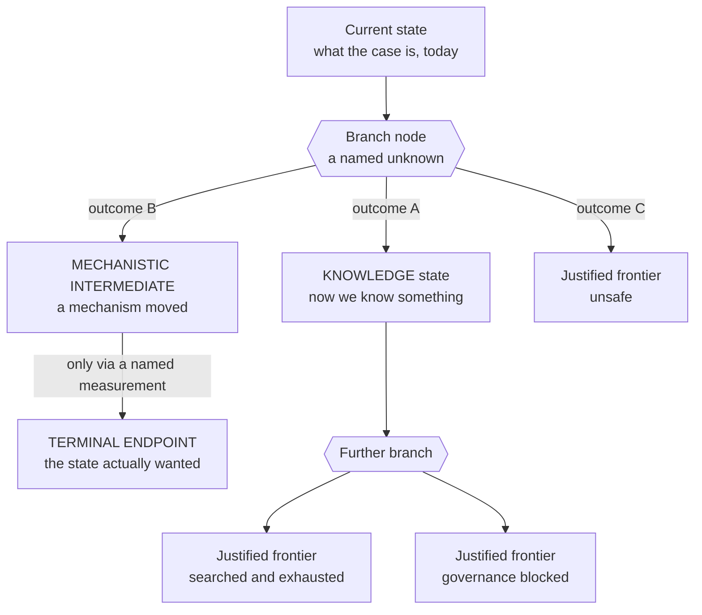

# The contingent route map

Most analyses of a hard case end in a recommendation: here is what we think, here is what we would
try. The route map ends somewhere else. It holds **every biological state the case could be in,
every experiment that moves between them, every admissible outcome of each experiment, and every
place where reasoning genuinely runs out** — as one validated graph, with no probabilities in it.

This page is for strategists, scientific stakeholders and researchers. It explains what the map is,
why it is shaped this way, and what it is good for commercially and scientifically. You do not need
to read the graph to read this page.

The artifact itself is two files:

| File | What it is |
|---|---|
| [`docs/control/MVA_CONTINGENT_ROUTE_MAP.yaml`](../control/MVA_CONTINGENT_ROUTE_MAP.yaml) | The map, as case data. Hand-authored, under seven closed vocabularies. |
| [`docs/control/MVA_CONTINGENT_ROUTE_MAP.md`](../control/MVA_CONTINGENT_ROUTE_MAP.md) | The report. Entirely generated, ~181 KB. Hand-editing it fails CI. |

The engine between them is [`tools/control/compile_route_map.py`](../../tools/control/compile_route_map.py)
— about 1,600 lines of validator and renderer. It computes no probabilities, because none would be
grounded.

---

## 1. Build the city, not two roads

The instinct when a case is hard is to find the shortest route and commit. That instinct is wrong
here, for a reason that is structural rather than philosophical: **you do not yet know which
measurement you are about to get.** A plan optimised for one answer is worthless the moment the
result comes back the other way, and a case like this one will produce a dozen such moments.

So the map is built as a city rather than a route. The governing rules while building it were:

- **Long routes are not worse routes.** A five-experiment path that ends somewhere real beats a
  two-experiment path that ends in a shrug.
- **Do not optimise the city while building it.** Pruning on expense during construction destroys
  exactly the neighbourhoods you need when the cheap route closes.
- **`UNKNOWN` and "needs experiment" are never terminal.** They are the most interesting nodes in
  the graph, and they are branch points.

What this buys, in practical terms: when a result arrives, the system can already say what it
decided and what it opened — without anyone reinterpreting the plan after the fact. And when a
route closes, the map says what remains rather than requiring the analysis to start again.



Note the edge from mechanistic intermediate to terminal endpoint. It is labelled, and the label is
enforced: **a mechanism may not imply the endpoint without an edge naming the establishing
measurement.** Improving chromosome alignment is not lowering missegregation until missegregation
is measured. The reverse is blocked too — reaching the endpoint may not backfill a canonical
mechanism.

---

## 2. The map today, in numbers

Taken live from the committed YAML:

| | Count |
|---|---|
| Nodes | **240** — 94 state, 86 terminal, 56 branch, 4 `all_of` |
| Edges | **154** |
| Admissible outcomes across all branches | **202** |
| Control variables | **10** |
| Strategy families | **4** |
| Declared campaigns | **4** |
| Grounded facts | **11** |
| Motif-derived hypotheses | **7** |
| Latent-variable hypotheses | **4** |
| Recorded negative latent results | **3** |

Branches sorted by the kind of work that would answer them — the `requires` field — which is the
most operationally useful cut in the whole map:

| What it would take | Branches |
|---|---|
| A human cell line and nothing else | **39** |
| An organism model | **9** |
| A tissue model | **7** |
| Blocked by governance | **1** |

That one governance-blocked branch is blocked because no patient material is available and none may
be acquired. It is not a biology problem and no experiment resolves it.

And the headline distances, printed by the compiler on every run:

```
to establish FUNCTIONAL_CELLULAR_TARGET: 2 unresolved branch(es) minimum
  -> DEP_ATTACH_TURNOVER, SAFE01
to establish ORGANISM_TARGET: 8 unresolved branch(es) minimum
  -> ACT_SAFETY01, CLEAR01, DEP_ATTACH_TURNOVER, IRREV01,
     NEXT_ACTUATOR01, SAFE01, SAFE_ORG, XSCALE02
unavoidable branches: none
```

"Unavoidable branches: none" means no single experiment is a chokepoint for every route — there is
always an alternative neighbourhood. That is a property of the city, and it is the thing building a
city buys you.

---

## 3. A leaf must be a justified frontier

The rule that does the most work: **a terminal node may not mean "we stopped reasoning."** It has
to name *why* it is a leaf, from a closed vocabulary of eleven states:

| Terminal state | Means |
|---|---|
| `FUNCTIONAL_TARGET_REACHED` | The cell-level state actually wanted |
| `ORGANISM_TARGET_REACHED_IN_MODEL` | Reached in a model organism — not in a person |
| `UNSAFE` | A safety constraint is violated on this path |
| `GOVERNANCE_BLOCKED` | Not permitted, regardless of biology |
| `PHYSICALLY_INCOMPATIBLE_WITH_EVIDENCE` | Evidence rules this out |
| `SEARCHED_EXTERNAL_UNIVERSE_EXHAUSTED` | We looked, in a named corpus, and found nothing |
| `NOT_IN_LOCAL_CASE_CORPUS` | Not in *our* material — a much weaker claim than the line above |
| `DECLARED_SCIENTIFIC_FRONTIER` | Nobody knows this; it is a real open question |
| `UNEXPANDED_FRONTIER` | We have not expanded this yet, and we are saying so |
| `CONTEXT_TRANSFER_REQUIRED` | Known somewhere else; moving it here is the open step |
| `BOUNDED_FRONTIER` | Bounded by a stated condition |

The three negatives are kept rigidly apart because they are different claims of wildly different
strength. "We searched a named universe and it was empty", "it is not in our local case corpus" and
"evidence establishes this is impossible" must never render as one another, and the strongest has to
earn it.

This vocabulary is also where the map audits itself. An earlier version had thirteen leaves typed
`NO_KNOWN_CONTINUATION`. An audit found that **all thirteen were simply unexpanded branches** — not
frontiers at all. Expanding them produced an entire strategy family that had been invisible
(`F4_REMOVE`, below). A separate wrinkle worth knowing: 86 nodes are typed terminal but only 72 are
actual leaves — 14 close one family and open another, so the frontier audit excludes them.

### Branch nodes

A branch node is a named unknown, and it must:

- enumerate **at least two** admissible outcomes, and continue from each;
- say why it is unresolved;
- declare its `branch_role` — `INTERVENTION` or `OBSERVATION`;
- declare its `requires` — what kind of model would answer it;
- declare its `resolves_by` — `MEASUREMENT` or `COMPONENT_DISCOVERY`.

An **observation cannot create an intervention state.** An `OBSERVATION` branch's outcomes may only
land on `KNOWLEDGE` states or terminals, because observing a system cannot improve it. There are 12
observation branches and 44 intervention branches.

---

## 4. Control variables versus actuators

This distinction is the one most likely to be collapsed by a reader in a hurry, and collapsing it
closes biology that is still open.

- A **control variable** is a biological quantity you want to move: *attachment turnover*,
  *poleward flux*, *cohesion protection*, *clonal dynamics*.
- An **actuator** is a specific physical means of moving it.

When an actuator fails — it does not work, it is unsafe, it cannot be built — **the actuator
closes. The control variable does not.** The variable closes only if the evidence speaks to the
variable itself.

Every closure therefore declares its scope, from another closed vocabulary: `ACTUATOR`,
`CONFIGURATION`, `CONTEXT`, `CONTROL_VARIABLE`, `NO_NEXT_STEP`. And a shared retry node has to
preserve control-variable identity: its `actuator_retry_map` must cover every incoming node that
closes an actuator for a control variable, or a working alternate actuator would resolve into the
wrong biology. That is a machine-checked invariant, not a convention.

The ten control variables, with their state variable as the map defines it:

| Control variable | The quantity being controlled |
|---|---|
| `CV_BUBR1_ABUNDANCE` | Steady-state abundance of the altered protein |
| `CV_POLEWARD_FLUX` | k-fibre poleward flux rate, set by antiparallel overlap length |
| `CV_CHROMOSOME_ALIGNMENT` | Fraction of chromosomes congressed and bioriented at the plate |
| `CV_CHECKPOINT_ACTIVATION` | Arrest competence on unattached kinetochores |
| `CV_CHECKPOINT_SILENCING` | Time from alignment to anaphase onset |
| `CV_ATTACHMENT_TURNOVER` | Rate at which attachment errors are corrected |
| `CV_COHESION_PROTECTION` | Sister chromatid cohesion at centromeres |
| `CV_CELL_SIZE` | Cell volume at mitotic entry |
| `CV_CLONAL_DYNAMICS` | Relative proliferation and loss rates, euploid versus aneuploid |
| `CV_ANEUPLOID_CELL_FRACTION` | Fraction of aneuploid cells in a population or tissue |

---

## 5. The four strategy families

Nothing in the system prefers repairing the broken thing. Repair is one family among four, and the
code cannot favour it:

| Family | The strategy |
|---|---|
| `F1_REPAIR` | Restore or stabilise the altered protein |
| `F2_REPLACE` | Supply the required function independently of it |
| `F3_EXPLOIT_AND_ALTER` | Exploit the residual function that is present, while altering another physical process |
| `F4_REMOVE` | Do not prevent the error — remove the cells that carry it |

`F4_REMOVE` is the one that proves the method works. It was not designed in; it appeared when the
thirteen falsely-terminal leaves were expanded. A map that had stopped reasoning at those leaves
would have had three families and would never have known a fourth existed.

### Two cell-level targets, deliberately distinguished

| State | Conjuncts | What it is |
|---|---|---|
| `FUNCTIONAL_CELLULAR_TARGET` | 4 — low missegregation, preserved viability, preserved division, no increase in cell death | The state actually **wanted**, open to any physically valid route |
| `CANONICAL_CELLULAR_STATE` | 7 — the above plus alignment, checkpoint activation, checkpoint silencing | **One route** to it, the canonical mechanism |

Conflating these two was a real bug, caught by a target-semantics audit. With them merged, a
synthetic route that safely produced faithful chromosome segregation by some other mechanism would
have been **rejected for not reproducing the canonical trajectory** — even though nothing shows that
trajectory is indispensable. The desired state has to stay modality-agnostic. Checkpoint activation
turned out to be an over-constraint: it is not an unavoidable gate.

Above both sits `ORGANISM_TARGET`, and the map is explicit that it is reachable by **no route today**
— bounded by governance as well as biology, since no intervention in this child is authorised, there
is no recontact, and much of the phenotype is developmental and already established.

---

## 6. Frontier, not distance: why the map reports sets

The most common way to misread the map is to read a count as a cost. The engine refuses to let you.

For each node, `frontier()` computes the minimal **sets** of unresolved branches that would
establish it, kept as incomparable alternatives — a Pareto antichain, capped at 8 per node. Not a
number. The reason is concrete: **two routes can share an experiment**, so summing branch counts
invents work that does not exist. A per-node minimum is also wrong, because it can discard the set
that makes a downstream union cheap.

Two more things about that computation, both learned the hard way:

- It is a **forward relaxation, not a backward search.** The backward form reports the target
  unreachable whenever a conjunct sits on the chain feeding it, because an `all_of` node's members
  are preconditions to *establish*, not waypoints with their own onward path. The first
  implementation got this wrong and reported the target unreachable.
- `cycles()` is **iterative, not recursive**, because the recursive version blew Python's stack
  once the map passed a hundred nodes — which is the wrong way for a validator to fail.

### Campaigns versus branches

A **branch is a unit of ignorance. A campaign is a unit of work.** One set of observations can
settle several branches at once, so a branch count overstates how many experiments a route needs.
Four campaigns are declared:

| Campaign | The question it asks |
|---|---|
| `CHAR01` | Does this exact allele destabilise the protein at all? |
| `FLUX01` | Does manipulating poleward flux reduce missegregation in a BubR1-limiting human-cell state, while preserving viability, cell death and division? |
| `STAB01` | Can a misfolding kinase-domain missense protein be stabilised in a human cell, and does the manipulation preserve the population? |
| `TRIP13_01` | Does augmenting MCC turnover restore timely exit in a BubR1-limiting state without degrading activation, and does the population survive it? |

The generated document says it outright: **do not read the campaign count as an experiment count.**
The shortest route to the cell-level target is 2 branches but needs 1 runnable campaign plus one
branch no campaign covers.

A campaign that declares joint outcomes must decide **every** branch it claims to resolve, or a
branch it claims to close is left open.

### What the map will not claim

`ROBUST_REACHABILITY` is reported as `NOT_ESTABLISHED`, and it is never inferred from
single-outcome resilience. `blocking_outcomes()` perturbs one branch at a time; an empty result
means no *single* admissible outcome closes the destination. An earlier version of the code called
that "robust". It overstated the claim, and the function's own docstring now says so.

Positive efficacy is also neutral with respect to independence. A branch whose outcome asserts that
a dependency was established must declare `dependency_tested` **and** have that specific outcome
listed in `dependency_outcomes` — otherwise an efficacy result rides in on a dependency claim. This
one was caught by mutation testing: a branch-level check looked sufficient and the mutation
*survived*, because an efficacy-named outcome rode in on the flag.

---

## 7. What comes after the city: motifs and latent variables

Once the city existed, two further analysis passes ran over its structure. Both produce
hypotheses, and both are held **outside** the graph.

**Motif analysis** (7 hypotheses) looks for structural patterns — the same shape recurring across
neighbourhoods that were authored independently.

**The latent control variable sweep** (4 hypotheses) asks a sharper question: *what single
unobserved variable would explain several otherwise unrelated neighbourhoods?*

| Latent variable | |
|---|---|
| `LV1_KINETOCHORE_PHOSPHATASE_CAPACITY` | Explains four neighbourhoods; retrodicts four separation-of-function alleles |
| `LV2_PROTEOSTASIS_CAPACITY` | |
| `LV3_MITOTIC_DURATION` | |
| `LV4_SHARED_LIMITING_PLATFORM` | |

Three **negative** latent results are recorded alongside them, because a sweep that only records
its hits is not a sweep.

### The firewall

Hypotheses are not routes, and the code makes the distinction structural rather than stylistic:

- status must be `NOT_TRAVERSABLE`;
- the hypothesis id **may not also be a graph node**;
- deleting every hypothesis must leave reachability **byte-identical**;
- and the test that actually matters: **it must predict something that was not used to construct
  it.** Otherwise it is only a new name for the pattern.

LV1 is the honest illustration. It explains four neighbourhoods and retrodicts four
separation-of-function alleles — genuinely more than it was built from. But one of its supporting
bridges was **weakened** by verification: a published residue it leaned on sits at the relevant
interface but outside the three critical positions, so the acetylation-to-phosphatase link is
recorded as an explicit `NOT_ESTABLISHED` bridge rather than quietly repaired. The hypothesis stayed;
the overclaim did not.

A grounded fact, by contrast, needs either evidence or a stated derivation. All 11 pass. One of them
carries a derivation and is explicitly marked a **structural consequence of the map** rather than a
literature claim — which is exactly the label that stops it being an assertion wearing the word
"grounded".

---

## 8. What the map is for

For a strategist, the case for this artifact is not that it is thorough. It is that it changes what
you can say before the data exists.

- **It prices ignorance in the right unit.** Minimal sets of unresolved branches, per destination,
  with the kind of model each needs. "39 branches need nothing but a human cell line" is a
  budgetable statement; "we need more research" is not.
- **It names the expensive object.** Nine branches share one prerequisite: an organism model. The
  costly thing is not any single experiment — it is that platform. That is a non-obvious finding
  that falls straight out of the structure, and it is the sort of thing a route-by-route analysis
  hides.
- **It survives bad news.** No branch is unavoidable. A closed actuator closes an actuator.
- **It makes a result's meaning precommitted.** Every branch enumerates its admissible outcomes
  *before* the experiment runs, so a result cannot be reinterpreted into the answer someone wanted.
- **It is auditable by construction.** The document is generated; the YAML is validated against
  closed vocabularies; CI fails on drift. There is no layer where someone's prose quietly became a
  conclusion.

What it is **not**: a plan, a ranking, or a recommendation. Route-selection sections were
deliberately removed from the main report — no "shortest route", no "highest leverage", no "where to
look first". The map's job is to hold the space. Choosing where to act is a human decision made on
top of it, and keeping those two things in separate documents is the point.

---

## Where to go next

- **The map itself** —
  [`docs/control/MVA_CONTINGENT_ROUTE_MAP.md`](../control/MVA_CONTINGENT_ROUTE_MAP.md). Large and
  entirely generated. Start at the target section, then the frontier section.
- **The three questions frozen for the bench** —
  [`docs/control/MVA_BENCH_EXECUTION_MATRIX.md`](../control/MVA_BENCH_EXECUTION_MATRIX.md). Treat
  them as a matrix, not a sequence: they are `NO_CROSS_PREREQUISITE`, which is a scheduling
  property and explicitly **not** a claim of biological independence.
- **The two execution packets** —
  [`FLUX01_EXECUTION_PACKET.md`](../control/FLUX01_EXECUTION_PACKET.md) and
  [`CHAR01_EXECUTION_PACKET.md`](../control/CHAR01_EXECUTION_PACKET.md).
- **Why the evidence under the map can be trusted** —
  [`05-evidence-discipline.md`](./05-evidence-discipline.md).
- **The engine that computes reachability** —
  [`04-control-compiler.md`](./04-control-compiler.md), then
  [`tools/control/compile_route_map.py`](../../tools/control/compile_route_map.py). The invariant
  tests live in [`tests/test_control_skills.py`](../../tests/test_control_skills.py).

---

> Unknowns are branch points, not dead ends. A leaf must say why it is a leaf. A failed actuator
> closes an actuator, never the biology.
