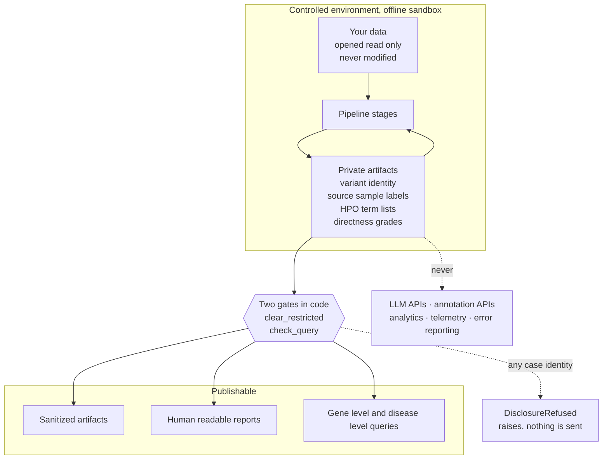

# For data holders and collaborators

This page answers the question a data holder actually asks: **what happens to my data.**

It is written for biobanks, registries, consortia, clinical laboratories and families considering
sharing material. Every claim below is drawn from the code and names the file that enforces it, so
you can verify rather than trust. Where something is asserted but not enforced, it says so
explicitly — that distinction is the only reason this page is worth reading.

---

## 1. The short answer

Controlled data is opened read-only, inside an offline sandbox, on a machine you can point at. It is
never transformed, never uploaded, and never sent to any model. Only a mechanically redacted artifact
leaves that boundary, and every outbound query is screened for case identity by code before it is
sent.

---

## 2. Your files are not modified, and not even read twice

**Opened read-only, no derived files.** Stage 01 walks the case directory read-only and never follows
directory symlinks. A test hashes **the entire input tree before and after every fixture run** and
fails on any difference
([`tests/test_intake_invariants.py::test_intake_does_not_mutate_inputs`](../../tests/test_intake_invariants.py)).

**Output cannot be written inside your directory.** Stage 01 refuses an output path inside the case
root as a usage error; Stage 02 additionally refuses one inside the Stage 01 run directory.

**Only the minimum is opened.** After Stage 01, the pipeline never walks your directory again — the
recorded manifest is the only description of the case it trusts, and a file Stage 01 did not record
cannot be consumed. Stage 02 opens **exactly** the primary variant file, its index, and the phenotype
asset. Sequencing reads are never opened at all: a test makes the FASTQ files unreadable and the
stage still succeeds.

**Nothing is transformed.** No rewriting, decomposition, left-alignment, filtering, sorting,
liftover, alignment, calling, phasing, annotation or prioritization. Every recorded operation carries
`transforms_source_data: false`.

**Nothing is inferred that your data does not state.** A sample's role is typed as literally
`"unknown"` until a human asserts it. Listing a phenotype term is never treated as "observed" —
polarity defaults to `unspecified`. Filenames and sample order are **never** pedigree evidence.
Sample identity is exact metadata label equality only; labels differing by case or punctuation are
flagged and kept **distinct**, never merged.

**A data problem is a recorded fact, not an exception.** Problems are recorded with a severity and a
code and carried forward. The pipeline does not quietly repair your data, and it does not quietly
stop.

---

## 3. No network, structurally

Four modules in the entire repository touch the network, and each is reachable only from a named
command. **No stage is one of them.**

For intake and normalization the guarantee is stronger than "we do not call out":

- `REF_PATH` and `REF_CACHE` are pinned to a nonexistent path for the duration of the run, because
  htslib will otherwise download CRAM reference sequences from EBI without being asked.
- Tests run both stages with **Python sockets disabled** and additionally under an OS-level network
  sandbox.
- A test asserts that **no stage imports** the one module that can fetch anything.

Real controlled data is run locally under
`sandbox-exec -p '(version 1)(allow default)(deny network*)'`, and only sanitized artifacts are read
back out — never a `*.private.json`.

External reference resources (an ontology release, an assembly report) are **provisioned
out-of-band** and pinned by size and SHA-256. A case run verifies the bytes and **refuses** a
mismatch; it never fetches. A silently updated ontology therefore cannot change a result, and
re-running against a newer release produces a visibly different digest rather than a quietly
different answer.

---

## 4. The two gates on the boundary, and what each one is

Both are code. Neither is a review step.

### `restricted()` / `clear_restricted()` — the redaction mechanism

[`src/rarepipe/core/redaction.py`](../../src/rarepipe/core/redaction.py)

Every artifact exists twice. A schema field declared `restricted()` lives **only** in the private
copy; `clear_restricted()` walks the model recursively and resets every tagged field to its default,
producing the sanitized sibling.

The design property that matters: **it is schema-driven, not list-driven.** Adding a sensitive field
means tagging it, and there is no second list anywhere that someone could forget to update. The
fields currently tagged restricted include variant coordinates, HGVS, genotype, rsIDs, local file
paths, source sample labels, read-group identifiers, raw header claims, HPO term lists, per-contig
record counts, and the directness grades described in §5.

Human-readable reports are rendered **exclusively** from the sanitized artifact, and every report
renderer asserts it was handed the sanitized copy before writing a line. So a report cannot leak a
restricted field regardless of what the report code does. That assertion is present in all seven
renderers.

One mechanical check worth knowing about, because it is the kind of thing that is usually left to
good intentions: a test asserts that the Stage 02 report and sanitized artifact contain **none** of
the words *pathogenic*, *benign*, *causal*, *candidate gene*, *diagnosis*, *compound het* or *drug*.
The no-interpretation rule for the descriptive stages is enforced by grep, not by convention.

### `check_query()` — the disclosure boundary

[`src/rarepipe/stages/adjudicate/disclosure.py`](../../src/rarepipe/stages/adjudicate/disclosure.py)

Every outbound query passes through it. Nine pattern classes are refused:

| Refused | Example shape |
|---|---|
| Genomic coordinate | `chrN:00000000` |
| HGVS coding / genomic | `NM_000000.0:c.…` |
| HGVS protein | `p.Xxx000…` |
| Protein change shorthand | `K668A` |
| **Bare residue position** | `K668` |
| dbSNP identifier | `rs…` |
| ClinVar variation id | `VCV…` / `variation_id:…` |
| HPO identifier | `HP:0000000` |
| Bare allele change | `40458000 A>G` |

The example shapes above are synthetic placeholders, not case data — this page carries no real identifier of any kind.

The guard **fails closed** and raises `DisclosureRefused`. A refusal is treated as a bug to fix or a
decision to escalate — never as something to work around, and loosening a pattern to get past one is
not an available move.

Two details that show the direction the design errs in:

**The private cross-check runs first.** Before any pattern is applied, every residue-shaped token in
the query is compared against the case's own private residues. So a token that trips *no* pattern is
still caught. This ordering was a defect once — the pattern scan ran first — and the fix is recorded
in the module.

**The bare-residue pattern is deliberately over-broad.** It also matches ordinary strings such as a
`C57` mouse strain, so legitimate gene-level queries are sometimes refused. Tightening in that
direction was a conscious choice, made **after a bare residue slipped through ungated**. A false
refusal is cheaper than a false release.

### Exact-variant external querying is not disabled — it is unimplemented

`approval_gate()` in the same module **has no success path.** It always raises. There is no
configuration flag, no environment variable and no administrative override that turns exact-variant
external querying on, because the function that would authorise it does not have a branch that
returns.

---

## 5. The residue exception, stated precisely

Published residues sometimes have to appear in a literature query — that is how mechanisms get
looked up. The project does **not** solve this with a syntax whitelist, because a whitelist that
permits "things shaped like a residue" permits the private one.

Instead, a residue token may leave only under a `PublicResidueProvenance`, and all of the following
must hold:

1. **The token is named explicitly** in the provenance. Per token, not per query.
2. **It is found verbatim in the stored text** of the public document that attests it. Per source.
3. **The attesting document lies inside the committed snapshot tree** under `data/literature`. A
   directory written during the call cannot attest anything.
4. **Nothing the caller supplies as metadata is consulted.** Only the stored text is read. Public
   attestation must pre-exist the release decision rather than travel with the request.
5. **Identity-grade patterns can never be unlocked this way.** A coordinate, an rsID, a ClinVar id
   or an HPO code is identity-grade whatever its origin, so provenance does not apply to them at
   all — only to the three residue-shaped classes.

And the rule that makes the whole mechanism coherent:

> **A residue derived from the private case is refused however well attested it is elsewhere.**

The private boundary is not a question of whether a string happens to be public somewhere. If it is
this child's residue, it does not leave — and because the private cross-check runs first, that holds
even when the provenance is perfect.

### Why gradings are restricted even though they contain no identifier

The project's published documents state that the child's missense allele is in the **protein kinase
domain**, because a domain name is public biology. They never state the position.

The gradings that compare a published residue to the child's — *exact*, *same position*, *within ten
residues*, *same region*, *different region* — are computed locally and held **only** in restricted
fields. The reason is specific: **a nearby published variant plus a proximity grade would localise
the child's residue.** The grade contains no identifier and is still identifying, so it is treated as
identifying.

Those grades are additionally withheld altogether unless the allele is numbered on the canonical
transcript, so an ungrounded numbering cannot produce a confident-looking proximity claim.

---

## 6. Retention, deletion and non-recontact

**Every asset gets a governance class** at intake — `controlled_genomic_delete_required` (variant
files, alignments, indexes, unidentified binaries), `controlled_case_material_review_required`, or
`external_reference`. Downstream artifacts inherit the case policy rather than claiming their own.

**Be clear about what this is: an assertion in the artifact, not an enforcement by the code.** The
pipeline marks native solver outputs `delete_required` and the full candidate set
`delete_required_review`, and **nothing in the stage deletes them.** A human or an operational step
must. We state this plainly because a data holder checking this page will find it out anyway, and
discovering it independently is worse.

**"Sanitized" is not "anonymous", and the sanitizer says so itself.** The sanitized artifact's own
note states it: internal aliases remain and the artifact still describes one real individual's case
structure. Both private artifacts additionally carry source sample labels and HPO identifiers, so
they are controlled material and belong in the deletion plan — along with the intake checksum cache
at `<output>/.cache/checksums.json`, which is easy to forget.

**Commitments currently in force for the one live case:**

| Commitment | Status |
|---|---|
| No redistribution of supplied genomic material | In force |
| Delete genomic material within 30 days of the hackathon close, and notify the organizers | The submission period runs to 24 October 2026 |
| **No recontact** of the child, the family, or the patient-organisation contacts | In force, absolute |
| The repository becomes public after the hackathon | Which is why `.gitignore` is a safety control, not housekeeping |

`.gitignore` excludes `*.private.json`, every genomic file extension, prediction CSVs, `/secure/`,
`/work/`, `/out/` and the entire `research/` directory — full texts and extracted verbatim quotes
included. The consequence is deliberate and worth stating: **two of the pipeline's stages are not
reproducible from a public clone**, because the material they depend on is not in it.

**One deliberate exception to "nothing leaves".** A single artifact — the external evaluator's
predictions file — carries exact variant identity and is *meant* to leave the working area. It goes
to that evaluator and nowhere else, it is gitignored, and **no code uploads it.** A person submits
it deliberately. The same is true everywhere in the system: no stage transmits anything, and the
outreach layer's dispatch path returns a stored unsent draft rather than sending.

---

## 7. What the project needs, and what it offers back

### What it needs

**Functional measurements, not more variant interpretation.** The causal variants for the live case
are known. What is missing is function: no experiment anywhere has expressed this child's exact
substitution at matched abundance. The three questions frozen for a bench are in
[`docs/control/MVA_BENCH_EXECUTION_MATRIX.md`](../control/MVA_BENCH_EXECUTION_MATRIX.md), and
**none of them requires patient material.** They need a human cell line.

**Cohort-level and aggregate answers.** Questions are generated as formal specifications with
`patient_identity_required: false` and an explicit list of acceptable output forms — an aggregate, a
deidentified summary, or the result of a computation run locally on your side. Several are generated
and stored unsent today.

**An organism model, if you have one.** Nine separate open questions in the route map share this one
prerequisite. The expensive object is not any single experiment — it is that platform.

**Cytogenetic data**, which would connect the live case to the disease-level aneuploidy bridge by
observation rather than by inference.

**Full text for ten corpus documents** that are currently abstract-and-metadata only, including a
priority study that is not open access. Legitimate access only — publisher, institutional, author
manuscript or organizer-provided. No paywall circumvention; *"potentially relevant evidence exists
but is presently inaccessible"* is a valid recorded state and will stay recorded as that.

### What it offers

**An auditable record of what your contribution established.** Operational facts and scientific
facts are structurally different record types, so "a lab replied" can never be promoted into "a lab
measured". A refusal, a non-disclosure or a silence is recorded as exactly that and **cannot** become
`MEASURED_NO_EFFECT`.

**Permission tracked per purpose.** Permission is granted per use — case use, public export, other
cases, policy training — and case use is bound to **one** case reference. A parent record's
restrictions constrain every derivative automatically.

**Independence is never assumed.** Several reports of one original observation share an evidence
family and are counted **once**. Independence between families must be asserted by a named human; two
replies from two institutions are not independent by default.

**You cannot be misquoted into a conclusion.** Every substantive sentence a report may use is tied to
its evidence ids, and the report generators consume only those, so polish cannot outrun the evidence.
Reports are rendered from the sanitized artifact only.

**Corrections propagate.** A record is never edited — a correction is a new record with a supersedes
link, and when a source is corrected the system invalidates the downstream derivatives and suspends
dependent work. When this was exercised for real on the project's own citations, **ten of eleven
dependent layers moved**, and the resulting answer was *weaker* than before. That is what a
correction mechanism looks like when it works.

**Public export is allowlist-first.** Fields are allowlisted, then every remaining string is scanned
for private references, local paths and caller-supplied private terms. A hit either drops the field
or **rejects the whole export**. The removal log names the rule rather than the matched term, so a
private term cannot reappear in the audit trail of its own removal. The scan refuses outright on
HGVS-style notation, genomic coordinates, case-identifier shapes or local paths found anywhere in
the payload.

---

## 8. What is asserted versus what is enforced

The honest summary, because this is the section that determines whether the rest of the page is
credible.

| | Status |
|---|---|
| Inputs unmodified | **Enforced** — whole input tree hashed before and after, per test run |
| No network during case stages | **Enforced** — sockets disabled, OS sandbox, import assertion, htslib pinned |
| Redaction of restricted fields | **Enforced** — schema-driven, recursive, with report-side assertions |
| Case identity in outbound queries | **Enforced** — `check_query`, fails closed, private cross-check first |
| Exact-variant external querying | **Structurally impossible** — no success path exists |
| Residue release requires public attestation | **Enforced** — per token, per source, against committed text |
| No stage uploads or transmits | **Enforced** — dispatch returns an unsent draft |
| Pinned resources cannot drift | **Enforced** — byte mismatch is a blocking error |
| Public export cannot leak | **Enforced** — allowlist, then scan, then reject-or-drop |
| **Deletion of controlled material** | **Asserted, not enforced** — classes are recorded; a human must act |
| **Retention classes on derived artifacts** | **Asserted** — inherited from case policy |
| **Non-recontact** | **Policy** — no code path exists to contact anyone, but it is a commitment, not a mechanism |

---

## Where to go next

- **The guard itself** —
  [`src/rarepipe/stages/adjudicate/disclosure.py`](../../src/rarepipe/stages/adjudicate/disclosure.py).
  It is short, and its docstring states the policy it implements. The tests that exercise it with
  deliberately fabricated identifiers are in [`tests/test_disclosure.py`](../../tests/test_disclosure.py).
- **The redaction mechanism** —
  [`src/rarepipe/core/redaction.py`](../../src/rarepipe/core/redaction.py).
- **What the intake and normalization stages record about your files** —
  [`docs/intake.md`](../intake.md) and [`docs/normalize.md`](../normalize.md).
- **The consolidated governance rules** — [`11-governance-and-safety.md`](./11-governance-and-safety.md).
- **The science, if you are deciding whether this is worth your material** —
  [`08-for-clinicians-and-researchers.md`](./08-for-clinicians-and-researchers.md).
- **What is known to be imperfect** — [`docs/POTENTIAL_IMPROVEMENTS.md`](../POTENTIAL_IMPROVEMENTS.md),
  including the outstanding external requests and the obligations with dates attached.

---

> A residue derived from the private case is refused however well attested it is elsewhere. A
> refusal is a bug to fix or a decision to escalate, never something to work around.
