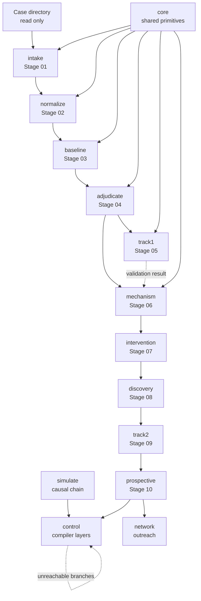

# Module reference

The detailed per-subsystem reference that [`02-architecture.md`](../02-architecture.md) links to.
Every subsystem gets the same template, so the page is scannable rather than narrative:

> **Purpose** · **Inputs** · **Outputs** · **Key modules** · **Named concepts and types** ·
> **Invariants enforced in code** · **Gotchas** · **Status**

This is a reference, not a tour. It is the longest page in the wiki and that is correct. If you want
the narrative, read [`03-the-pipeline.md`](../03-the-pipeline.md) and
[`04-control-compiler.md`](../04-control-compiler.md) first.

**The "Gotchas" sections are the most valuable part.** Each one is something that would cost a
newcomer hours, and most of them record a defect that actually occurred.

---

## What consumes what

Artifact flow, not import graph. No stage reaches behind the one before it.

Two cross-cutting dependencies that the stage numbering hides, and both are real coupling:

- **`control` reads `simulate`.** The realization layer builds its evidence inventory by walking the
  causal chain. **Evidence is derived, never typed in.**
- **`control` reads `prospective`.** The case problem reads endpoint lists from the plan seed, and
  unreachable decision branches from a tool loaded **by file path at runtime**. Moving either file
  breaks experiment compilation and nothing in the type system will catch it.

---

## `core/` — shared primitives

**Purpose.** The seven small primitives every stage reuses. Makes quiet failure — a report that
cannot be traced to its bytes, a number typed by hand, a document drifted from its code — either
impossible or loud.

**Inputs.** CLI options and a recorded `argv`; sealed upstream run directories by path; a pinned
resources directory.

**Outputs.** Immutable run directories `<output>/<RUN_timestamp_hex>/` holding a paired
private/sanitized artifact, a report, a log and a `SHA256SUMS` seal. JSON Schemas for 11 artifact
names. Self-verifying zip packages. Exit codes `0` ok, `2` usage, `3` blocked.

**Key modules.**

| Path | What it does |
|---|---|
| `core/artifacts.py` | Immutable versioned run directories. Writes into `.incomplete-<run_id>/` with exclusive-create, chmods `0444`, seals with `SHA256SUMS`, then **atomically renames** — so a crashed run never looks finished |
| `core/issues.py` | The shared problem taxonomy: 4 severities with explicit ranks, 63 issue codes grouped by subject. `sort_issues` de-duplicates and orders deterministically so manifests are idempotent |
| `core/digest.py` | `semantic_digest()` hashes content minus execution-specific sections. `volatile_fields()` walks a payload and reports anything run-specific. **Its docstring records that this broke twice** |
| `core/hashing.py` | Streaming SHA-256 in 8 MiB chunks, so a large case is never loaded or copied. `DigestCache` persists completed digests with atomic temp-file writes so an interrupted intake resumes |
| `core/redaction.py` | `restricted()` tags a field; `clear_restricted()` walks a model recursively and resets every tagged field. The private/sanitized split |
| `core/provenance.py` | rarepipe version, git commit + dirty flag, Python version, platform, library versions including bundled htslib/samtools. Shells out to git with a timeout and degrades to `unknown` |
| `core/package.py` | Zip packages carrying their own `MANIFEST.sha256` over archive-relative paths, verified by **actually unpacking and running `shasum -c`** before the package is returned |
| `core/console.py` | Operator output. Everything is written to the run log except `progress()`, which is terminal-only |

**Named concepts and types.** Run directory · semantic digest · volatile field · Issue (severity +
code) · restricted field · resource lock · self-verifying package · exit-code contract.

**Invariants enforced in code.**

- A run directory is **never overwritten** — `open()` raises if the final path exists, files use mode
  `'x'`, staging is created with `exist_ok=False`.
- A partially written run is never visible as finished; the only way files appear is one `os.replace`
  after every write succeeded.
- Every file written appears in that run's `SHA256SUMS`, and all are mode `0444` before the rename.
- Nothing run-specific may live inside a semantic digest. Exactly **two** upstream-pointer paths may
  legitimately contain a run id, because a different upstream run genuinely is a different input.
- Issues are de-duplicated and sorted by (severity rank, code, asset ids, sample ids, message) —
  required for byte-identical manifests across runs.
- Data problems **do not raise**. A blocked status becomes exit code 3.
- Issue messages and sample ids carry operator-facing text and internal aliases only — never genomic
  payload or raw sample labels.
- A restricted field is cleared **recursively**, so adding one cannot forget the public copy.
- A package cannot contain an absolute path, a `..` component, or a file named `MANIFEST.sha256`, and
  `build()` calls `verify()` before returning.
- A resource can only be registered from inside the resources directory.

**Gotchas.**

- **`core/redaction.py` is the version used from Stage 02 onward. Stage 01 deliberately carries its
  own frozen copy** of the same mechanism, so the Stage 01 schema cannot drift. Two copies exist on
  purpose.
- A sealed run's `SHA256SUMS` **cannot verify an export**, because it covers private files that are
  never exported. That is the entire reason `package.py` writes a second manifest over
  archive-relative paths.
- `DigestCache` keys on inode and `mtime_ns`, so **moving or touching a file invalidates resume** for
  that file. Correct, but surprising if you expected content-only keying.
- `verify_run` and the package verifier split checksum lines on **exactly two spaces** — the `shasum`
  format, which means a filename containing two consecutive spaces breaks parsing.
- `src/rarepipe/__main__.py` is two lines and calls `main()` **at import time**.

**Status.** Stable. 9 modules. Used by every stage.

---

## `intake/` — Stage 01, case intake

**Purpose.** Answers *"what were we given?"* A case arrives as an arbitrary directory from a third
party. Nothing downstream can be trusted until the pipeline establishes, provably, what those files
are, which coordinate system they use, which sample labels appear where, and what is missing.
**Deliberately non-interpretive: it produces evidence and uncertainty, never conclusions.**

**Inputs.** `--case-root` (opened read-only), `--case-id` matching
`^[A-Za-z0-9][A-Za-z0-9._-]{0,63}$`, `--output` **outside** the case root, optional `--reference`
FASTAs living outside the case, `--primary-variant`, `--exclude` globs, `--config`,
`--no-checksum-cache`.

**Outputs.** `case_manifest.private.json`, `case_manifest.sanitized.json`, `intake_report.md`,
`intake.log`, `SHA256SUMS`. Status derived purely from issue severities: `INTAKE_COMPLETE` /
`_WITH_WARNINGS` / `_BLOCKED`.

**Key modules.**

| Path | What it does |
|---|---|
| `intake/stage.py` | Orchestration in 7 steps: discover → variants → reads/reference → phenotype/pedigree → checksums → cross-validate → write. Refuses an output path inside the case root. **Pins `REF_PATH`/`REF_CACHE`** so htslib cannot reach the network |
| `intake/manifest.py` | The `CaseManifest` contract (schema 1.0.0) — all enums and per-format metadata models, discriminated on `kind`. The clearest statement of what the subsystem believes. Defines the **local** `restricted()` marker |
| `intake/discovery.py` | Walks the case root read-only, **never following directory symlinks**. Assigns asset ids from the relative path, maps format → role and → retention class, and links assets with **the evidence for each link recorded** |
| `intake/formats.py` | Content-first detection: the filename *claims* a format, the bytes *are* one. **Both recorded, disagreement surfaced as an issue, never reconciled.** Reads a bounded prefix plus the trailing 28 bytes for BGZF EOF |
| `intake/validation.py` | Cross-asset validation: the sample registry minting `SAMPLE_nnn` from **exact** label equality, genome-build consistency (conflicts are blockers), CRAM reference resolution by `@SQ` M5 vs FASTA-computed MD5 |
| `intake/reference.py` | Genome build from nuclear contig length tables. **A deliberate inversion of the PRD's preference order**: contig lengths decide, header text only corroborates |
| `intake/redact.py` | Private → sanitized. Walks the model and resets every `restricted` field recursively |
| `intake/pedigree.py`, `phenotype.py`, `genomic.py`, `schema.py`, `report.py` | Per-domain handling, schema export, and the report rendered **only** from the sanitized artifact |

**Named concepts and types.** `CaseManifest` (v1.0.0) · Issue + Severity · `restricted()` /
visibility · `asset_id` / `SAMPLE_nnn` · `retention_class` · `input_fingerprint` /
`inventory_fingerprint` / `semantic_digest`.

**Invariants enforced in code.**

- Output must be outside the case root — raises a usage error.
- **Inputs are opened read-only and no derived files are created.** A test hashes the whole input tree
  before and after every fixture run.
- **No network.** `REF_PATH`/`REF_CACHE` are pinned to a nonexistent path (htslib otherwise downloads
  CRAM references from EBI); tests run with Python sockets disabled *and* under an OS network sandbox;
  a test asserts no stage imports the fetching module.
- Sanitization is **schema-driven, not list-driven**. Reports render exclusively from the sanitized
  artifact.
- No transformation anywhere. Every recorded operation carries `transforms_source_data: false`.
- Nothing is inferred that the data does not state. `asserted_role` is typed `Literal["unknown"]`;
  phenotype polarity defaults to `unspecified`; **filenames and sample order are never pedigree
  evidence.**
- Sample identity is **exact metadata label equality only.** Near-matches are flagged and kept
  distinct, never merged.
- Run directories are sealed; `semantic_digest` excludes the `execution` block.
- Data problems never raise past the stage boundary — only invalid invocation does.
- The committed schema is **frozen against the `stage01-case_intake-v0.1.0` tag.**

**Gotchas.**

- **`asset_id` is derived from the relative path**, so renaming or moving a file changes its ID.
  Content identity is the checksum — and that split is exactly why there are two fingerprints.
- **"Sanitized" is not "anonymous."** The sanitizer's own note says so: internal aliases remain and
  the artifact still describes one real individual's case structure.
- **Stage 01 parses only the FIRST VCF record**, to prove the body is readable. Corruption deeper in
  the file is invisible until Stage 02's full dual-pass stream.
- **Genome build is decided by contig lengths, not by the `##reference` header text.** A documented,
  deliberate inversion — header claims are often a stale local path.
- **Filenames are untrusted for identity but trusted for structure.** They are never pedigree
  evidence, yet index pairing and FASTQ mate pairing *are* filename-derived — and each such
  relationship records "filename pairing" as its evidence string so a reader can tell.
- `restricted()` is **defined twice on purpose** — a frozen copy here, the shared one in `core/`.
- pysam verbosity is silenced because htslib's diagnostics **embed absolute paths.**
- The checksum cache never stores the digest of a file that changed size or mtime during the run —
  that becomes a **blocker**, because a download still writing to disk makes every inspection
  untrustworthy.
- **Exit code 0 covers both clean and with-warnings**, so a caller that only checks exit codes misses
  `ACTION_REQUIRED` items. The readiness fields are the real gate.

**Status.** Frozen at `stage01-case_intake-v0.1.0`. 13 modules, 3,176 lines.

---

## `normalize/` — Stage 02, case normalization

**Purpose.** Answers *"can this become one coherent analysis-ready representation?"* Emits canonical
identities, measured VCF characteristics, and **readiness stated per capability rather than as a
single yes/no.** Also non-interpretive.

**Inputs.** `--manifest` pointing at `case_manifest.private.json` (**a sanitized manifest is
refused** — it has no asset locations), optional `--resources` holding `resources.lock.json`,
`--assertions`, and a `--case-root` override.

**Outputs.** `normalized_case.private.json`, `normalized_case.sanitized.json`,
`normalization_report.md`, `normalization.log`, `SHA256SUMS`.

**Key modules.**

| Path | What it does |
|---|---|
| `normalize/stage.py` | 7 steps: load manifest + check its Stage 01 seal → verify pinned resources → load assertions → SHA-256-verify declared assets → full VCF stream → semantic normalization → write. Carries every Stage 01 issue forward with `origin_stage` and a `resolution` |
| `normalize/model.py` | The `NormalizedCase` contract (schema 1.1.0). The subsystem's richest type statements: `ContigBinding.basis`, `FilterCharacterization`, `PhaseInformation`, `GenotypeStates`, `Capability`, `Retention` |
| `normalize/vcf_scan.py` | **Two independent full passes** over the complete VCF: a strict byte-level text parser accumulating **aggregate counters only** — no record, allele or genotype value is retained — cross-checked against an htslib read that must agree on record count |
| `normalize/readiness.py` | Six per-capability verdicts (yes/partial/no with machine-readable blocking reasons): phenotype prioritization, VCF prioritization, trio analysis, phase-aware analysis, decomposition/left-alignment, read-level analysis |
| `normalize/assertions.py` | The `CaseAssertions` contract — **the only channel** through which facts a computation cannot establish enter the pipeline, each with evidence type, reference, author and timestamp |
| `normalize/contigs.py` | Binds each declared contig by **name AND length** to a row of the pinned assembly report, recording the `basis` so a guess is never indistinguishable from a match |
| `normalize/phenotype.py`, `upstream.py`, `schema.py`, `report.py` | Ontology handling, upstream seal checks, schema export, sanitized-only report |

**Named concepts and types.** `NormalizedCase` (v1.1.0) · readiness by capability ·
`CaseAssertions` · contig binding + `basis` · pinned resources · **FILTER as evidence**.

**Invariants enforced in code.**

- **Stage 02 never walks the case directory.** The manifest is the only description it trusts; a file
  Stage 01 did not record cannot be consumed.
- Every asset opened is **SHA-256 verified** against the manifest first, and the manifest itself is
  checked against the Stage 01 seal.
- Stage 02 opens **exactly** the primary VCF, its index, and the phenotype asset(s). **FASTQs are
  never opened** — a test makes them unreadable and the stage still succeeds.
- A pinned resource whose bytes differ from the lock is **refused**, so a silently updated ontology
  cannot change a result.
- **Obsolete ontology identifiers are never silently replaced**: a single unambiguous replacement is
  followed and the basis recorded; consider-only terms stay unresolved with original ids preserved.
- A supplied assertion is applied **whole or rejected whole**, and cannot override a polarity the
  source document itself states.
- Accepts only `CaseManifest` major version 1.x, and only the **private** variant.
- A test asserts the report and sanitized artifact contain **none** of: *pathogenic*, *benign*,
  *causal*, *candidate gene*, *diagnosis*, *compound het*, *drug*.

**Gotchas.**

- **`sorted` has a narrow meaning** — coordinate-ordered *within contiguous contig blocks*. Contig
  order differing from the header is reported separately and does **not** make the file unsorted.
- A FORMAT field counted as "populated" only means **not a missing value** — not that the value is
  meaningful. Duplicate detection is exact-match within a position, so the same indel written two
  ways is not detected without left-alignment, which needs the reference that is not yet bound.
- **Phase is reported structurally, never inferred.** The stage distinguishes GT separators, PS phase
  sets and read-backed PGT/PID, and writes a mechanical interpretation note for the common
  HaplotypeCaller-style combination where PGT/PID carry phase while GT stays unphased.
- **Non-PASS records are preserved** and remain part of the case. Whether to exclude them is an
  analysis decision recorded as a condition, not applied here.
- **Two variant files with no `--primary-variant` is only `ACTION_REQUIRED` in Stage 01 but a BLOCKER
  here.** Stage 01 may describe an ambiguity it cannot resolve; Stage 02 may not guess.
- Re-running against a newer ontology release yields a **different semantic digest** — tested
  explicitly.

**Status.** Built, schema v1.1.0, drift-tested. No release tag. 11 modules, 1,919 lines.

---

## `baseline/` — Stage 03, baseline candidate generation

**Purpose.** Asks a mature off-the-shelf solver (Exomiser) which genes it ranks as the strongest
causal candidates — **four times, under four explicitly declared sets of analytical assumptions** —
and records exactly what it said. The first stage permitted to produce biological hypotheses, and it
**deliberately produces none of its own.**

**Inputs.** A **private** `NormalizedCase` (a sanitized one is refused), the source VCF resolved
through the recorded manifest and re-verified against the upstream digest, and a locally provisioned
solver plus its data directories.

**Outputs.** `raw_candidate_set.private.json`, `raw_candidate_set.sanitized.json`,
`baseline_report.md`, `baseline.log`, `SHA256SUMS`. The solver's native outputs go **separately**
under `<output>/native/<run_id>/<profile>/`.

**Key modules.**

| Path | What it does |
|---|---|
| `baseline/stage.py` | Validates upstream, re-verifies the VCF digest, locates the solver, builds profiles, runs them, compares, writes. Collects issues rather than raising |
| `baseline/model.py` | `RawCandidateSet` (schema 1.1.0), `AnalysisProfile`, `Candidate`, `ContributingVariant`, `Stability`, `Retention` |
| `baseline/profiles.py` | The four profile specs and the solver's job files. Holds the fixed analysis parameters: inheritance modes, frequency sources, 2.0% max frequency, pathogenicity sources, step order |
| `baseline/exomiser.py` | Finds a Java 21+ runtime and the CLI jar, invokes the solver as a child process with a heap cap and timeout, and **classifies the exit**: out-of-memory, rejected-input, timeout |
| `baseline/ingest.py` | Parses native TSV tables into candidates. Joins contributing variants by (gene, inheritance mode), derives the compound-het flag, and **re-reads each variant's FILTER from the source VCF** via targeted tabix fetches |
| `baseline/compare.py` | Cross-profile stability: per-pair top-1/5/10/20 overlap, rank movement, genes appearing only under one assumption, and a verdict. **A plain comparison table, explicitly not a statistical model** |
| `baseline/report.py` | Asserts at the top that it was handed the **sanitized** artifact. Includes a "Not done here" section |
| `testing/baseline_fixtures.py` | A **fake solver** that reads the generated job files and reacts to the two varied decisions — so profiles, pair representation, FILTER preservation, sensitivity and privacy are all testable without the multi-gigabyte bundles |

**Named concepts and types.** `RawCandidateSet` · the profile matrix (A–D) · `analysisMode
PASS_ONLY` vs `failedVariantFilter` · `AnalysisAssumption` · `variant_ref` ·
compound-heterozygous configuration · source filter status · stability verdict · retention classes.

**Invariants enforced in code.**

- **No reranking, rescoring or filtering by rarepipe.** Ranks and scores are copied verbatim;
  candidates are sorted only by (rank, gene symbol, inheritance model).
- **No disease name, gene panel, seed gene or candidate list is ever written into the solver's job
  files.** A test greps the generated documents.
- **Source FILTER labels are never rewritten.** `source_filter_labels_modified` is typed
  `Literal[False]`, so a modified-labels profile is **unrepresentable**.
- `analysisMode: PASS_ONLY` is constant across all four profiles, and a test asserts the only
  step-list difference between two profiles is the presence of `failedVariantFilter`.
- The report asserts `visibility == 'sanitized'` before rendering.
- The source VCF's SHA-256 must match the upstream digest, and the referenced manifest must still
  match the digest recorded in the `NormalizedCase`.
- Peak memory unit handling is **platform-explicit** rather than inferred by magnitude.

**Gotchas.**

- **The solver's own TSV FILTER column is not the source VCF's FILTER.** It reads PASS for every
  variant that survived the solver's filter chain. Taking it at face value would record a
  quality-failed variant as PASS — which is why `ingest.py` re-opens the source VCF at that exact
  locus.
- **There is no `COMP_HET` value to search for.** The solver abbreviates inheritance to AD/AR/XD/XR,
  so pattern-matching on the long form used in the config finds nothing and **silently reports zero
  pairs.**
- **`PASS_ONLY` does not exclude non-PASS VCF records** — a measured observation, and the reason two
  of the four profiles genuinely test filter sensitivity rather than duplicating the others.
- A gene can appear **more than once per profile**, once per inheritance mode. `candidate_count`
  counts gene/inheritance rows, **not distinct genes**.
- **Blocking is a result, not a crash.** A missing solver, an out-of-memory host or a changed VCF
  produces a complete artifact with blocker issues and exit code 3; profiles are recorded `not_run`
  with a reason, and **no results are invented.**
- `--dry-run` **still writes every profile's job configuration** before marking profiles `not_run`.
- Spring configuration must reach the solver as a JVM `-D` property; the CLI also wants `GRCh38`,
  not `hg38`, and a flat analysis script rather than the older combined job file.
- **Native outputs are written outside the sealed run directory** precisely because the run directory
  is made read-only at seal time.
- **Retention is asserted, not enforced.** Nothing in the stage deletes anything.

**Status.** Built. Needs the external solver to run for real; the offline suite uses the fake. No
release tag. 9 modules, 1,413 lines.

---

## `adjudicate/` — Stage 04, evidence adjudication

**Purpose.** Takes a candidate genetic hypothesis and asks three questions **separately, refusing to
merge them into one score**: is the gene–disease mechanism appropriate, does each allele impair
function, and is the biallelic configuration established. Also home to the repository's
**disclosure boundary**.

**Inputs.** The **private** `raw_candidate_set.private.json` (a sanitized one is refused), the native
solver variants table, the case's VCF, and an optional pinned-resources directory with a variant
database, gene-validity data, protein records and literature JSON.

**Outputs.** `adjudicated_hypothesis.private.json`, `adjudicated_hypothesis.sanitized.json`,
`adjudication_report.md`, `adjudication.log`.

**Key modules.**

| Path | What it does |
|---|---|
| `adjudicate/model.py` | `EvidenceAssertion` (the durable unit), `Claim` over five fixed subjects, the ranked `EvidenceClass` hierarchy, `PhaseEvidence`, `EvidenceRequest`, `Action` **with a lifecycle**, `AdjudicatedHypothesis` |
| **`adjudicate/disclosure.py`** | **The disclosure boundary for the whole repository** — Stage 06 and the control tools import it too. `check_query` refuses nine case-identity pattern classes. `PublicResidueProvenance` is the single narrow exception. **`approval_gate()` always raises** |
| `adjudicate/local_evidence.py` | Builds assertions from the pinned solver bundle and the case VCF, with calibrated bands where they exist and explicit `indeterminate` for uncalibrated predictors |
| `adjudicate/external.py` | Variant database region-queried **locally** with pysam, gene-validity CSV, protein JSON, literature JSON |
| `adjudicate/stage.py` | Picks the leading variant-pair candidate, establishes variant identity, assembles claims, phase, gaps and actions, writes private + sanitized + report |
| `adjudicate/report.py`, `schema.py` | Sanitized-only rendering; schema export |

**Named concepts and types.** `EvidenceAssertion` · `EvidenceClass` rank · strength with
`indeterminate` · `PhaseEvidence` · `DisclosureRefused` / `check_query` ·
`PublicResidueProvenance` · `independence_group` / `embeds`.

**Invariants enforced in code.**

- Refuses a **sanitized** `RawCandidateSet`. Private identity is required locally and is never in the
  published sibling.
- In `check_query`, **the private-residue cross-check runs before the pattern scan** and on every
  residue-shaped token, so a token that trips no pattern is still compared against the case's own
  residue. **A residue derived from the case is refused however well attested it is.**
- A `PublicResidueProvenance` is honoured only when **all** its corpus roots resolve inside the
  committed `data/literature` tree — attestation must **pre-exist** the release decision, so a
  directory written during the call cannot attest anything, and caller-supplied metadata is never
  consulted.
- Only REVEL has calibrated ACMG bands; the other predictors are recorded `indeterminate` with a note
  that no calibrated mapping exists.
- Read-backed phase is derived from the case VCF; when absent the status stays `unresolved` and the
  artifact states that **absence of phase is not evidence of cis.**
- `approval_gate()` **has no success path** — exact-variant external querying is unimplemented by
  design.

**Gotchas.**

- **Rank fields are inverted from intuition**: a LOWER number means STRONGER, and `min()` finds the
  best evidence. So a predictor cannot outrank an assay.
- **The disclosure regexes fail closed and are intentionally broad.** The bare-residue pattern also
  matches ordinary strings such as a `C57` mouse strain, so legitimate gene-level queries can be
  refused. Tightening in that direction was deliberate, **after a bare residue slipped through
  ungated.**
- **`variant_a`/`variant_b` are reordered** so that `variant_a` carries the more severe consequence.
  Stage 06 does **not** trust the role names — it re-derives which allele is truncating.
- **Actions carry a lifecycle** and are split at write time into `next_actions` (outstanding) and
  `actions_taken` (completed, with what they yielded). **Reading only `next_actions` hides what the
  run did.**
- `independence_group`/`embeds` exist because **correlated predictors are not independent
  witnesses** — a composite records what it embeds so the report can say how many genuinely
  independent sources sit behind a bundle.

**Status.** Frozen at `stage04-evidence_adjudication-v0.1.0`. 8 modules, 1,745 lines. **The
disclosure module is the single most security-relevant file in the repository.**

---

## `track1/` — Stage 05, submission and external validation

**Purpose.** Packages predictions for an external evaluator with a hidden answer key — **with the
pipeline's prior state hashed and sealed first**, so feedback is auditable rather than retroactively
absorbable as tuning.

**Inputs.** The Stage 03 and Stage 04 **private** artifacts (the sanitized sibling is refused),
optionally the Stage 02 sanitized artifact to close the intake→submission provenance chain, and
optionally a path to the challenge's public evaluator script.

**Outputs.** `track1_submission.csv` — **the only artifact carrying exact variant identity, and it
goes to the evaluator only** — plus `track1_methods.md`, `submission_manifest.json` (sanitized),
`validation_snapshot.json`, and later `external_validation_result.json`. Prints `READY_TO_SUBMIT` or
`NOT_VALID_DO_NOT_SUBMIT` and exits non-zero when invalid.

**Key modules.**

| Path | What it does |
|---|---|
| `track1/stage.py` | Freezes a hashed `ValidationSnapshot` of upstream run ids, digests and git commit; builds rows; writes the run. Also `record_result`, which captures the evaluator's verdict **as case state** and names the branch it puts the case into |
| `track1/select.py` | The frozen selection rule for rows 2–10, as six documented steps plus tie-breaks. Keys configurations by variant set so duplicates across profiles collapse, drops subsets, orders by cross-profile robustness. **No new ranker, no hand reranking** |
| `track1/export.py` | Renders the CSV and validates it **twice**: 17 schema checks here, plus a local run of the challenge's own public parser, which **never sees the answer key** |
| `track1/epcr.py` | The confidence-surrogate schedule: `TOP = 0.90`, `STEP = 0.08`, so rank 1 → 0.90 and rank 10 → 0.18. Asserts strictly decreasing and distinct values |
| `track1/methods.py` | The methods document, including the AI-assistance disclosure completeness check |
| `track1/model.py` | `SubmissionRow`, `SubmissionVariant`, `ValidationCheck`, `EpcrSchedule` with its `disclaimer`, and the `BRANCHES` table mapping a verdict to the next investigative question |

**Named concepts and types.** `ValidationSnapshot` · EPCR · branch (full / partial / no match) ·
`SubmissionState`.

**Invariants enforced in code.**

- Refuses a sanitized adjudication artifact, and refuses adjudicated variants lacking exact identity.
- **Row 1 is always the Stage 04 adjudicated hypothesis**, with alleles in genomic coordinate order
  and `phase` defaulting to `unresolved` rather than asserting trans phase.
- A configuration that is a **subset** of an already-emitted row is dropped, and no configuration is
  submitted twice however many profiles reported it.
- EPCR values must lie in (0,1], be **distinct**, and decrease with rank.
- The package is `valid` only if **all 19 checks pass** — 17 schema checks plus
  provenance-chain-complete and a complete AI-assistance disclosure — **and** the official parser did
  not reject the file.
- An unresolved placeholder in the AI-assistance disclosure blocks the package.
- **Supplying a `NormalizedCase` the baseline never consumed, or whose digest does not match what the
  baseline recorded, is a hard error** — the snapshot may not record a chain that never happened.
- **No stage uploads anything.** A person submits, deliberately.

**Gotchas.**

- **EPCR is a rank-preserving surrogate, not a calibrated probability.** The artifact says so in its
  own `disclaimer` field. Distinctness exists so the evaluator's F-max sweep can separate every row.
- The test that exercises the **second** validation layer (the official parser) **skips unless the
  evaluator script is provisioned**, so it does not run in CI by default.
- The submission budget recorded here is 6, while the Track 2 manifest records 3 — **two different
  external limits, not a typo.**
- `upstream_modification` records that nothing upstream changes on a verdict; **a further submission
  requires an independently justified pipeline change.**

**Status.** Frozen at `stage05-track1_export-v0.1.0`. 8 modules, 1,007 lines.

---

## `mechanism/` — Stage 06, mechanism resolution

**Purpose.** Asks what the alleles **do**, built so that every scientific sentence carries an
epistemic class and a scope, and **no statement enters the record unless a verbatim quote can be
re-found in a stored document.**

**Inputs.** A sealed corpus run directory (`corpus_index.json` plus `docs/*.txt`), the **private**
Stage 04 artifact (**required**, because exact-allele matching is local), optionally the Stage 05
validation result, a research workspace, variant-effect predictions, and frozen runs to compare
against.

**Outputs.** `mechanism_dossier.private.json`, `mechanism_dossier.sanitized.json`,
`mechanism_graph.json`, `mechanism_dossier.md`, `mechanism.log`, and when inputs were present
`direction_corrections.json`, `comparison_with_baseline.md` and copies of reviewed input YAML. Ends
in **exactly one of two states**: `MECHANISM_READY_FOR_INTERVENTION_SEARCH` or `MECHANISM_BLOCKED`.

**Key modules.**

| Path | What it does |
|---|---|
| `mechanism/model.py` | The contract. `EpistemicClass` has four values and **deliberately no model-knowledge class.** `Scope` separates exact_variant / same_residue / nearby_variant / variant_class / gene_level / disease_level. `TaskProgress`/`TaskState` separate "we fetched it" from "a reasoning process read it". Also `InvalidInference`, `LLMResearchSession`, `Readiness` (**two independent booleans**), `AutomationStatus`, `MechanismGraph` with `unknown_edges` and `qualifications` |
| `mechanism/stage.py` | The offline resolve run: load corpus + private artifact, extract and verify, search the corpus locally for the case residue, fold in observations and imported research, build thirteen claims, build the graph, apply reviewed corrections, assess residual function, run the gate, write |
| `mechanism/retrieve.py` | **The only networked part, and it never opens a case artifact.** Europe PMC search with deterministic triage; **two gates on every query** — the disclosure guard, then a therapeutic-intent filter. Full text stored only under a licence stating text-mining permission, and **the licence travels in the access note** |
| `mechanism/extract.py` | The deterministic extractor and the hallucination guard. One record per (sentence, assay) match, **with the matched sentence itself as the quote.** `verify()` requires the source in the corpus and the quote re-found in stored text |
| `mechanism/claims.py` | Turns evidence into claims **without counting.** Applies a `topic` regex guard and an `establishing_levels` guard. `status_of` decides on **who observed it and in how many sources**; `mechanistic_classes` keeps disagreeing mechanisms separate instead of averaging them |
| `mechanism/research.py` | The human-in-the-loop workflow. `render_brief` lists exactly the public documents an assistant may see. `import_analysis` is the gate. `synthesis_only` restricts a synthesiser to already-accepted evidence |
| `mechanism/experiments.py` | Extracts **experiments** rather than sentences: construct, protein tested, abundance condition, per-readout verbatim quotes, all re-verified on load. Keeps normal-protein replacement apart from the altered protein, and treats checkpoint **activation** and **silencing** as different endpoints |
| `mechanism/alphagenome.py` | Variant-effect predictions. Region queries are **refused below a 2000 bp window** |
| `mechanism/corpus_stage.py`, `refresh.py`, `compare.py`, `dossier.py`, `questions.py`, `schema.py` | Corpus acquisition, sealed refresh, baseline comparison, report, question set, schema |

**Named concepts and types.** `EpistemicClass` · `Scope` · establishing vs indirect evidence · topic
guard · `TaskProgress`/`TaskState` · `LLMResearchSession` · directness · `ResidualFunctionAssessment`
· `Readiness` · `unknown_edges` and `qualifications`.

**Invariants enforced in code.**

- Refuses a **sanitized** adjudication artifact.
- **Every evidence quote is re-found in its stored source** before acceptance — in the extractor, in
  assistant imports, and in experiment loading, where **one failure rejects the whole YAML file.**
- A proposed claim with **no citation, a citation outside the bundle, or a quote not in the document**
  is recorded as an `InvalidInference` with its reason and **kept, never silently dropped.**
- A claim at `exact_variant` or `same_residue` scope is rejected unless at least one cited document
  **actually mentions the case residue**, checked locally.
- Only levels in the `MEASURED` set can establish a claim. A claim with no establishing evidence
  stays `UNRESOLVED` with `epistemic_class = unknown` and a stated reason.
- `function_at_restored_abundance` may only be set when the abundance condition **is** a
  restored-abundance test, and **a normal-protein replacement experiment can never answer the
  residual-function question.**
- A truncation label is **never expanded** into a simple stop at the same position; `published_identity`
  needs its own verbatim identity quote.
- **Directness grades are withheld entirely** unless the case allele is numbered on the canonical
  transcript.
- The frozen corpus is **never edited** — `refresh` copies it into a new sealed run. Bot-detection
  challenges are recorded and **never solved or bypassed**; a hand-supplied file's bytes are checked
  against the publisher's checksum and a mismatch is **recorded rather than hidden.**
- The baseline comparison table is **computed** from two sanitized artifacts, so "unchanged" means
  unchanged.
- **No module in the stage path calls a model.** A test asserts an LLM module does not exist and that
  five named modules contain no API endpoint, key name or client call. The dossier records
  `pipeline_depends_on_an_llm: false`.
- Retrieval applies **two independent gates**. Perturbation vocabulary is deliberately searchable;
  `gene therapy` is blocked twice over.

**Gotchas.**

- **`mechanism fetch-corpus` is broken** — a missing module import. `--help` works because the import
  is lazy inside the CLI function, **so the breakage only surfaces on a real run.**
- **The gate is about the DISEASE-level chain only.** `MECHANISM_READY_FOR_INTERVENTION_SEARCH`
  **does not mean the specific allele's effect is known** — `exact_allele_mechanism_complete` is a
  separate field and the dossier says so explicitly.
- **Three different direction vocabularies coexist**, and one adds `not_applicable` — the value that
  removes a passage from one claim while leaving it as evidence elsewhere.
- **Quote matching is not uniform.** The extractor does an exact raw substring check; the research and
  experiment loaders collapse whitespace, strip tags and lowercase first. **A quote that passes one
  path can fail the other.**
- Direction corrections are keyed by **source id plus a quote substring**, not by evidence id,
  because evidence ids are renumbered whenever the corpus grows. Stale corrections are warned about
  and exported rather than failing the run.
- Variant-effect region queries are refused below 2000 bp: **a window tight enough to identify one
  variant stops being a public question.**
- The stage produces **no therapy, drug or repurposing reasoning at all**, and rescue experiments are
  recorded as mechanistic evidence rather than proposed treatments. That boundary is load-bearing.

**Status.** Frozen at `stage06-mechanism-v0.2.0`. 15 modules, 4,011 lines. One CLI command broken.

---

## `intervention/` — Stage 07, intervention logic

**Purpose.** States **what an intervention would have to do** — the biological state and the
direction it must move — without naming anything that could do it. The step usually skipped between
"we know the mechanism" and "here is a drug".

**Inputs.** A Stage 06 dossier with status `MECHANISM_READY_FOR_INTERVENTION_SEARCH`, plus an
optional research workspace.

**Outputs.** `intervention_map.private.json`, `intervention_map.sanitized.json`,
`intervention_logic.md`.

**Key modules.**

| Path | What it does |
|---|---|
| `intervention/model.py` | The clearest statement of what the stage believes. `MechanisticAxis` records support **per evidence level** instead of collapsing it; `NegativePredictionEvidence` **can only deprioritize** (its `does_not_establish` field says so); `ForbiddenEffect` is derived from the mechanism graph or functional evidence **only**; `InterventionSearchSpec` carries acceptable, insufficient **and disallowed** mechanisms |
| `intervention/stage.py` | Refuses to run on a dossier that is not ready. Derives axes and four intervention points **from the frozen dossier's own claims**, classifies each rescue record as `establishing` or merely `related`, reads negative computational signal from attribution shares, and gates on every supported point having a direction, endpoints and establishing rescue evidence |
| `intervention/report.py` | Sanitized-only rendering |

**Named concepts and types.** `MechanisticAxis` vs `InterventionPoint` · `ForbiddenEffect` ·
`NegativePredictionEvidence` · `independence_group`.

**Invariants enforced in code.**

- Refuses a dossier that is not `MECHANISM_READY_FOR_INTERVENTION_SEARCH`.
- **A supported intervention point without an explicit direction, a cellular endpoint, or
  establishing rescue evidence blocks the stage** — a target without a direction is how a search
  finds a compound that pushes the wrong way.
- `ForbiddenEffect` is **never derived from a computational prediction**, and is explicitly not
  clinical safety advice.
- A negative prediction's `consequence` is fixed to `deprioritize`; axes become **DEPRIORITIZED with
  `reopen_if` conditions, never REJECTED.**
- Offline. **Names no medication.**

**Gotchas.**

- **The rescue classifier is gene-specific** — it hardcodes this gene's symbols to decide whether a
  rescue record establishes a point or merely sits near it. Correct for this case, useless for the
  next one. Listed in the improvements backlog.
- Support is recorded **per evidence level** rather than collapsed, so reading a single aggregate
  "support" value loses the distinction the type exists to preserve.

**Status.** Frozen at `stage07-intervention-v0.1.0`. 4 modules, 1,097 lines.

---

## `discovery/` — Stage 08, approved-intervention discovery

> **Name collision warning.** This is **not** `control/discovery/`. That one is capability-gap
> discovery for the control compiler, and `tests/test_discovery_gates.py` tests **that** one, not
> this.

**Purpose.** Searches the published record for anything **already approved** that has done what
Stage 07 says needs doing — and separates *"nobody has tried it"* from *"someone tried it and it
failed."*

**Inputs.** A Stage 07 run directory, a research workspace holding retrieved lane bundles and a
reviewed YAML of intervention experiences, and network calls to regulator and drug-naming services
unless `--offline`.

**Outputs.** `intervention_discovery.private.json`, `intervention_discovery.sanitized.json`,
`intervention_discovery.md`. Prints a terminal status token such as
`NO_DEFENSIBLE_APPROVED_DRUG_CANDIDATE_FOUND`.

**Key modules.**

| Path | What it does |
|---|---|
| `discovery/lanes.py` | The four discovery lanes, with five seeded knowledge tasks and their queries. Holds **`check_intervention_query`** — the one place the therapy-term filter is lifted, while the case-identity guard still applies |
| `discovery/approval.py` | Approval verification. **Only an approved regulator application can set `verified`**; drug-directory presence is recorded as identity/marketing evidence and **can never set it.** Fails closed, records the non-approval categories it saw, and preserves jurisdiction |
| `discovery/stage.py` | Refuses to start unless the Stage 07 map is ready. One candidate per ingredient; branch order is considered-but-unmeasured → insufficient, observed harm without benefit → contradicted, approval unverified → reference compound, otherwise direction plus directness decides. `_gaps` turns what the corpus could not answer into query specs **that are generated and never sent** |
| `discovery/model.py` | `MedicationCandidate`, `InterventionExperience`, `SearchOutcome` with its `does_not_mean` field, `NodeQuerySpec` |
| `discovery/ingest.py`, `report.py` | Lane-bundle ingest; sanitized-only rendering |

**Named concepts and types.** The four lanes (direct restoration · rescue in deficient biology ·
mechanistic leads · **failure and harm**) · `InterventionExperience` · `SearchOutcome` /
`does_not_mean` · `MedicationCandidate` · `NodeQuerySpec`.

**Invariants enforced in code.**

- **Lane D — failure and harm — is a first-class discovery lane, not a safety afterthought.**
- An `InterventionExperience` enters only if its cited source was **actually retrieved into a lane
  bundle** and the quoted passage is verbatim in the stored text. **Contradicting evidence is held to
  the same standard.**
- Outcomes `improved`, `no_effect` and `worsened` are **refused on import without at least one
  measured endpoint.**
- **A search that found nothing produces no experience at all** — it becomes an unresolved evidence
  need and a query spec.
- Approval is `verified` **only** by an approved regulator application. An unapproved ingredient
  becomes a reference compound, **not a candidate**.
- **Observed harm and inferred harm are separate**: something a clinician declined to give has outcome
  `unknown`, yields insufficient evidence, and the mechanistic conflict is labelled an inference.
- Absence claims are **scoped to the corpus** — the sentence is computed from the evidence actually
  present rather than asserted as a constant.
- Reports are rendered only from the sanitized artifact.
- Query specs are generated with `sent: false` and `patient_identity_required: false`, and carry an
  **acceptable-output list**: aggregate, deidentified summary, or local computation result.

**Gotchas.**

- **A contradicted or insufficient-evidence ingredient appears in BOTH `candidates` and `rejected`.**
  `candidates` is **not a shortlist**, and reading it as one **inverts the stage's meaning.** The
  report's own framing says the two most valuable sections are what moved the biology the wrong way
  and what nobody has tried.
- **`NO_DEFENSIBLE_APPROVED_DRUG_CANDIDATE_FOUND` is a designed outcome, not an error.** It still
  seals a baseline and carries query specs forward.
- **Every ingredient is matched against only the FIRST search spec** — the code takes
  `next(iter(specs), …)` and hardcodes one intervention point — so additional Stage 07 specs are
  recorded in provenance but **not independently matched.** In the backlog.
- `research/` is **gitignored**, so the lane bundles this stage depends on are not in the public
  repository. **A Stage 08 run cannot be reproduced from this checkout alone.**

**Status.** Built. Not reproducible from a public clone. No release tag. 7 modules, 1,220 lines.

---

## `track2/` — Stage 09, research-hypothesis adjudication

**Purpose.** A **promotion gate**, and here the gate *is* the stage. Keeps *"the evidence justifies
testing this"* from drifting into *"this works."*

**Inputs.** A Stage 08 run directory, a research workspace of imported hypothesis sessions, and
optionally the Stage 07 and Stage 06 runs so the mechanism link resolves.

**Outputs.** `track2_hypothesis_set.private.json`, `track2_hypothesis_set.sanitized.json`,
`candidate_adjudication.md`, `track2_baseline_snapshot.json`, `rejected_hypotheses.json`,
`stage09_actions.json` — and **only when the gate passes** a submission report, manifest and pitch
script.

**Key modules.**

| Path | What it does |
|---|---|
| `track2/stage.py` | `gate()` applies **15 checks, all of which must pass**, to each imported hypothesis. Passing hypotheses get an evidence grade and an eligible state; failures are recorded **with their failed checks.** Writes a sealed baseline snapshot asserting `created_before_network_search: true` **on either branch** |
| `track2/model.py` | `ResearchRepurposingHypothesis`, `EfficacyDependency`, `SubmissionClaim`, with `clinical_actionability` typed `Literal["NOT_ASSESSED"]` and `treatment_recommendation` typed `Literal[False]` |
| `track2/ingest.py` | Loads hypothesis sessions. **Sessions are never edited** — a new session with `supersedes:` causes the earlier record to be skipped, and it stays on disk |
| `track2/pitch_check.py` | Validates the reviewer-written claim map rather than trusting it. **An unmapped sentence fails** |
| `track2/report.py` | Renders only from `SubmissionClaim` objects, so polish cannot outrun the evidence |

**Named concepts and types.** `MedicationCandidate` (Stage 08) vs `ResearchRepurposingHypothesis`
(Stage 09) — **two different objects, and nothing is promoted between them except through the gate**
· `EfficacyDependency` · `SubmissionClaim`.

**Invariants enforced in code.**

- A hypothesis reaches Track 2 **only** by passing every one of the 15 gate checks.
- `clinical_actionability` is `Literal["NOT_ASSESSED"]` and `treatment_recommendation` is
  `Literal[False]`, **so a recommendation cannot be represented at all.**
- A chain arrow claiming `evidenced` with no citation, or an unverifiable quote, **fails the whole
  hypothesis import.**
- The sealed baseline snapshot is written on **both** branches, so the pre-network "before" state
  exists even when nothing passes.
- Refuses an intervention map or mechanism run that does not match the chain the pinned Stage 08
  artifact consumed.
- The export zips three directories with a root manifest and **verifies it by unpacking** before
  returning.

**Gotchas.**

- **`docs/track2.md` and the `gate()` docstring both say "thirteen" checks; the code defines 15.**
- **One of the 15 is vacuous as written**: it tests whether a field `is not None`, and the field is a
  **non-optional bool defaulting to False**, so it can never fail.
- **`TRACK2_SUBMISSION_BLOCKED_NO_DEFENSIBLE_HYPOTHESIS` is a designed outcome, not an error.**
- The export ships the run's own `SHA256SUMS` **for cross-checking only** — it names private files
  that are never exported, so `shasum -c` against it **cannot pass inside the package.** The
  package's own gate is the root manifest.
- `apply_residual_function` indexes a status map **directly**, so a Stage 06 decision value outside
  the three keys would raise rather than degrade.
- An edited pitch is only uploaded with a passing `check-pitch` report.

**Status.** Frozen at `stage09-track2-v0.1.2`. 6 modules, 1,429 lines. Not reproducible from a public
clone.

---

## `prospective/` — Stage 10, prospective plans and decision rules

**Purpose.** **Stops retrospective reinterpretation.** Records, before any result exists, what each
experiment would measure, what direction is expected, what would disconfirm it, and which pre-written
branch fires on each outcome. A human then interprets the branch, and **the plan version that held
the prediction stays immutable.** Also makes every missing piece of science an owned, actionable
record rather than an invisible assumption.

**Inputs.** A verified Stage 09 package as the pinned baseline; observation JSON plus an optional raw
result file **re-hashed** against a recorded digest; hypothetical scenario JSON for previews; an
outcome-availability declaration at freeze; a local private-terms file for export; and per-command
actor identity, role and actor type. **Everything runs offline — no network, no model API, no
database.**

**Outputs.** Under `<workspace>/<plan_id>/`: immutable `versions/*.json`, a `HEAD` pointer,
content-addressed `observations/`, `decisions/`, `reviews/`, plus `execution.json`,
`idempotency.json` and `audit.jsonl` (**ids, kinds and reasons only — never observation values**).
Plus a four-part validation report, machine-readable gap records, a decision record per ingested
result, a sealed export run directory, static offline HTML views, a three-way change classification,
and a replay verdict.

**Key modules.**

| Path | What it does |
|---|---|
| `prospective/model.py` | ~25 models and 14 enums. **Read this first** — the enums are the clearest statement of what the subsystem believes. Includes validators refusing a missing number without a reason and a qualitative forecast carrying a probability |
| `prospective/rules.py` | The outcome-branch engine: **19 branches** evaluated as three-valued Kleene predicates. **UNKNOWN is `None`, never zero.** Pins `RULES_VERSION = "stage10-rules-1.2.0"` and serializes each branch into every plan version |
| `prospective/workflow.py` | The operations, which double as the service interface: validate, record_plan_review, freeze, check_observation, ingest, preview, review_decision, amend, rebase, replay. **Every mutation names the version it was made against** |
| `prospective/store.py` | Canonical JSON digests and the immutable versioned store. Versions are create-only then `0444`; HEAD is replaced atomically; **a stale parent is a conflict and nothing is written.** Defines `plan_digest` vs `review_digest` |
| `prospective/policy.py` | **Six permissions over nine roles.** Agents get read + draft only and can never sign a review or freeze. `external_send` is disabled for everyone |
| `prospective/seed.py` | The one real plan: 7 hypotheses, 22 endpoint specs, 3 experiments, 4 capability requests, 5 tasks, 4 assumptions. **Deliberately leaves every assay method, threshold, analysis field and model availability null so they surface as owned gaps** |
| `prospective/baseline.py` | Imports a Stage 09 package into a pinned reference: re-hashes every manifest entry, rejects unlisted files, **rejects any file named `*private*`**, requires the sanitized hypothesis set and all six upstream provenance pointers |
| `prospective/nodes.py` | Capability requests to outside data holders. `ResponseState` separates operational outcomes from evidence, **so a refusal can never become `MEASURED_NO_EFFECT`.** `send()` is a policy check plus `NotImplementedError` |
| `prospective/export.py` | **Allowlist first**, then a regex scan of every string. A hit is dropped or **rejects the whole export**; the removal log names the rule, **never the matched term** |
| `prospective/views.py`, `diff.py`, `cli.py`, `demo.py`, `fixtures.py` | Static HTML views, three-way change classification, 12 CLI commands, demo and fixtures |

**Named concepts and types.** Kleene three-valued logic · the `Knowledge` enum (**seven distinct ways
a value can be absent, none of which means zero**) · `StatementType` · admissibility gates ·
**no precedence** · `Unresolved` · the `Applicability` hierarchy · plan digest vs review digest ·
`TemporalStatus` · synthetic separation · endpoint separation · `private:` references.

**Invariants enforced in code.**

- A quantity rejects a null value with **no reason**, and rejects a value and a reason **together**.
- A qualitative conditional forecast **cannot carry a numeric probability**, and any numeric
  probability **requires a calibration reference.**
- Plan versions are written **create-only** then `0444`; a second write raises.
- A commit whose expected parent is not the current HEAD raises **with a rendered diff**; nothing is
  written and HEAD does not move.
- **Observation identity is the content digest of the observation**, so re-ingesting identical
  evidence creates no second replication.
- `freeze` **refuses while any structural, scientific-readiness, provenance or policy item remains**,
  and raises with every gap **named and owned.**
- Freezing additionally requires approvals from three named roles, **each by a HUMAN actor, each
  naming the current review digest.**
- A synthetic observation is rejected by a real plan and a real observation by a fixture plan.
- An agent or system actor **cannot** obtain scientific-review or freeze permission.
- `review_decision` rejects any selected action whose name contains `ADMINIST`, `PRESCRIB` or `TREAT`.
- If a raw result file is supplied, its digest must match or ingest fails.
- **Every decision carries the line "a cellular result does not establish patient benefit or
  treatment readiness" in `cannot_conclude`, appended unconditionally.**
- Every branch in the action table must also appear in the evaluation order list, **or it is computed
  and silently dropped** — a test asserts the two cover each other exactly.
- `replay` must reproduce the digest, predicates, matches, inadmissible matches, unknown inputs,
  actions, conflicts and hypothesis updates **identically**.

**Gotchas.**

- **Branch evaluation is split by experiment kind in a way the descriptors do not advertise.** Five
  branches are declared for every experiment kind, but the evaluator computes them only on one path.
  Verified by running the engine: on one experiment, a result with every functional endpoint normal
  but viability and division rate both decreased matches only one branch and **still proposes
  permitting further planning.** The adverse-event hold does fire everywhere; **the population-change
  review does not.**
- **The reachability checker cannot see this**, because it only checks whether an experiment's
  endpoint set can supply a branch's inputs — not whether the evaluator computes that branch at all.
- That checker currently reports **two unreachable branches**: one experiment's endpoint set omits the
  two readouts they need, so **the replication experiment cannot test the mechanism it is
  replicating.** CI runs it advisory (`|| true`) with a comment saying to make it blocking once
  resolved. A test pins the exact current state.
- **Plan versions are write-once; decisions are not.** The store deliberately chmods an existing
  decision back to writable to rewrite it when the review version increases, then re-seals it.
- **Nothing locks.** Concurrency safety comes entirely from comparing expected parent / expected
  review version, so two racing writers are caught **after the fact** as a conflict.
- **`preview()` defaults all four quality gates to True**, so scenario output is **optimistic about
  admissibility** unless the scenario JSON overrides them. A preview also takes no store and cannot
  write, send or be reviewed into the case.
- A freeze claims preregistration **only** with timestamp evidence and no result-access record.
  Otherwise it is `TEMPORAL_STATUS_UNVERIFIED` — **a hash alone is not timing evidence.**
- `reviews` is excluded from the content digest, so recording one review does not invalidate the
  others; **a scientific edit invalidates all of them.**
- **Private terms are supplied per-invocation from a local file and never stored in the plan**, so a
  public export is only as safe as that file.
- **Accepting a decision review only adopts tasks whose ids match the selected action**, so
  deselecting an action silently drops its proposed task too.
- A skill document's gap count is **dated**. Read `validate --json` as the live source.

**Status.** Built. **The one real plan is a `DRAFT` and cannot freeze** while scientific-readiness
gaps remain — by design. No release tag. 15 modules, 3,133 lines.

---

## `simulate/` — causal chain and propagation

**Purpose.** **No prediction may claim more confidence than the weakest piece of evidence on its
path.** A conventional simulator multiplies plausible rate constants and emits a confident number,
which destroys exactly the information that matters: **where the reasoning actually breaks.** Its
working question is not "what will the cells do" but "which measurement would change what we do, and
where does the reasoning break". Also keeps negative and non-results as durable records.

**Inputs.** **In-process Python objects only** — no files, no network, no patient data. One concrete
chain (14 nodes, 16 edges, 7 unmeasured parameters, 5 references), a target node, a master seed, a
draw count; plus the hypothesis set for the contradiction audit and hand-built published-behaviour
cases for validation.

**Outputs.** Frozen records, **every one carrying `origin="synthetic"`**, plus text generated from
them. **Nothing is written to disk and there is no CLI command.** Consumers are the control
compiler's evidence inventory, the case problem, and the evidence-repair recompile.

**Key modules.**

| Path | What it does |
|---|---|
| `simulate/chain.py` | The whole design in one file: the `Support` and `Strength` enums, `Parameter`, `CausalEdge`, `ChainPath`, `PredictionClaim`, `PropagatedEffect`, and `CausalChain` with `predict()`, the **single canonical** `propagate()`, `unknown_parameters()` and `seed_for()`. **Read the enums first** |
| `simulate/mva.py` | The one concrete chain. Every edge carries the **scope** of the evidence actually behind it and, where weak, **why**. Several comments record attributions that were **withdrawn rather than relabelled** |
| `simulate/engine.py` | Monte Carlo propagation from stated priors. Emits a distribution summary and a directional summary with a Wilson interval, **both tagged with the path verdict and the limiting edge.** Refuses to call a contradicted path favourable |
| `simulate/sensitivity.py` | Variance-based global sensitivity over the unmeasured parameters, numpy only. Also `assess_stability()`, which ranks at N and 2N and reports whether the ordering survives — **it does not for this chain** |
| `simulate/experiments.py` | Turns the ranking into ordered measurements: what to measure, which question it serves, what it resolves, **what it explicitly leaves open.** Carries two refusals in code: **no rank unless the order was stable**, and `audit_priors()` flags any prior that would assume the unresolved answer |
| `simulate/validate.py` | The only benchmark available: does the chain reproduce published trends, **and does it claim no more support than those sources give?** Two checks per case, four outcomes including **`OVER_CLAIMS_ITS_SOURCE`**. The report lists what it does **not** check |
| `simulate/contradict.py` | Per hypothesis: what would falsify it, which edges must hold or fail, whether it rests only on weak edges, which measurement separates it from its alternatives, **and whether anyone has looked for opposing evidence.** Never ranks likelihood and never picks a winner |
| `simulate/negatives.py` | Append-only, content-addressed store with a discriminated union keeping *measured and found nothing*, *informative negative with validated controls and power*, and *nobody looked* **structurally different.** No update, no delete |

**Named concepts and types.** `Support` (8 members) · `Strength` ordering · **weakest-link cap** ·
`Parameter` as quantity-or-explicit-unknown · the canonical `propagate()` · entitlement check ·
`RankStability` · a prior that encodes an answer · `criterion_kind` · `NegativeRecord` · `seed_for`.

**Invariants enforced in code.**

- A parameter with **no value and no interval raises at construction**; an inverted interval raises.
  All 7 live parameters are unknowns with intervals.
- An edge claiming anything stronger than `asserted_only` **without an evidence reference raises.**
  An edge marked as a different agent or compartment **without a scope note raises** — otherwise the
  substitution is invisible.
- **A prediction claim whose verdict contains ESTABLISH or PROVEN raises**: a simulated path
  establishes nothing. None of the seven verdict strings means "established".
- A distribution summary **refuses to exist without a verdict and a limiting edge** — a number without
  its cap is not a result.
- A sensitivity index must state its draw count and **must set `interval_applies=False` with a stated
  reason** — a variance ratio may not claim a binomial confidence interval.
- **No experiment may carry a position unless the rank order was stable.**
- The store has **no update or delete.** A correction requires both a predecessor and a reason, and
  may not change origin, target or lineage. Queries include predecessors **so a correction cannot
  erase evidence.**
- **A missing search is reported as "none looked for", never as clearance.**
- Engine and sensitivity both route through the one `propagate` — **pinned by test**, because the two
  modules previously had their own rules and **disagreed by a factor of two.**

**Gotchas.**

- **The chain has seven unmeasured parameters; the priority report has a specification for six** and
  does `if spec is None: continue`, so **one unknown is silently dropped from the priority list with
  no note that it is missing.**
- **Only 7 of the 16 edges carry a parameter.** The other 9 propagate as a bare sign, so the simulated
  magnitude is a product over a **sparse subset** — **not a kinetic model.**
- Unknowns are sampled **uniformly**, and the uniform shape is itself an assumption the records do not
  flag — the one place the refusal-to-default discipline is not strict.
- `engine.run()` has **two propagation code paths**: a vectorised sweep and a per-draw fallback. **Only
  the fallback is the documented canonical rule**; the sweep is pinned to agree with it **by test,
  not by construction.**
- Several concrete figures in one module's docstring and rendered text are **claims about past runs**,
  not values computed at call time.
- A contract document lists **six** unmeasured parameters; there are **seven**. A validation docstring
  says two references keep an unverified marker; **the live run reports zero.**
- One recorded function asserts that a specific edge is **still** `asserted_only` with no evidence
  reference, and **will fail loudly if that edge ever regains evidence.** That is intentional — the
  record would have to be recomputed rather than left standing — but it means **a chain edit can break
  a function in a different module.**
- `paths()` enumerates every acyclic route by recursive walk and the fallback re-walks per draw. Fine
  at 14 nodes; **will not scale to a large chain.**

**Status.** Built. 9 modules, 2,592 lines. No CLI surface. **Rank order is not reportable for this
chain**, which is itself the finding.

---

## `control/` — the control compiler

The largest subsystem by file count: **70 files, 11,575 lines**, in five layers plus the route-map
engine. Each layer gets its own section below.

The narrative version is [`04-control-compiler.md`](../04-control-compiler.md). This is the
reference.

### `control/` core — the inverse problem

**Purpose.** Forward reasoning asks *"given this intervention, what happens?"* This asks the
inverse: *"given the state we have and the state we want, which biological variables would have to
be controlled to get there without ever passing through a forbidden state?"* It exists because the
honest answer for a rare-disease case is usually *"it depends on one specific thing nobody has
measured"* — **and the value is in naming that thing precisely rather than producing a
confident-looking prediction.**

**Inputs.** A single frozen `Problem` object, **constructed in code, not parsed from a file**: a
state space of categorical/ordinal variables; evidence constraining the current state; a target
region (conjunction, each with approval) and an unsafe region (disjunction); one or more models;
candidate control variables (**biological transformations, never drug names, enforced in code**); an
observation model; existing experiment specs; actuator candidates; external model registry entries;
declared assumptions, known omissions, three version strings, and `max_depth` (1–6, default 3).

**Outputs.** One immutable `ControlCompilationReport`: a result class **plus its plain-English
meaning**; per-variant initial-state sets; which model variants the evidence excluded **and why**;
ranked strategies saying which variants each route works under; unsafe trajectories rejected **with
the violated constraint and the path**; named blocking relationships; unknowns explicitly marked
irrelevant; discriminating measurements (what to measure, what reading means what, **what must be
measured alongside it**); what each existing experiment resolves and where it fails closed; possible
actuator classes; admission decisions on external models; assumptions, known omissions, an abstention
reason; and a content digest over every field except itself and the reproducibility block.

**Key modules.**

| Path | What it does |
|---|---|
| `control/compiler.py` | The whole pipeline. `Problem`, `ControlCompilationReport`, `compile_problem()`. Encodes the **result precedence** so the headline never overstates. A validator **refuses any result class its own contents do not support** — "no result by prose" |
| `control/reachability.py` | The finite-state engine. Asynchronous updates with **ALL interleavings explored**, terminal strongly connected components via an iterative Tarjan as the post-step belief, hard safety as an **early abort with the offending path returned**, and breadth-first search over strategies. **Everything that reaches an output is sorted, deliberately** |
| `control/uncertainty.py` | Makes uncertainty **a set rather than a guess.** `expand()` turns one model with N unknowns into one variant per combination, **each candidate held FIXED for that variant's whole trajectory.** `initial_states()` computes every evidence-compatible steady state; **an empty set means the evidence falsifies that variant**, which is reported as excluded |
| `control/dynamics.py` | A relationship is either a **total** explicit lookup table or **explicitly unknown** — there is no third state where it is merely absent. Rejects two relationships defining the same variable, or one defining a declared-exogenous variable |
| `control/state_space.py` | Categorical and ordinal only. **Interval variables raise at construction** rather than being silently discretised. An ordinal must state what its order means; an exogenous one must state why nothing drives it. **No value is ever mapped to a number for convenience** |
| `control/provenance.py` | `EpistemicType` (22 members); `promote()` is the only legal type change and **refuses to turn a derived result into an observation without an external citation.** `Approval` requires a named human in a scientific-lead or treating-clinician role |
| `control/controllability.py` | **An unknown counts as a BLOCKER only if flipping its candidate, everything else held fixed, flips the outcome** — otherwise it is reported as irrelevant to this question |
| `control/observability.py` | Two separate checks, **because they fail differently**: every variable the target or safety is defined on must be **directly measured**, and states projecting to identical measurements but differing in something that matters are flagged indistinguishable. **A model's prediction that a safety variable will not move cannot certify safety** |
| `control/experiment_design.py` | Picks the measurement whose reading differs between surviving possibilities. **A reading is only a clean discriminator if no uncontrolled exogenous ancestor could fake it**; such confounders are listed and only an experiment measuring them too is credited. **Expected information gain is deliberately not used** |
| `control/objective.py` | **Explicitly refuses the weighted form**, because none of the four weights is grounded. Ranking is lexicographic with safety first |
| `control/proposals.py` | The gate. **The GATE assigns the epistemic type, never the proposer** |
| `control/controls.py`, `actuator_registry.py`, `target_constraints.py`, `safety_constraints.py`, `result_types.py`, `model_registry.py` | 13 biological control kinds classified by route class; actuators; target and safety constraints; the seven result classes with fixed meanings; the external-model admission rule |
| `control/mva.py` | The first real case as a `Problem`: 12 variables, one accepted model, **one decisive unknown relationship with two named hypotheses**, 4 target constraints, 3 safety constraints, 2 biological controls, 5 actuator classes. **Restates what the case's existing plan already records; asserts no new biology** |
| `control/render.py` | Markdown rendering |
| `control/_reachability_bridge.py` | Loads a tool **by file path at runtime** |

**Named concepts and types.** The inverse problem tuple · result class (7, each with a sentence of
meaning) · **variant** · unknown-function vs named alternative models · **control vs actuator** ·
target region vs mechanism · hard safety · the proposals gate · the admission rule · **confounded
discriminator**.

**Invariants enforced in code.**

- A non-exogenous variable the target or safety depends on, with **no defining relationship**, makes
  the compiler **fail closed** rather than treat the variable as constant.
- **An empty initial-state set is rejected, not counted** — the engine raises rather than let "works
  for every initial state" be vacuously true of nothing.
- A solution class **requires a strategy that is robust, feasible and safe under every consistent
  variant**; the validator raises otherwise. Indeterminate **must name a blocker**; model disagreement
  **must name the disagreement**; uncontrollable **is refused if any strategy works anywhere.**
- `origin` is pinned to `simulated_prediction` and any other value is rejected — **a compilation is
  never an observation.**
- **A simulated prediction cannot constrain the case's initial state.**
- Approved target or safety definitions require a **human** approver in the right role.
- **The gate never assigns** grounded-capability, observed-empirical or extracted-parameter
  provenance, and **refuses outright** any proposal claiming to be a grounded capability.
- Actuator mapping **raises if no control lies on a route that works under at least one variant** —
  **no intervention list before a control objective.**
- All outputs sorted; all models frozen with `extra="forbid"`; a **cross-process digest-equality
  test** guards reproducibility.
- **Enumeration caps fail loudly rather than silently truncating.**

**Gotchas.**

- **`render.py` is NOT case-generic.** It hard-codes case-specific prose into the generated map and
  assumes every constraint has a predicate. **A second case needs the renderer changed, not just a new
  `Problem`.**
- **The gate's result-claim check is a case-insensitive SUBSTRING scan** over the whole payload for
  every word in the result vocabularies — **which includes the bare word `UNSAFE`.** A perfectly
  honest proposal whose prose mentions avoiding unsafe states **is rejected as carrying a result
  class.**
- **Strategy search is exponential in the control set.** Every non-empty subset of remaining controls
  at every depth, re-run against every variant. Trivial at 2 controls and depth 3; **it will not scale
  to tens of controls.** The caps are the guard, and they **raise rather than degrade.**
- **"Safe under the model" says almost nothing.** The three safety variables are declared
  **exogenous** — nothing in the biological model moves them — precisely because intervention-induced
  population effects belong to the actuator layer. **That is why the compiler insists those variables
  be MEASURED**, and why it records the point as a known omission rather than claiming safety.
- **An unknown that does not change the answer is reported as irrelevant, not as a blocker.**
  Intentional — over-reporting blockers hides the real one in noise — but it means **the blocker list
  is narrower than the list of things nobody knows.**
- **Sorting is load-bearing, not cosmetic.** Iterating a set of string tuples gives a different order
  per process under hash randomisation, which would silently break the content digest.
- **`_reachability_bridge.py` loads a tool by file path at runtime**, four directory levels up.
  **Moving either file breaks experiment compilation and nothing in the type system will catch it.**
- The robust result class is decided **purely by whether more than one variant survived the
  evidence**, so a problem with no unknowns and one model **can never return the robust class** however
  well the route works.
- `compile_problem` **silently drops infeasible controls from the search while still listing them**
  among candidate controls — so a control can appear in the map and be absent from every route for a
  reason the route table does not explain.
- The reproducibility block shells out to git and **swallows all exceptions**, returning "unavailable".
  It is excluded from the digest, **so a digest match does not imply the same code revision.**

**Status.** Built. The renderer is the blocker to a second case.

### `control/synthesis/` — architecture synthesis

**Purpose.** The inverse of the core layer: *given the target state, what architectures could produce
it?* Built so the search is **not biased toward the obvious answer**: nothing in it assumes the fix
must repair the altered gene, restore the original protein, follow a natural pathway, use one
intervention, or correct every cell. **Repair is one family among several and the code cannot prefer
it.** Its second purpose is epistemic hygiene: an elegant composition that reaches the target in a
finite-state model is a legitimate output, **and the layer is built so it can never be read as a
proposal to do anything.**

**Inputs.** A `SynthesisProblem`: the core `Problem`; a building-block registry; an optional
population layer; optional feedback policies; optional agent-proposed architectures (already typed by
the gate); optional family specs — **families the compiler is asked about whether or not anything
implements them**; version strings and search caps.

**Outputs.** One immutable `SynthesisReport` with a single result class plus fixed meaning text, the
target decomposition, a building-block table, per-architecture assessments (**logical status,
physical status, robustness, stability, works/fails/unsafe variants, blocking relationships,
overridden relationships, confounder gaps, order note, loop status**), family verdicts, experiment
discriminators, and a content digest.

**Key modules.**

| Path | What it does |
|---|---|
| `synthesis/kinds.py` | The closed vocabularies. **Read this first.** Enums are closed on purpose **so a proposer cannot invent a category and smuggle a claim in with it** |
| `synthesis/building_blocks.py` | A block stores **what a piece can DO** — variable → value, with direction, scale, cell type, reversibility, validity domain, uncertainty, provenance, feasibility — **never a drug name.** Validators enforce: reversible means every transformation declares what it returns to; **off-target and population effects are transformations too**; a magnitude or time dependence without a citation is refused |
| `synthesis/requirements.py` | **The inversion.** `decompose()` turns the target into required functions and computes, per constraint, the causal ancestors, the **entry points**, and the unresolved relationships between an entry point and the requirement. **Names positions in the causal model, never an intervention** |
| `synthesis/composition.py` | Turns a composition into the control strategy the existing engine already understands, **so the engine's guarantees apply unchanged.** Owns three checks: conflicts (**one variable at two values is refused, not resolved by sort order**), precondition gaps, and `order_matters` — **SEQUENTIAL is a claim**, so permutations plus the simultaneous collapse are re-run |
| `synthesis/search.py` | **Deterministic enumeration over typed compositions, not free generation by an agent.** Bounded at 25,000 and **raising rather than truncating.** `_minimal()` drops architectures whose component set strictly contains a reported one with the same outcome |
| `synthesis/architecture.py` | The candidate and its assessment. Cross-field validators do the work: **physically-feasible is impossible while components have no established implementation**; target-reachable **must name the variants it holds under**; robust is impossible with any failing variant |
| `synthesis/population.py` | The population scale as a variable in the same state space, moved by **named** mechanisms that **must state what makes the movement selective — "selection" is not an answer.** `rescue_scope()` states, **in the same breath as the result**, that a population-scale success **corrected no cell** |
| `synthesis/feedback.py` | Closed-loop control as a finite transition system; **every interleaving explored, so no sampling interval is invented.** A control may only be released if it declares what its variable returns to |
| `synthesis/experiments.py` | Which single reading eliminates the most candidates. **Each reading is pre-committed to what it eliminates.** Expected information gain deliberately not computed; the criterion is `deterministic_elimination` |
| `synthesis/compiler.py` | Orchestrator and result precedence (**most fundamental limitation first**). Its validators require contents to support the headline, **fix the no-recommendation statement verbatim**, and **refuse advisory phrasing anywhere in free text** |
| `synthesis/synthesizability.py`, `robustness.py`, `stability.py`, `report.py`, `mva_synthesis.py` | Physical verdict from components' own fields; robustness over the model set; stability; rendering; the case instance |

**Named concepts and types.** Building block · **logical synthesizability vs physical feasibility** ·
`SYNTHETIC_ROUTE_FEASIBILITY_UNKNOWN` · entry point · **override** · robustness over M · stability ·
the confounded-population rule · **minimality**.

**Invariants enforced in code.**

- Physically-feasible **cannot coexist** with unestablished components or undeclared releases.
  **Logical success never upgrades the physical verdict.**
- A reversible block must give a release value for **every** transformation; an irreversible one must
  give **none**; a release value **without a stated rationale is refused.**
- A composition holding one variable at two values is **refused rather than resolved by sort order.**
- The search **raises past 25,000 compositions instead of truncating** — a silently truncated search
  would report "no architecture found" **in the same words as an exhaustive one.**
- **Unknown stability is the default whenever any held control cannot be withdrawn**; the absence of a
  decay mechanism is **never read as a maintenance mechanism.**
- A population mechanism must drive a variable **declared population-scale** and must state its source
  of differential; a confounding process **must name at least one observable that would exclude it.**
- The no-treatment-recommendation statement is **byte-fixed and may not be reworded.**
- The headline must be supported by contents, and compilation **fails closed before any search** when
  success is undefined or a target/safety variable has no defining relationship — **rather than
  composing across the hole.**

**Gotchas.**

- **"Feasibility unknown" is a success here, not a failure.** Readers expecting a ranked list of
  interventions will find the opposite: **the strongest routes in the committed map are all unknown
  under "can it be built", and that is the designed output.**
- **The report is generated, never hand-edited.** A test fails if the committed map differs from what
  the compiler produces, **so editing the document is not a way to change a verdict.**
- **Most enumerated compositions never appear.** Prefix-success pruning plus minimality remove anything
  whose extra component changes nothing. **A missing combination is usually non-minimal, not
  unexamined.**
- **Overrides are reported even for successful architectures**, and overriding an *established*
  relationship earns an extra note. **Intentional friction, not a bug.**
- **Unsafe compositions are kept in the report rather than filtered out**, so the rejection is
  visible. An entry with unsafe logical status is a **refusal**, not a candidate.
- `order_matters` only enumerates permutations at four steps or fewer, so **for deeper compositions an
  order can be reported as not load-bearing on the strength of the all-at-once collapse alone.**
- **Feedback stability is judged against the controls still held at the loop's attractors, not an
  empty hand** — otherwise an exogenous variable that simply never moves again would read as
  self-stabilizing.
- **The advisory-language scan is a narrow fixed phrase list, not a classifier**, and is tested to
  **not** fire on "dose-dependent" or "the authors recommend caution".
- **Cost lives in composition assessment**: precondition checks and the order test each re-run the
  engine over the belief set, per candidate, per variant. **Raising the depth caps is expensive before
  it is informative.**
- **The layer adds no reachability semantics of its own.** Read `reachability.py` before trying to
  change what a verdict means.

**Status.** Built. Committed headline for the live case: **`SYNTHETIC_ROUTE_FEASIBILITY_UNKNOWN`.**

### `control/realization/` and `control/discovery/` — physical realization and capability gaps

**Purpose.** Two linked compilers that try to turn an abstract function into a chain of **real
components backed by real citations** — and, when they cannot, **state in machine-checked terms
exactly which physical relation is missing.** The premise: **a physical layer could be populated with
invented biology faster than anyone could check it**, so fabrication is made *structurally hard*
rather than merely discouraged — no free-text citations, no self-grading components, no confidence
numbers, and every negative labelled as a statement about the inspected corpus.

**Inputs.** A synthesis problem plus a target architecture name; the case's causal chain **walked
into an evidence inventory** (the layers never type in biology — they read what the repository
already recorded); a registry of declared primitives and candidate chains; capability gaps; and
providers — the repository's own inventory, an unconfigured curated file, and a literature provider
reading a **versioned snapshot** written by the only networked tool.

**Outputs.** Digest-stamped reports rendered to committed Markdown: two realization maps, a
repository-corpus gap baseline, an external gap report and a discovery trace. **The headline metric is
not papers or candidates but `interfaces_whose_state_changed`** — previously-open functional
interfaces whose epistemic state moved against a recorded baseline.

**Key modules.**

| Path | What it does |
|---|---|
| `realization/kinds.py` | The closed vocabularies: 7 realization outcomes, 6 entitlement words, primitive classes, effects, and the **epistemic-burden → sufficient-entitlement table** that sets a higher bar for replacing a better-established natural mechanism. **Contains no numbers by design** |
| `realization/evidence.py` | **The anti-fabrication module.** `inventory_from_repo()` walks the case's own causal chain into 16 evidence edges (13 cited, across 5 references). `entitle()` derives what a step may claim **from the support the chain already recorded**; `transfer_gap()` answers the **separate** question of whether the measurement was made in the system the case needs |
| `realization/checks.py` | Nine deterministic checks plus `assess()`, which turns findings into one result through a **fixed precedence.** **Safety is a filter that returns unsafe first, never a cost weighed against benefit** |
| `realization/compiler.py` | **Re-derives logical sufficiency by recompiling the synthesis problem** rather than trusting a prior report. Reads each function's epistemic burden **from the relationship being bypassed**, recurses into sub-transformations (depth-capped, cycle-guarded), and composes a one-step realization from the registry **where none was declared** |
| `realization/mva_realization.py` | The only populated registry: 6 primitives and 4 candidate chains. **One primitive deliberately cites nothing, so the gap it would fill is visible** |
| `discovery/gaps.py` | A missing function as a **formal interface** — required input/output/value/direction, forbidden dependencies, required context, forbidden states, epistemic burden. **Deliberately not prose** |
| `discovery/validators.py` | The ~20 validators that decide what exists. **`build()` is the only constructor of a grounded capability and refuses anything the validators did not pass** |
| `discovery/compiler.py` | Enumerates candidates, assesses them, then — **the part that makes it more than retrieval** — converts any grounded capability into a physical primitive, extends the inventory, recompiles the realization targets **and reports the delta, including when the delta is zero** |
| `discovery/external/literature.py` | Reads a frozen snapshot **offline**. Keeps three usually-collapsed states apart: **provider unavailable**, **search returned zero**, and **search returned documents in which nothing survived validation** |
| `discovery/external/citation_audit.py` | **The grounding rule run backwards** over the repository's own citations. **Asymmetric by construction: it can disqualify an attribution, never confirm one** |
| `discovery/external/semantics.py`, `claims.py`, `corpus.py`, `queryplan.py`, `trace.py`, `mva_claims.py` | Functional-effect mappings, candidate claims, snapshot handling, query plans, the trace, the case claims |

**Named concepts and types.** Evidence edge · **entitlement vs transfer gap** · epistemic burden ·
relative support labels · capability gap · **forbidden-dependency ancestry** · independence is never
a default · **a state is not a level** · three verification levels · **bounded negative** · corpus
snapshot · **recompile delta**.

**Invariants enforced in code.**

- **No numbers anywhere in either layer**: no probability of success, no efficacy score, no expected
  information gain, no model-generated confidence. Verdicts come from closed vocabularies only.
- **A component cannot grade its own evidence.** A primitive has **no entitlement field to set.**
- **A citation must resolve.** An invented citation or unregistered primitive is refused **before any
  reasoning happens**; in discovery, a cited id no provider returned is marked `FABRICATED`.
- **Only deterministic code creates a capability.** A proposal carrying any *other* over-confident
  label is **typed down and kept**, not discarded.
- An extracted candidate claim is **an agent's reading, never a finding** — enforced by model
  validator.
- **A quoted span must appear in the stored document after whitespace normalisation only. A paraphrase
  fails.**
- **A capability citing a claim about a different input is a provenance failure, not weak support.**
- A capability touching a safety-region variable **must state the value it drives it to**; an
  undeclared safety interaction **fails closed**, and a declared forbidden state returns unsafe
  immediately.
- **Report contents must support the report headline**, and **a negative must name the universe
  inspected.**
- **The compiler never touches the network** — asserted by test.
- **No query in the committed snapshot contains case-specific content, and no query names the gene** —
  two tests.
- **No case-level genomic content reaches any report** — two tests.
- Every context transcription must **still match the chain scope note it came from**, so the two
  cannot drift.
- The headline metric is measured against a recorded baseline that **stays separately runnable** and
  must reproduce.

**Gotchas.**

- **The three design documents are partly stale.** A later evidence-repair phase retired a citation and
  re-cited a human trial. One design document's table says a route is `CONTRADICTED`; the generated
  report now says `EVIDENCE_INSUFFICIENT` — **unsupported rather than refuted, a weaker and different
  claim.** **Trust the generated reports and the code, not the design prose.**
- **Several counts in docstrings are hard-coded and have drifted.** One advertises "five citations
  across fifteen claims" while the inventory returns **16 edges, 13 cited, across 5 references.**
  The computed corpus size is correct — **only the prose is wrong.**
- **The ancestry walk direction is the subtlest decision here, and the wrong version shipped first.**
  **Walking upward from the required output finds the forbidden component for every candidate**,
  because the inventory records precisely that it drives these outputs — **that is why the gaps
  exist.** The walk must start from what the candidate's own mechanism rests on. An apparently
  harmless "simplification" here **silently makes every candidate look dependent.**
- **`ONLY_DEPENDENT_CAPABILITIES_FOUND` is a STRONGER negative than `NO_GROUNDED_CAPABILITY`, not a
  weaker one.** Candidates were found and every one routes through the forbidden node. When two gaps
  moved from the former to the latter **that was progress** — three candidates now failing for three
  different named reasons instead of sharing one blocker.
- **A gap whose required value is a qualitative state can never ground from a direction-only claim**,
  because no functional-effect mapping is registered. Deliberate and load-bearing — but it means the
  outcome is **structurally constrained by the semantics registry as well as by the evidence.**
- **Auto-composition is skipped where a chain was declared.** So **adding a primitive will not change a
  verdict for a function that already has a hand-written chain.** This asymmetry was a deliberate fix:
  without it, nothing could ever recompile differently.
- **The agent checked for an agent substitution is the one the *realization administers***, not the
  capability's. Reading it off the capability **would let a chain administering one compound inherit
  the evidence of another.**
- **Two different fixed verdict orderings exist.** Changing either **silently changes which verdict a
  report reports.**
- One report field is a **duplicated string literal** rather than the imported constant, **so the two
  can drift apart.**
- **The snapshot stores abstracts and metadata only, never full text.** This bounds the whole phase: a
  claim whose support lives in a figure or methods section **cannot be grounded here.**
- **The citation audit is intentionally asymmetric.** Reading `SUPPORTS_ATTRIBUTION` as "this citation
  checks out" is **the wrong reading** — it means only that the document *could be* about that
  relation.
- **There is deliberately no provider that asks a language model what it remembers about the
  literature. A model's recollection is not a source.**
- **Three gates were added only after deliberate-failure fixtures exposed real holes**: nothing
  verified that a capability's cited claim was about the input it acts on; a chain candidate citing a
  real intermediate claim was refused as fabricated; and an unverified citation blocked grounding
  entirely instead of capping it at conditional.

**Status.** Built. Committed result for the live case: **zero grounded capabilities** — a legitimate
and informative result, not a gap in the run.

### `control/evidence_repair/` — evidence correction and full recompile

**Purpose.** Exists because an audit found that **a citation the case rested on did not support the
claim built on it**, and that a directly relevant human trial sat in the repository **attached to
nothing.** Rather than editing the affected conclusions, it records each fix as a versioned repair
and then **recompiles all eleven dependent layers from scratch** — so *evidence correction →
epistemic correction → model correction → architecture correction* is **mechanical rather than
manual.**

**Inputs.** The causal chain and its cited edges; the frozen snapshot and the stored text of each
document; the backward audit's verdicts; and **a data file holding the recorded pre-repair state** at
a named commit.

**Outputs.** Two generated documents — per-repair (before, audit verdict, recovery attempt, after,
**why this state and not another**, downstream effects) and all eleven layers with **a stated reason
for every layer that did not move.** Current result: **10 of 11 layers moved.**

**Key modules.**

| Path | What it does |
|---|---|
| `evidence_repair/records.py` | The type layer. **`RepairKind` has exactly three values.** `EvidenceRepair` forces each fix to record the previous claim version, source assignment and verdict, the reason for invalidation, the new version and support level — **plus `computed_not_chosen`, a required field explaining why the new state is what the code computes** rather than a substitute that looked right. `RecoveryAttempt` records the search for the intended reference **before anything is retired**, with a validator: **a recovered reference must be named, and an unrecovered one must name nothing** |
| `evidence_repair/mva_repair.py` | The ledger: **4 repairs.** The baseline is **read from a data file, not written in source** |
| `evidence_repair/recompile.py` | Names the eleven layers **in dependency order**. `observe()` reads each layer's observable **out of a fresh compilation** — importing and re-running four compilers plus the chain, **with no cached values.** `deltas()` emits a delta per layer **whose `why` field is required**, so an unchanged layer still has to explain itself |
| `evidence_repair/report.py` | Renders the two delta documents. **A digest-only move is labelled as such** — contents changed, conclusion did not |

**Named concepts and types.** Repair kind (3) · **`RecoveryAttempt`** · `AttributionState` (the
audit's six verdicts) · `computed_not_chosen`.

**Invariants enforced in code.**

- **An edge with no evidence reference may only be `asserted_only`** — enforced by the chain's own
  validator, and **it is what determined the new state: the support level was computed, not chosen.**
- **No contradicted verdict survives the withdrawal of its only citation** — asserted on *constructed*
  chains rather than on the case's own route, **specifically so the invariant holds while the
  conclusion is free to move.**
- **Every one of the eleven layers emits a delta with a non-blank reason** (minimum 20 characters).
  **"Unchanged" without a reason is indistinguishable from "not recomputed."**
- **Baseline digests live in a data file, never in source**: one test checks each recorded digest
  against the artifact git holds at that commit; another asserts the string `sha256:` appears nowhere
  in the ledger source.
- Both generated documents must be **byte-identical to a fresh render.**
- **The repaired pipeline is deterministic across processes** — re-run in subprocesses with different
  hash seeds, and must produce one identical output.

**Gotchas.**

- **Repair made the answer weaker, and that is the headline result.** Withdrawing the refutation meant
  a route stopped being excluded as falsified; it is now an assertion with no evidence either way, so
  it contributes and **caps the propagated verdict at `ASSERTION_ONLY`.** The system **stopped knowing
  something it never had grounds for.** A newcomer expecting "we fixed the evidence, so the answer
  improved" **has it backwards.**
- **`recompile.observe()` is expensive and sits at the top of the dependency stack despite the
  subsystem's modest name**: ~fifteen imports and five full compilations, reading nothing cached.
  Deliberate — **a cached value would make the exercise meaningless** — and why the suite takes ~30
  seconds.
- **Check ordering mattered in the citation audit.** The first version tested the unverified-retrieval
  label *before* the term checks, so the decisive finding came back as "no retrieval record" and
  **the fact that the cited document was about something else entirely was hidden behind the weaker
  verdict.**
- **Mutation testing caught a subtlety worth repeating:** the chain has two identical
  evidence-required guards. **The first mutation attempt broke the wrong one and the test still
  passed. The control was never inert — the mutation was.**
- **Five existing tests had to be rewritten, and two had asserted the historical conclusion
  directly** — which **would have made the correct answer unreachable.** Three others asserted counts
  that legitimately changed. **A count is not a property.**

**Status.** Built and exercised for real. 22 tests, all passing.

### The route map engine

**Purpose.** Holds **every state the case can be in, every experiment that moves between them, every
outcome each can return, and where reasoning runs out** — so an unknown is never a dead end, and the
system can say **what a result would decide before the result exists.**

**Inputs.** One hand-authored YAML artifact under seven closed vocabularies. **No network, no raw
case directories.**

**Outputs.** A generated ~181 KB Markdown report, plus a printed summary: validity, node/edge/branch
counts, unavoidable branches, and **the minimum unresolved-branch set for each destination.** CI runs
a `--check` mode that validates and compares **without writing.**

**Key modules.**

| Path | What it does |
|---|---|
| `tools/control/compile_route_map.py` | ~1,600 lines, the whole engine. `validate()` checks integrity against the closed vocabularies and enforces the structural invariants. **`frontier()` computes the minimal SETS of unresolved branches** that would establish each node — **sets rather than counts, because two routes can share an experiment and summing would invent work that does not exist.** `dominators_for()` finds unavoidable branches by deletion; `campaign_cover()` brute-forces the fewest campaigns covering a route; `blocking_outcomes()` reports which single results close a destination; `motifs()` finds patterns **explicitly wired into nothing**; `render()` produces the document. **No probabilities are computed anywhere** |
| `docs/control/MVA_CONTINGENT_ROUTE_MAP.yaml` | The map as data: **240 nodes** (94 state, 86 terminal, 56 branch, 4 `all_of`), **154 edges**, **202 admissible outcomes**, 10 control variables, 4 strategy families, 4 campaigns, 11 grounded facts, 7 motif hypotheses, 4 latent-variable hypotheses, 3 negative latent results |
| `tests/test_control_skills.py` | The route map's ~22 invariant tests |

**Named concepts and types.** Branch node · **frontier, not distance** · **campaign vs branch** ·
`state_class` · `branch_role` · `requires` · **two cell-level states, deliberately distinguished** ·
the eleven-state terminal vocabulary · latent-variable hypothesis.

**Invariants enforced in code.**

- A branch node must enumerate **at least two** admissible outcomes, say why it is unresolved, and
  declare its role, requirements and resolution mode — all from closed vocabularies. **UNKNOWN is
  never a terminal state**, and no state or `all_of` node may have no outgoing transition.
- **An observation cannot create an intervention state** — an observation branch's outcomes may only
  reach knowledge states or terminals. **Observing the system cannot improve it.**
- **A mechanistic intermediate may not imply a terminal endpoint without an edge naming the
  establishing measurement** — improving alignment is not lowering missegregation until missegregation
  is measured. **The reverse is blocked too**: reaching the endpoint may not backfill a canonical
  mechanism.
- **Positive efficacy is neutral with respect to independence.** A branch whose outcome asserts
  dependency must declare `dependency_tested` **and** have that specific outcome in
  `dependency_outcomes`, **or an efficacy result rides in on a dependency claim.**
- **A shared retry node must preserve control-variable identity**, or a working alternate actuator
  would resolve into the wrong biology.
- The graph is **acyclic once edges explicitly marked `reentry` are removed.**
- **A grounded fact needs either evidence or a stated derivation** — with neither it is **an assertion
  wearing the word "grounded."** All 11 pass; one carries a derivation and is explicitly marked **a
  structural consequence of the map rather than a literature claim.**
- A campaign that declares joint outcomes **must decide every branch it claims to resolve.**
- **`ROBUST_REACHABILITY` is reported as `NOT_ESTABLISHED` and is never inferred from single-outcome
  resilience.** An earlier version called one-branch-at-a-time perturbation "robust"; **that
  overstated it, and the code now says so in the function's own docstring.**

**Gotchas.**

- **The documents are generated, never edited.** Hand-editing breaks CI immediately. Change the YAML or
  the renderer, then re-run the tool.
- **Sets, never counts.** The rendered document says it outright: **do not read the campaign count as
  an experiment count.** The shortest route to the cell-level target is 2 branches but needs 1 runnable
  campaign plus one branch no campaign covers.
- **`frontier()` is a forward relaxation, not a backward search.** The backward form **reports the
  target unreachable** whenever a conjunct sits on the chain feeding it, because an `all_of` node's
  members are **preconditions to establish** rather than waypoints with their own onward path.
- **`blocking_outcomes()` perturbs one branch at a time.** An empty list means **no *single* admissible
  result closes the destination** — it does **not** establish robust reachability.
- **`cycles()` is iterative rather than recursive**, because the recursive version **blew Python's
  stack once the map passed a hundred nodes** — the wrong way for a validator to fail.
- **86 nodes are typed terminal but only 72 are leaves**: 14 close one family and open another, so the
  frontier audit excludes them. Of the real leaves, **49 are `BOUNDED_FRONTIER`.**
- **The private boundary is enforced in the data, not just by convention.** The bench handoff record
  states that one campaign's exact substitution stays in the private layer, and that the published
  residue cited in the map and this child's missense allele **are different positions, so neither
  document discloses the other.**

**Status.** Built and valid. **Zero unexpanded frontiers**, and **no unavoidable branch.**

---

## `network/` — outreach and coordination

**Purpose.** Turns *"ask an outside research group a bounded question"* into typed, auditable records
— drafting the request, gating whether anything may ever be sent, structuring whatever comes back,
and learning a good order of actions in a synthetic world — **while sending nothing in the current
build.** Its core commitment: **operational facts (a lab replied, a lab has capacity) can never be
promoted into scientific facts**, and **synthetic material can never be mistaken for an authentic
institutional reply.**

**Inputs.** Hand-entered **public** institutional profiles and campaign questions; a campaign with
scope, mode, owner and budget limits; authorization records **each carrying the issuing human's
confirmation**; raw inbound reply text, headers and attachments **treated as untrusted inert data**;
the pinned Stage 10 plan read from a controlled volume; and for simulation a master seed plus world
split and reward declarations.

**Outputs.** A per-campaign **append-only journal**; outbox task states and a handoff on
pause/cancel; **prepared dispatch artifacts that were never sent**; typed contribution / operational
response / scientific finding / assessment records; review tasks and next actions; plan proposals and
invalidation reports; an evaluation run record with **two digests**; a generated report, submission
claim index and restriction-scanned public export; seven operator view payloads; and a generated
outreach handover document.

**Key modules.**

| Path | What it does |
|---|---|
| `network/model.py` | The vocabulary and most of the enforcement. All records are frozen with `extra="forbid"`; **`model_copy(update=)` is deliberately broken so a correction must be a new successor record** |
| `network/eventlog.py` | Append-only journal. **Numbered event files are authoritative**; each event carries a digest **and the previous event's digest**, so reading **raises on any chain break.** Task ids and actor identities are stored **only as opaque digests.** The writer lock is a directory that **fails closed and is never stolen on timeout** |
| `network/outbox.py` | Request lifecycle: prepare with an idempotency key, allowed transitions, dispatch claims, cadence and spend checks, reconciliation after an ambiguous send, bounded follow-ups, receive, and pause/cancel producing a handoff |
| `network/authorization.py` | The dispatch gate: standing authorizations with a validity window and revocation, opt-outs, hard exclusions, registered intermediaries plus a content scan, disclosure-scope check, and the unsent-draft path |
| `network/transport.py` | A transport interface and a test implementation that **records what would be sent and delivers nothing.** `dispatch_request()` checks authorization and — because external send is disabled — **returns a prepared artifact** |
| `network/registry.py` | The seeded capability registry: nine candidate nodes and six questions, **each with a public source URL and availability/permission/capacity/cost/turnaround left UNKNOWN.** `explain_match()` returns why a node matches, what is inferred and what confirmation remains; **ranking is an ordinal evidence-specificity tier, explicitly not a reply probability** |
| `network/intake.py` | The reply pipeline: classify, deduplicate, propose structured fields, mark missing/conflicting/ambiguous, **build a context comparison instead of a vote when findings conflict**, create a review task, and **emit operational changes separately from case changes** |
| `network/extract.py` | Regex extraction with **verified character spans**, and **flags hostile instructions without ever executing them** |
| `network/adapter.py` | **The only network module allowed to touch the native Stage 10 plan.** Preserves native rule holds over any learned preference, invalidates downstream derivatives, suspends dependent dispatch when a source is corrected, and **refuses patient-directed actions** |
| `network/policy_q.py` | Tabular Q-learning over a versioned observation encoding. **Lab execution and patient actions are structurally unrepresentable.** Eligibility masks are applied **before exploration as well as exploitation**, selection probability is logged **at decision time**, and shadow mode stores recommendations that **can never dispatch** |
| `network/sim/` | The synthetic world, 7 modules: latent truth behind a **scorer-only accessor**; reply dispositions for eight **fictional** nodes; reward scored **outside the learner**; disjoint world families **refusing seed-only splits**; fixed expert baselines; scenario fixtures |
| `network/evaluate.py`, `views.py`, `report.py`, `cli.py`, `scheduler.py`, `compose.py` | Evaluation runs, seven operator views, reporting and public export, a module CLI, UTC timers and quiet hours, message composition |

**Named concepts and types.** **Origin** (public evidence / authentic institutional / synthetic) ·
**operational vs scientific event** · restrictions / use purpose · **evidence family** ·
`HumanConfirmation` · request state · **prepared dispatch artifact** · latent truth vs policy
observation · **`UNCLASSIFIED`** · two digests · `NAMED_BY_TEST`.

**Invariants enforced in code.**

- Records are frozen, revalidated always, and **`model_copy(update=…)` raises** — a correction is a
  new record with a supersedes link.
- **Derived origin must equal the inherited origin of its parents, with synthetic dominating.** **A
  derivative cannot launder a synthetic ancestor.**
- A live campaign **rejects synthetic contributions and synthetic feedback.**
- A node's resource availability or analysis permission **may only be a boolean when a matching
  AUTHENTIC institutional response naming that node is attached** — **a public profile alone cannot
  confirm a resource.**
- **No-response, not-searched, declined and cannot-disclose cannot confirm resource or permission**;
  access-denied cannot grant analysis permission; **a no-resource reply cannot report availability.**
- A scientific finding only matches a claim when quality is valid, **every** stated criterion matches
  exactly, and intervention, compartment and endpoint are concrete.
- **The event journal is hash-chained** and re-checked on read; a mismatch **raises instead of
  returning events.**
- **Unset cadence or spend limits block dispatch while still allowing preparation**; every attempt
  **reserves cost even when its outcome is ambiguous.**
- A task mid-dispatch **cannot be re-attempted** — reconciliation with an explicit result and evidence
  reference must run first. **No exactly-once delivery is claimed.**
- **The action space refuses any token naming a patient or laboratory execution.**
- A policy decision requires a **selection probability logged at decision time**, and the selected
  action must be in the eligible set. Shadow recommendations are typed `dispatched = Literal[False]`.
- **World splits must be disjoint and a split differing only by random seed is rejected.** Stream
  seeds derive from CRC32, **never Python's per-process `hash()`.**
- **Public export drops restricted field names and refuses outright** on HGVS-style notation, genomic
  coordinates, case-identifier shapes or local paths found anywhere in the payload.
- **Synthetic reply text may not contain any real institution name.**

**Gotchas.**

- **There are two dispatch paths and they behave differently.** `dispatch_request()` returns a prepared
  artifact **before** calling the outbox, so **under the default policy no dispatch event is journaled
  and no budget is reserved.** The claim/limit/reconcile machinery is only exercised when external send
  is enabled or the outbox is driven directly.
- **The journal stores opaque digests, not identifiers.** A reader needs the real task id to replay;
  HEAD is only a recoverable cache and **the numbered event files are authoritative.**
- **The writer lock is a directory that is never stolen on timeout.** A crashed writer leaves it in
  place and **every later write raises until an operator clears it** — deliberate, because a slow
  writer might still be dispatching.
- **Only the partnership composer scans its own output for forbidden terms.** The private-terms list
  includes words the scientific composer legitimately needs, **so the scientific path has no equivalent
  content scan.**
- **The exclusion terms word-match "patient", "child" and "family" against the recipient address and
  institution name**, so **a real institution with one of those words in its name would be blocked
  from outreach.**
- **Recipient verification only raises when both a node and a contact route are supplied.** A node with
  no contact route at all — **which is every seeded node today** — passes the check.
- **The reply classifier is ordered, and order decides meaning.** Declines, access denials,
  non-disclosure and no-resource patterns are tested **before** any scientific pattern, and the
  measured-effect pattern **fires on bare words like "elevated" or "reduced."** Anything unmatched
  becomes `UNCLASSIFIED` **for a human rather than a guess** — a comment records that the old fallback
  **was manufacturing capability claims.**
- **Independence needs two things at once**: a different evidence family **and** an explicit
  independence assertion naming the other family. **Two replies from two institutions are not
  independent by default.**
- **Q values can only be rendered through one function**; asking for a probability, percentage or
  efficacy framing **raises.** Scenario views replace any assumption name that would reveal latent
  truth with a withheld marker.
- **The pinned plan id, rules version and a scientific-readiness gap figure are hard-coded constants**
  in an environment-verification command, **not read live** from the native store.
- `docs/network/` contains **five successive PRD drafts** alongside the current one. **Only the current
  PRD and the native-interfaces note are tracked by the code**; the others are history.

**Status.** Built, 24 modules, 12,660 lines — the largest subsystem. **Nothing has ever been sent.**
Zero authentic institutional replies exist; the learner trains against a **synthetic** world.

---

## `cli.py` and `tools/` — the operator surface and the scanners

**Purpose.** One command-line entry point over every stage, plus the static scanners and document
compilers that CI runs.

**Key modules.**

| Path | What it does |
|---|---|
| `src/rarepipe/cli.py` | One Typer app, ~977 lines, **30 commands** plus a mounted `prospective` sub-app (12 more). Covers stage runs, grouped sub-apps (`mechanism`, `track2`, `discovery`, `alphagenome`, `research`, `export`, `resources`, `prospective`) and operator utilities (`schema`, `verify-run`, `fixtures`, `record-validation`). **Every stage import happens lazily inside its command body** |
| `tools/network/check_invariants.py` | **A deliberately static, test-independent scan of source**, because a task's author writes both the code and its tests. **Five checks, each tied to a defect that actually occurred.** Prints JSON with an explicit `not_checked` list |
| `tools/network/check_branch_reachability.py` | Whether an experiment's endpoint set can supply a branch's endpoint-keyed inputs. **It cannot see whether the evaluator computes that branch at all** |
| `tools/network/endpoint_discrimination.py` | Endpoint discrimination report. **Warns that a minimal endpoint subset is a costing question, never a recommendation to measure less** |
| `tools/control/compile_*.py` | Seven document compilers. Each loads case data and a compiler, renders Markdown into `docs/control/`, and prints a result plus content digest |
| `tools/control/retrieve_capability_evidence.py` | **The only networked tool in the control path.** Writes a versioned snapshot; every query passes the case-identity guard and a therapy filter first |
| `tools/control/check_skills.py` | Holds the **dose and recommendation patterns** enforced over the generated documents |
| `tools/network/delegate.sh` | Dispatches an implementation task to an external CLI coding agent **with write access to the repo.** Its own comment states the blast radius is controlled by **prompt-level file ownership and human review of the diff before commit** |

**Invariants enforced in code.**

- **pytest's exit status is never piped** — asserted both by the scanner and by the CI file's structure.
- **No SHA-256 digest is written by hand** anywhere in scanned source.
- **Committed generated documents must be byte-identical after regeneration** — six CI steps.
- **Network access is confined to explicitly named commands.** Compilation and CI read a frozen
  snapshot, so the gate needs no connectivity.
- Exit-code contract: `0` ok, `2` usage, `3` blocked.

**Gotchas.**

- Every stage import in `cli.py` is lazy **except one**, imported at module scope with a lint
  suppression.
- `intake --checksum-cache` and a `--config` file combine with **AND**, so **a config file can only
  disable the resume cache, never enable it against the flag.**
- **The static scanner defaults to one package.** CI invokes it twice, **so other stage packages are
  not covered by that scan.**
- **The scanners publish their own limits.** The invariant scan's `not_checked` list includes *"whether
  the science is right"* and *"anything requiring the code to run."*
- **Documents under `docs/control/` are build outputs.** Editing one by hand **passes review and then
  fails CI** on the staleness diff.
- **`.gitignore` is part of the safety story**, not housekeeping — and the accepted consequence is that
  two stages are not reproducible from a public clone.

**Status.** Built. One broken sub-command (`mechanism fetch-corpus`). One advisory CI check.

---

## Where to go next

- **The narrative versions** — [`03-the-pipeline.md`](../03-the-pipeline.md) for the stages,
  [`04-control-compiler.md`](../04-control-compiler.md) for the compiler.
- **The contracts themselves** — each subsystem's `model.py` or `kinds.py`. **The enums are the
  clearest available statement of what that subsystem believes**, and they are closed on purpose.
- **Getting productive** — [`07-for-developers.md`](../07-for-developers.md).
- **What is partial and what is deferred** — [`12-current-state.md`](../12-current-state.md).
- **What is known to be imperfect, with costs** —
  [`docs/POTENTIAL_IMPROVEMENTS.md`](../../POTENTIAL_IMPROVEMENTS.md).

---

> Read the enums first. The gotchas are the expensive knowledge. Generated documents and code are the
> source of truth; design prose and docstring counts drift.
